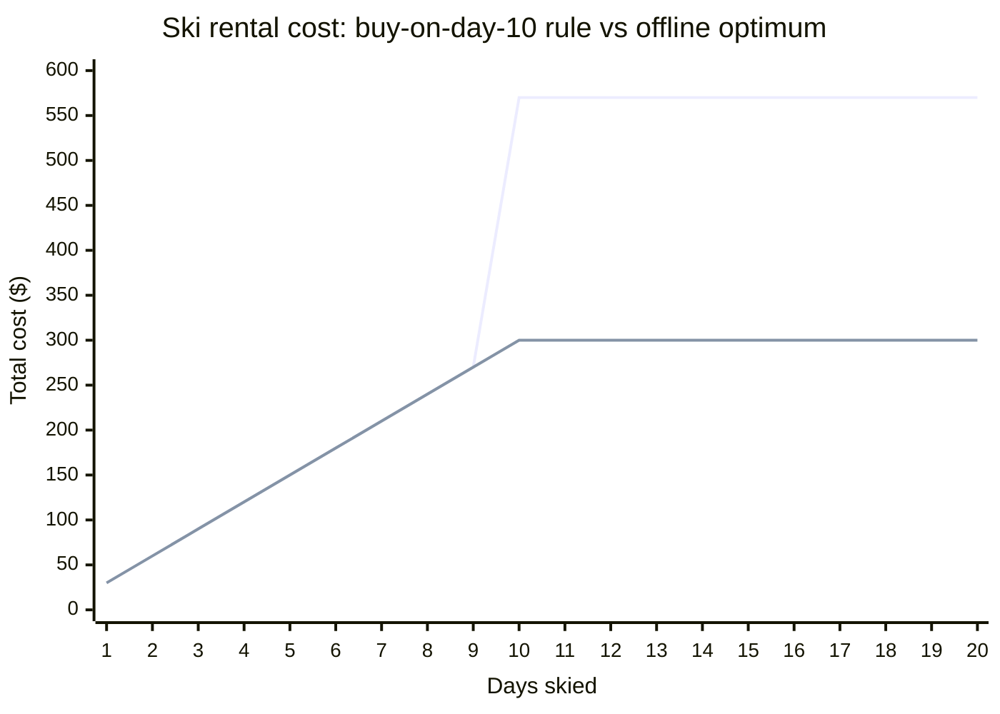
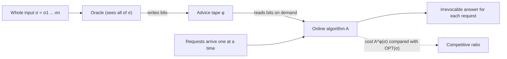
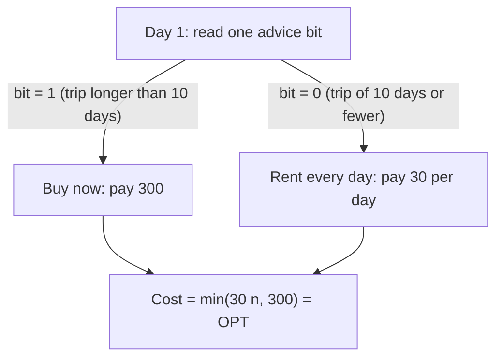
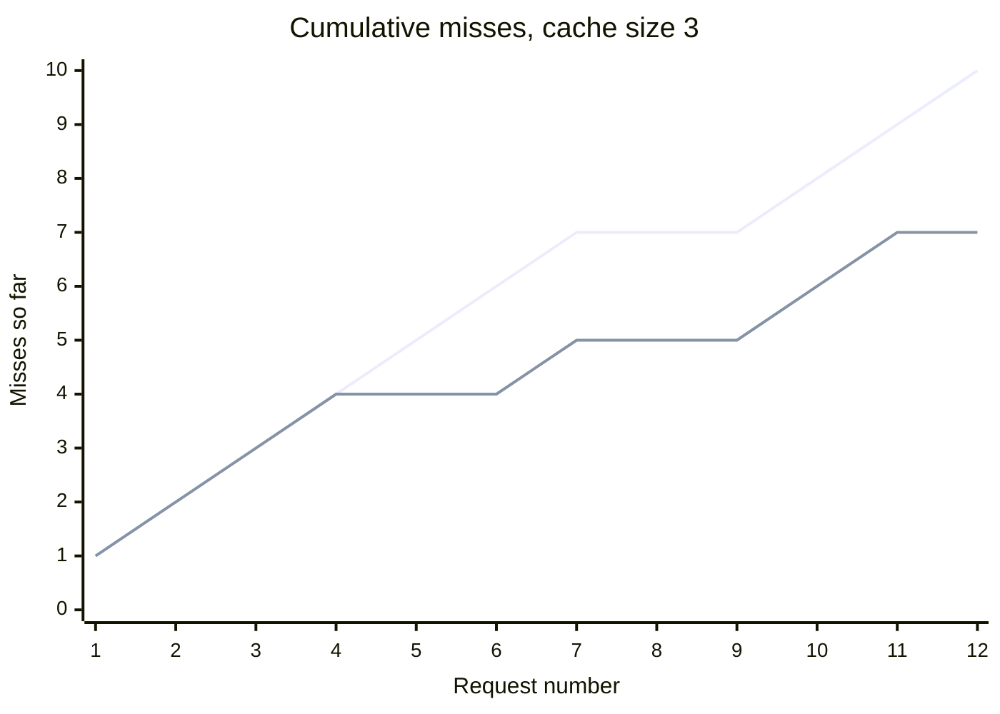
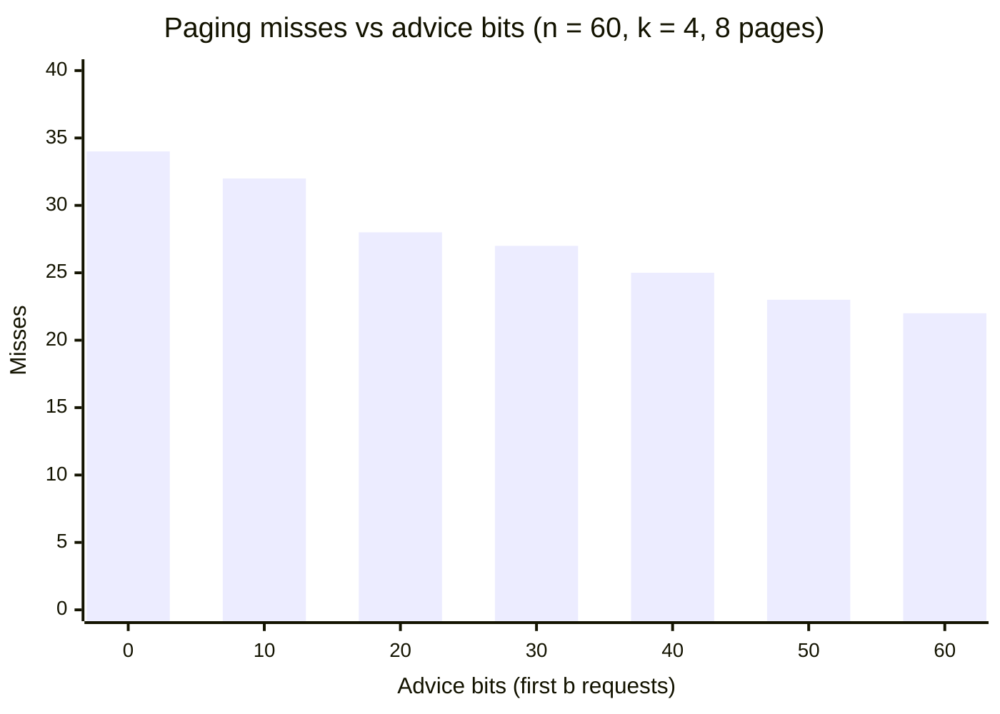
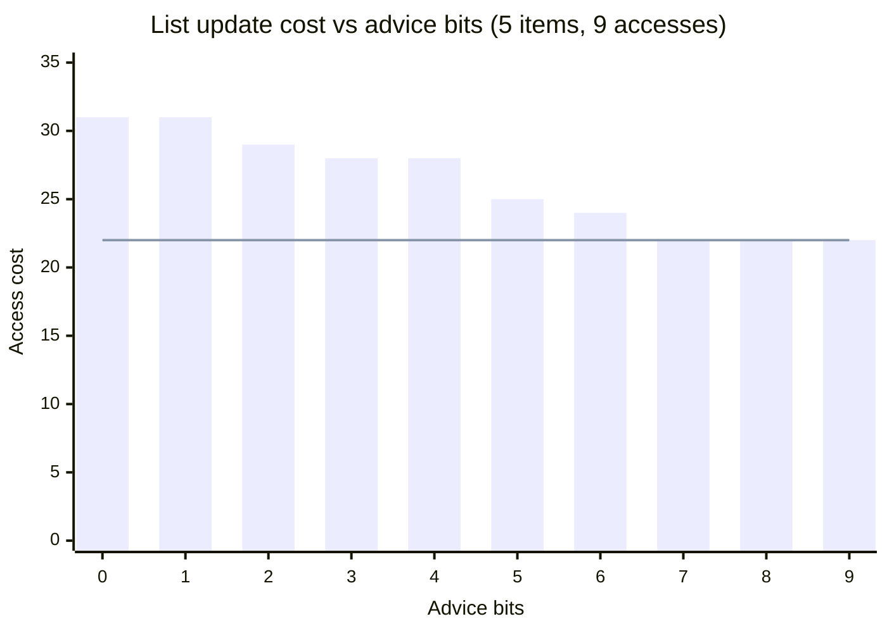

Suppose you manage a cache for a web server, and requests arrive in real time. You have limited memory. You must decide which pages to keep and which to evict, but you do not know the next request. This is an **online algorithm**. It makes decisions with incomplete information, and we judge it against an optimal solution that knows the entire future.

Traditional competitive analysis compares online algorithms with optimal offline algorithms. Its bounds are often pessimistic and do not match real-world performance. **Advice complexity** measures how much "future information" an online algorithm needs to get better performance guarantees.

If you are an undergraduate who is new to algorithm engineering, these two ideas give you tools to analyze and design algorithms that work under uncertainty.

## Understanding the Online vs Offline Paradigm

### The Fundamental Difference

First, we need to define what makes an algorithm "online."

**Offline Algorithm**: Has access to the entire input sequence before making any decisions. It can analyze the complete problem instance and compute an optimal solution.

**Online Algorithm**: Receives input piece by piece and must make irrevocable decisions without knowing future inputs. It bases each decision only on past and current information.

### A Concrete Example: The Ski Rental Problem

**Problem Setup**: You go on a ski trip, but you do not know how many days you will ski. You can either:

- Rent skis for $30 per day
- Buy skis for $300 (and use them for free thereafter)

If you knew the number of days in advance (offline), the decision would be easy:

- Ski ≤ 10 days: rent
- Ski > 10 days: buy

In the online version, you decide each morning whether to rent or buy. You know only how many days you have skied so far.

```python
class SkiRentalOnline:
    def __init__(self, buy_cost=300, rent_cost=30):
        self.buy_cost = buy_cost
        self.rent_cost = rent_cost
        self.has_bought = False
        self.total_cost = 0
        self.days_skied = 0

    def decide_daily(self):
        """Make decision for current day without knowing future"""
        self.days_skied += 1

        if self.has_bought:
            # Already bought, no additional cost
            return "use_owned_skis", 0

        # Decision: rent today or buy today?
        if self.should_buy():
            self.has_bought = True
            cost = self.buy_cost
            decision = "buy"
        else:
            cost = self.rent_cost
            decision = "rent"

        self.total_cost += cost
        return decision, cost

    def should_buy(self):
        # Simple strategy: buy after renting for 10 days
        return self.days_skied > 10

# Offline optimal solution for comparison
def ski_rental_offline(total_days, buy_cost=300, rent_cost=30):
    """Optimal solution knowing total days in advance"""
    rent_total = total_days * rent_cost
    if buy_cost < rent_total:
        return buy_cost, "buy_immediately"
    else:
        return rent_total, "rent_always"
```

### The Competitive Ratio

We usually measure online algorithms with **competitive analysis**. An online algorithm ALG is **c-competitive** if, for any input sequence σ:

```
ALG(σ) ≤ c · OPT(σ) + α
```

Where:

- ALG(σ) = cost of the online algorithm on input σ
- OPT(σ) = cost of the optimal offline algorithm on input σ
- c = competitive ratio
- α = additive constant (independent of input size)

For ski rental, the deterministic strategy "buy after renting for k days" has a competitive ratio of 2 when k = buy_cost/rent_cost.

**Intuition**: The worst case is a trip of exactly k+1 days. You rent for k days (cost k×rent_cost) and then buy (cost buy_cost). The total is k×rent_cost + buy_cost = 2×buy_cost. The optimal offline solution buys immediately for buy_cost. So the ratio is 2. Buying one day earlier, on day k, gives the best deterministic ratio, 2 − 1/k (1.9 for our prices).

The chart below plots both costs for trips of 1 to 20 days. It uses the "buy on day 10" rule. The upper line is the online cost and the lower line is the offline optimum. The gap is widest on day 10, where the online algorithm pays 570 and the optimum pays 300.



## Classic Online Algorithm Problems

Advice complexity builds on a few classic online problems. This section describes three of them.

### 1. Online Paging/Caching

**Problem**: Manage a cache of size k. When a page is requested:

- If it's in cache: free access
- If not in cache: pay 1 unit to fetch it, and potentially evict another page

```python
from collections import OrderedDict
from typing import List, Tuple

class OnlinePaging:
    def __init__(self, cache_size: int):
        self.cache_size = cache_size
        self.cache = OrderedDict()  # Maintains insertion order
        self.total_cost = 0
        self.requests_served = 0

    def lru_strategy(self, page: int) -> Tuple[bool, int]:
        """Least Recently Used eviction strategy"""
        self.requests_served += 1

        if page in self.cache:
            # Cache hit - move to end (most recent)
            self.cache.move_to_end(page)
            return True, 0  # hit, no cost

        # Cache miss - need to fetch page
        cost = 1
        self.total_cost += cost

        if len(self.cache) >= self.cache_size:
            # Evict least recently used (first item)
            self.cache.popitem(last=False)

        self.cache[page] = True
        return False, cost  # miss, cost = 1

    def fifo_strategy(self, page: int) -> Tuple[bool, int]:
        """First In First Out eviction strategy"""
        self.requests_served += 1

        if page in self.cache:
            return True, 0  # hit, no cost

        # Cache miss
        cost = 1
        self.total_cost += cost

        if len(self.cache) >= self.cache_size:
            # Evict oldest (first inserted)
            self.cache.popitem(last=False)

        self.cache[page] = True
        return False, cost

# Simulate cache performance
def simulate_caching(pages: List[int], cache_size: int, strategy: str):
    cache = OnlinePaging(cache_size)

    hits, misses = 0, 0
    for page in pages:
        if strategy == "LRU":
            is_hit, cost = cache.lru_strategy(page)
        elif strategy == "FIFO":
            is_hit, cost = cache.fifo_strategy(page)

        if is_hit:
            hits += 1
        else:
            misses += 1

    return hits, misses, cache.total_cost

# Example usage
pages = [1, 2, 3, 4, 1, 2, 5, 1, 2, 3, 4, 5]
hits, misses, cost = simulate_caching(pages, cache_size=3, strategy="LRU")
print(f"LRU: {hits} hits, {misses} misses, total cost: {cost}")
```

For paging with cache size k, LRU and FIFO are k-competitive, and no deterministic online algorithm does better (Sleator and Tarjan, 1985). The adversary uses k+1 pages and always requests the page the algorithm just evicted. The online algorithm then misses on every request. The optimal offline algorithm (Belady's rule: evict the page whose next request is furthest away) misses at most once every k requests.

### 2. Online Load Balancing

**Problem**: Assign incoming jobs to m machines to minimize the maximum load (makespan).

```python
import heapq
from typing import List

class OnlineLoadBalancing:
    def __init__(self, num_machines: int):
        self.num_machines = num_machines
        # Use min-heap to track machine loads
        self.machine_loads = [0.0] * num_machines
        self.assignments = []

    def greedy_assignment(self, job_size: float) -> int:
        """Assign job to least loaded machine"""
        # Find machine with minimum load
        min_machine = min(range(self.num_machines),
                         key=lambda i: self.machine_loads[i])

        # Assign job to this machine
        self.machine_loads[min_machine] += job_size
        self.assignments.append((len(self.assignments), min_machine, job_size))

        return min_machine

    def get_makespan(self) -> float:
        """Return maximum load across all machines"""
        return max(self.machine_loads)

    def get_total_load(self) -> float:
        """Return sum of all loads"""
        return sum(self.machine_loads)

def compare_online_offline_scheduling(jobs: List[float], num_machines: int):
    # Online greedy algorithm
    online_scheduler = OnlineLoadBalancing(num_machines)
    for job in jobs:
        online_scheduler.greedy_assignment(job)

    online_makespan = online_scheduler.get_makespan()

    # Lower bound for optimal offline (total_load / num_machines)
    total_load = sum(jobs)
    optimal_lower_bound = total_load / num_machines

    # Another lower bound (largest job size)
    max_job = max(jobs) if jobs else 0

    offline_lower_bound = max(optimal_lower_bound, max_job)

    competitive_ratio = online_makespan / offline_lower_bound if offline_lower_bound > 0 else float('inf')

    return {
        'online_makespan': online_makespan,
        'offline_lower_bound': offline_lower_bound,
        'competitive_ratio': competitive_ratio,
        'assignments': online_scheduler.assignments
    }

# Example
jobs = [4, 3, 2, 8, 1, 5, 2, 6]
result = compare_online_offline_scheduling(jobs, num_machines=3)
print(f"Online makespan: {result['online_makespan']:.2f}")
print(f"Offline lower bound: {result['offline_lower_bound']:.2f}")
print(f"Ratio vs. lower bound: {result['competitive_ratio']:.2f}")
```

The printed ratio divides by a lower bound on the optimum, so it overestimates the true ratio. Here the true optimum is 11 (for example {8, 2, 1}, {6, 4}, {5, 3, 2}), so greedy's 12 is within a factor 1.09.

The greedy online algorithm achieves a competitive ratio of 2 - 1/m, where m is the number of machines.

### 3. k-Server Problem

**Problem**: Serve requests in a metric space using k mobile servers. When a request arrives at location x, move a server to x (if none is there) and pay the distance moved.

```python
import math
from typing import List, Tuple

class KServerOnline:
    def __init__(self, k: int, positions: List[Tuple[float, float]]):
        self.k = k
        self.server_positions = positions[:k]  # Initial server positions
        self.total_cost = 0
        self.requests_served = 0

    def distance(self, pos1: Tuple[float, float], pos2: Tuple[float, float]) -> float:
        """Euclidean distance between two positions"""
        return math.sqrt((pos1[0] - pos2[0])**2 + (pos1[1] - pos2[1])**2)

    def nearest_server_strategy(self, request_pos: Tuple[float, float]) -> float:
        """Move nearest server to request position"""
        self.requests_served += 1

        # Check if any server is already at request position
        for i, server_pos in enumerate(self.server_positions):
            if self.distance(server_pos, request_pos) < 1e-9:  # Essentially at same position
                return 0  # No cost

        # Find nearest server
        distances = [self.distance(pos, request_pos) for pos in self.server_positions]
        nearest_idx = min(range(len(distances)), key=lambda i: distances[i])

        # Move nearest server and calculate cost
        cost = distances[nearest_idx]
        self.server_positions[nearest_idx] = request_pos
        self.total_cost += cost

        return cost

# Example usage
servers = [(0, 0), (10, 0), (0, 10)]  # 3 servers
k_server = KServerOnline(k=3, positions=servers)

requests = [(1, 1), (2, 2), (8, 1), (9, 9), (1, 8)]
for req in requests:
    cost = k_server.nearest_server_strategy(req)
    print(f"Request at {req}: moved server, cost = {cost:.2f}")

print(f"Total cost: {k_server.total_cost:.2f}")
```

The greedy "nearest server" rule above is simple but not competitive. An adversary can make it shuttle one server between two nearby points forever. The k-server problem generalizes paging, which is the case of a uniform metric. No deterministic algorithm beats ratio k on any metric with more than k points (Manasse, McGeoch, and Sleator, 1990). The Work Function Algorithm is (2k−1)-competitive on every metric (Koutsoupias and Papadimitriou, 1995). The k-server conjecture says ratio k is achievable everywhere. It is still open in general. It is proven for special cases such as k = 2, metrics with k+1 points, and trees.

## Limitations of Competitive Analysis

Competitive analysis has three limitations that motivate the study of advice complexity.

### 1. Overly Pessimistic Bounds

Consider paging again. A competitive ratio of k suggests that online algorithms perform terribly against optimal offline solutions. In practice, algorithms like LRU perform much better, for three reasons:

- Real access patterns have locality (temporal and spatial)
- Worst-case sequences rarely occur in practice
- The analysis focuses on adversarial inputs

### 2. Inability to Distinguish Between Algorithms

Many online algorithms have the same competitive ratio, but some perform better in practice. For example:

```python
def compare_paging_algorithms():
    # Both LRU and FIFO have competitive ratio k for cache size k
    # But they behave very differently on real workloads

    # Example: sequential access pattern (both miss every request)
    sequential_pages = list(range(1, 21)) * 2  # [1,2,...,20,1,2,...,20]

    lru_hits, lru_misses, lru_cost = simulate_caching(sequential_pages, 3, "LRU")
    fifo_hits, fifo_misses, fifo_cost = simulate_caching(sequential_pages, 3, "FIFO")

    print("Sequential access pattern:")
    print(f"LRU:  {lru_hits} hits, {lru_misses} misses")
    print(f"FIFO: {fifo_hits} hits, {fifo_misses} misses")

    # Example: one hot page between cold pages (LRU keeps page 1, FIFO evicts it)
    hot_page = [p for cold in range(2, 22) for p in (1, cold)]  # [1,2,1,3,...,1,21]

    lru_hits, lru_misses, lru_cost = simulate_caching(hot_page, 2, "LRU")
    fifo_hits, fifo_misses, fifo_cost = simulate_caching(hot_page, 2, "FIFO")

    print("\nHot-page access pattern:")
    print(f"LRU:  {lru_hits} hits, {lru_misses} misses")
    print(f"FIFO: {fifo_hits} hits, {fifo_misses} misses")

compare_paging_algorithms()
```

On the sequential pattern, both algorithms miss all 40 requests. On the hot-page pattern, LRU keeps page 1 and gets 19 hits. FIFO evicts page 1 every few requests and gets only 10 hits. Both have ratio k, so the ratio cannot tell them apart.

### 3. No Fine-Grained Analysis

Competitive analysis gives a single number, the competitive ratio. It does not capture:

- How much improvement is possible with small amounts of future information
- Trade-offs between advice and performance
- The structure of optimal solutions

## Introduction to Advice Complexity

Dobrev, Královič, and Pardubská introduced advice complexity in 2008. Emek, Fraigniaud, Korman, and Rosén gave a model with a fixed number of advice bits per request in 2009. Böckenhauer, Komm, Královič, Královič, and Mömke refined it in 2009 into the advice-tape model that most later work uses. It is a framework to study online algorithms that get extra information about the future.



The figure shows the model. The oracle sees the whole input and writes advice. The algorithm still receives requests one at a time. It may read advice bits whenever it wants. The advice complexity is the number of bits it reads.

### The Advice Model

**Formal Setup**: An online algorithm with advice has access to:

1. The standard online input (arriving sequentially)
2. An **advice string** written by an oracle that sees the entire input sequence

The algorithm reads the advice string sequentially and uses it to make better decisions.

**Key Questions**:

- How much advice is needed to achieve a competitive ratio of c?
- What's the minimum competitive ratio achievable with b bits of advice?
- What does the advice-performance trade-off look like?

### Advice Complexity Notation

For an online problem P, this post uses two shorthands:

- **Adv_b[P]**: The best competitive ratio achievable by any online algorithm using at most b bits of advice
- **Opt_c[P]**: The minimum number of advice bits needed to achieve competitive ratio c

### A Simple Example: Binary Search with Advice

**Problem**: Find a target value in a sorted array using binary search, but you can only ask "is the target in the left or right half?" without knowing the array contents.

```python
class BinarySearchWithAdvice:
    def __init__(self, sorted_array, target):
        self.array = sorted_array
        self.target = target
        self.advice_bits_used = 0
        self.comparisons = 0

    def search_with_advice(self, advice_string):
        """Binary search using advice bits"""
        left, right = 0, len(self.array) - 1
        advice_index = 0

        while left <= right:
            mid = (left + right) // 2
            self.comparisons += 1

            if self.array[mid] == self.target:
                return mid

            # Use advice bit to decide direction
            if advice_index < len(advice_string):
                advice_bit = int(advice_string[advice_index])
                self.advice_bits_used += 1
                advice_index += 1

                if advice_bit == 0:  # Go left
                    right = mid - 1
                else:  # Go right
                    left = mid + 1
            else:
                # No more advice, use standard comparison
                if self.array[mid] < self.target:
                    left = mid + 1
                else:
                    right = mid - 1

        return -1  # Not found

    def generate_optimal_advice(self):
        """Generate advice string for optimal path"""
        advice = []
        left, right = 0, len(self.array) - 1

        while left <= right:
            mid = (left + right) // 2

            if self.array[mid] == self.target:
                break
            elif self.array[mid] < self.target:
                advice.append('1')  # Go right
                left = mid + 1
            else:
                advice.append('0')  # Go left
                right = mid - 1

        return ''.join(advice)

# Example usage
array = [1, 3, 5, 7, 9, 11, 13, 15, 17, 19]
target = 7

searcher = BinarySearchWithAdvice(array, target)
optimal_advice = searcher.generate_optimal_advice()

print(f"Optimal advice string: {optimal_advice}")
print(f"Advice bits needed: {len(optimal_advice)}")

result = searcher.search_with_advice(optimal_advice)
print(f"Target found at index: {result}")
print(f"Advice bits used: {searcher.advice_bits_used}")
print(f"Comparisons made: {searcher.comparisons}")
```

**Insight**: Each advice bit replaces one comparison outcome, so the advice string has at most ⌊log₂ n⌋ bits. Here 3 bits steer the search to index 3. An oracle could also write the index itself in ⌈log₂ n⌉ bits, and then no search is needed. When the advice runs out, the code falls back on ordinary comparisons.

## Formal Framework for Advice Complexity

### Mathematical Formulation

**Definition 1 (Online Algorithm with Advice)**: An online algorithm A with advice is a deterministic algorithm that processes an input sequence σ = (σ₁, σ₂, ..., σₙ) where:

- An oracle that sees the entire sequence σ writes an advice string φ on a tape
- A receives σᵢ and may read further bits of φ before it produces the output for σᵢ
- The advice complexity b(n) is the largest number of bits A reads on any input of length n

**Definition 2 (b-bit c-competitive)**: An online algorithm A is b-bit c-competitive if, for every input sequence σ, there is an advice string φ such that A reads at most b bits of φ and:

```
A^φ(σ) ≤ c · OPT(σ) + α
```

where A^φ denotes A run with advice φ. The order of quantifiers matters. The oracle picks φ after it sees σ.

### Advice Complexity Functions

We can compute Adv_b exactly for ski rental. With b bits, the oracle can choose one of 2^b deterministic rules for the algorithm. So the best b-bit algorithm is the best set of 2^b "buy on day t" rules. The code searches all such sets for b = 0 and b = 1.

```python
from itertools import combinations

def ski_worst_ratio(buy_days, buy_cost=10, horizon=60):
    """Worst-case ratio when the oracle may pick any day in buy_days.
    Costs are in rental days: renting costs 1 per day, buying costs buy_cost.
    A buy day of None means "rent forever"."""
    worst = 0.0
    for n in range(1, horizon + 1):          # n = actual number of ski days
        opt = min(n, buy_cost)
        # each candidate rule rents until day t, then buys on day t
        alg = min(n if t is None or t > n else (t - 1) + buy_cost for t in buy_days)
        worst = max(worst, alg / opt)
    return worst

def best_ratio_with_advice(bits, buy_cost=10, horizon=60):
    """b advice bits let the oracle choose one of 2^b deterministic rules.
    Search every set of 2^b rules and keep the best worst case."""
    rules = list(range(1, horizon + 1)) + [None]
    return min(ski_worst_ratio(s, buy_cost, horizon)
               for s in combinations(rules, 2 ** bits))

print("Ski rental (buy = 10 rental days)")
print("Advice bits | Best competitive ratio")
for bits in (0, 1):
    print(f"{bits:11d} | {best_ratio_with_advice(bits):.2f}")
```

## Detailed Analysis: Ski Rental with Advice

### Optimal Advice Strategy

The optimal offline solution depends only on the total number of skiing days. The algorithm does not even need that number. It only needs to know whether the trip lasts longer than the break-even point. One bit says that.

```python
import math

class SkiRentalWithAdvice:
    def __init__(self, buy_cost=300, rent_cost=30):
        self.buy_cost = buy_cost
        self.rent_cost = rent_cost
        self.breakeven = buy_cost // rent_cost  # 10 days

    def generate_advice(self, total_days):
        """Oracle: one bit, '1' if buying beats renting for the whole trip"""
        return "1" if total_days * self.rent_cost > self.buy_cost else "0"

    def strategy_with_advice(self, advice_string, total_days):
        """Online: read one bit on day 1, then rent or buy accordingly.
        total_days is used only to add up the cost of the days that happen."""
        if not advice_string:
            # No advice - use 2-competitive strategy
            return self.strategy_no_advice()

        if advice_string[0] == "0":
            # Rent for all days
            return "rent_always", total_days * self.rent_cost
        else:
            # Buy immediately
            return "buy_immediately", self.buy_cost

    def strategy_no_advice(self):
        """2-competitive strategy without advice"""
        # Buy after renting for breakeven days
        return "buy_after_breakeven", None

    def simulate_with_advice(self, total_days):
        """Simulate ski rental with optimal advice"""
        advice = self.generate_advice(total_days)
        strategy, cost = self.strategy_with_advice(advice, total_days)

        # Optimal offline cost
        optimal_cost = min(total_days * self.rent_cost, self.buy_cost)

        return {
            'total_days': total_days,
            'advice_bits': len(advice),
            'advice_string': advice,
            'strategy': strategy,
            'online_cost': cost,
            'optimal_cost': optimal_cost,
            'competitive_ratio': cost / optimal_cost if optimal_cost > 0 else 1
        }

# Analysis
ski_rental = SkiRentalWithAdvice()

print("Ski Rental with Advice Analysis:")
print("=" * 50)

test_cases = [1, 5, 10, 15, 20, 50, 100]
for days in test_cases:
    result = ski_rental.simulate_with_advice(days)
    print(f"Days: {days:3d} | Advice: {result['advice_bits']:2d} bits | "
          f"Ratio: {result['competitive_ratio']:.2f} | Strategy: {result['strategy']}")
```

**Key Results for Ski Rental**:

1. With 1 bit of advice, the algorithm is optimal (competitive ratio 1) on every input. The code above prints ratio 1.00 for every trip length.
2. With 0 bits of advice, the best deterministic ratio is 2 − 1/k for a break-even point of k days. That is 1.90 here, as the exact search printed.
3. There is no gradual trade-off. Ski rental jumps from 1.90 to 1 with a single bit. The earlier search confirms this: b = 1 already gives ratio 1.00.



The flowchart shows the whole 1-bit algorithm. Either branch pays exactly the offline optimum.

### Paging with Advice

For paging, the advice tells the algorithm which page to evict on each miss.

```python
class PagingWithAdvice:
    def __init__(self, cache_size, page_universe_size):
        self.k = cache_size
        self.page_universe = page_universe_size
        self.cache = set()
        self.total_cost = 0

    def generate_optimal_advice(self, request_sequence):
        """Generate advice for optimal paging strategy"""
        advice_bits = []
        cache_state = set()

        for i, page in enumerate(request_sequence):
            if page in cache_state:
                # Cache hit - no advice needed
                continue

            # Cache miss - need to decide which page to evict
            if len(cache_state) < self.k:
                # Cache not full - just add page
                cache_state.add(page)
                continue

            # Cache full - need to evict one page
            # Find which current page is requested furthest in future
            future_requests = request_sequence[i+1:]
            evict_candidates = list(cache_state)

            # Find page with furthest next request (or never requested again)
            furthest_page = None
            furthest_distance = -1

            for candidate in evict_candidates:
                try:
                    next_request = future_requests.index(candidate)
                except ValueError:
                    # Page never requested again - evict this one
                    furthest_page = candidate
                    break

                if next_request > furthest_distance:
                    furthest_distance = next_request
                    furthest_page = candidate

            # Encode which page to evict (log k bits)
            evict_index = evict_candidates.index(furthest_page)
            bits_needed = math.ceil(math.log2(self.k)) if self.k > 1 else 1
            advice_bits.extend([int(b) for b in format(evict_index, f'0{bits_needed}b')])

            # Update cache state
            cache_state.remove(furthest_page)
            cache_state.add(page)

        return advice_bits

    def simulate_with_advice(self, request_sequence, advice_bits):
        """Simulate paging algorithm with advice"""
        cache = set()
        cost = 0
        advice_index = 0

        for page in request_sequence:
            if page in cache:
                continue  # Cache hit

            # Cache miss
            cost += 1

            if len(cache) < self.k:
                cache.add(page)
                continue

            # Need to evict - use advice
            bits_per_eviction = math.ceil(math.log2(self.k)) if self.k > 1 else 1

            if advice_index + bits_per_eviction <= len(advice_bits):
                # Decode which page to evict
                evict_bits = advice_bits[advice_index:advice_index + bits_per_eviction]
                evict_index = sum(bit * (2 ** (bits_per_eviction - 1 - i))
                                for i, bit in enumerate(evict_bits))
                advice_index += bits_per_eviction

                cache_list = list(cache)
                if evict_index < len(cache_list):
                    evict_page = cache_list[evict_index]
                    cache.remove(evict_page)
            else:
                # No more advice - use LRU or arbitrary eviction
                cache.pop()

            cache.add(page)

        return cost, advice_index

# Example analysis
paging = PagingWithAdvice(cache_size=3, page_universe_size=10)
requests = [1, 2, 3, 4, 1, 2, 5, 1, 2, 3, 4, 5]

print("\nPaging with Advice Analysis:")
print("Request sequence:", requests)

advice_bits = paging.generate_optimal_advice(requests)
online_cost, bits_used = paging.simulate_with_advice(requests, advice_bits)

print(f"Advice bits generated: {len(advice_bits)}")
print(f"Advice bits used: {bits_used}")
print(f"Online cost with advice: {online_cost}")

# Compare with LRU (no advice)
lru_hits, lru_misses, lru_cost = simulate_caching(requests, 3, "LRU")
print(f"LRU cost (no advice): {lru_cost}")
print(f"Improvement ratio: {lru_cost / online_cost:.2f}")
```

The advice-guided run misses 7 times and LRU misses 10 times. The table traces both runs with a cache of 3 pages. The advice names the same victims as Belady's rule. "Evicts" lists the page removed on that request.

| Step | Request | LRU  | LRU evicts | Advice | Advice evicts |
| ---- | ------- | ---- | ---------- | ------ | ------------- |
| 1    | 1       | miss |            | miss   |               |
| 2    | 2       | miss |            | miss   |               |
| 3    | 3       | miss |            | miss   |               |
| 4    | 4       | miss | 1          | miss   | 3             |
| 5    | 1       | miss | 2          | hit    |               |
| 6    | 2       | miss | 3          | hit    |               |
| 7    | 5       | miss | 4          | miss   | 4             |
| 8    | 1       | hit  |            | hit    |               |
| 9    | 2       | hit  |            | hit    |               |
| 10   | 3       | miss | 5          | miss   | 1             |
| 11   | 4       | miss | 1          | miss   | 2             |
| 12   | 5       | miss | 2          | hit    |               |

The chart shows cumulative misses after each request. The upper line is LRU and the lower line is the advice-guided algorithm. LRU falls behind at step 4, when it evicts page 1 just before page 1 returns.



The code above spends ⌈log₂ k⌉ bits on every eviction. A cheaper scheme needs only 1 bit per request (Dobrev, Královič, and Pardubská). The bit says whether the optimal algorithm keeps the requested page in cache until its next request. On a miss, the online algorithm evicts any page whose bit is 0. Such a page always exists, and the result is optimal. The version below breaks ties by recency. Requests beyond the end of the advice count as 0, so with no advice it is plain LRU.

```python
import random

def belady_misses(requests, k):
    """Offline optimum: on a miss, evict the page requested furthest in the future."""
    cache, misses = set(), 0
    for i, page in enumerate(requests):
        if page in cache:
            continue
        misses += 1
        if len(cache) == k:
            rest = requests[i + 1:]
            cache.remove(max(cache, key=lambda p: rest.index(p) if p in rest else len(rest)))
        cache.add(page)
    return misses

def one_bit_advice(requests, k):
    """Oracle: bit i is 1 if Belady keeps page requests[i] until its next request."""
    cache, bits, last_seen = set(), [0] * len(requests), {}
    for i, page in enumerate(requests):
        if page in cache:
            bits[last_seen[page]] = 1          # Belady kept it: that request gets a 1
        elif len(cache) == k:
            rest = requests[i + 1:]
            cache.remove(max(cache, key=lambda p: rest.index(p) if p in rest else len(rest)))
        cache.add(page)
        last_seen[page] = i
    return bits

def paging_with_one_bit(requests, k, bits):
    """Online: on a miss, evict the least recently used page whose last bit is 0.
    Requests past the end of the advice count as bit 0, so b = 0 is plain LRU."""
    cache, keep, misses = [], {}, 0         # cache is ordered from least to most recent
    for i, page in enumerate(requests):
        if page in cache:
            cache.remove(page)
        else:
            misses += 1
            if len(cache) == k:
                cache.remove(next((p for p in cache if not keep[p]), cache[0]))
        cache.append(page)
        keep[page] = i < len(bits) and bits[i] == 1
    return misses

requests = [1, 2, 3, 4, 1, 2, 5, 1, 2, 3, 4, 5]
bits = one_bit_advice(requests, 3)
print("Advice bits:", bits)
print("Misses with 1 bit per request:", paging_with_one_bit(requests, 3, bits))
print("Belady (offline optimum):", belady_misses(requests, 3))

# Partial advice: only the first b requests get a bit
random.seed(1)
long_requests = [random.randint(1, 8) for _ in range(60)]
full = one_bit_advice(long_requests, 4)
print("\nb (advice bits) | misses   [n = 60, k = 4, 8 pages]")
for b in range(0, 61, 10):
    print(f"{b:15d} | {paging_with_one_bit(long_requests, 4, full[:b])}")
print("Belady:", belady_misses(long_requests, 4))
```

On the 12-request example, the 1-bit scheme also misses 7 times. For the longer random sequence, the chart plots misses against the number of advice bits. Each bit covers one more request. With 0 bits the algorithm is LRU and misses 34 times. With all 60 bits it matches Belady's 22 misses.



These are measurements on one sequence, not worst-case bounds. Böckenhauer et al. (2009) prove upper and lower bounds on the advice that optimal paging needs in the worst case.

## Advanced Advice Complexity Results

### Asymptotically Optimal Advice

**Definition**: An advice complexity result is asymptotically optimal if the upper and lower bounds match up to lower-order terms.

The summary below lists known results. n is the number of requests. It does not claim every bound is tight.

```python
def advice_complexity_bounds():
    """Summary of known advice complexity results"""

    results = {
        "Paging (cache size k)": {
            "no_advice": "Deterministic competitive ratio: k",
            "optimal_advice": "1 bit per request (n bits) for ratio 1",
        },

        "Ski Rental (break-even after k days)": {
            "no_advice": "Deterministic competitive ratio: 2 - 1/k",
            "optimal_advice": "1 bit for ratio 1",
        },

        "k-Server (metric spaces)": {
            "no_advice": "Deterministic lower bound k, WFA achieves 2k - 1",
            "optimal_advice": "ceil(log2 k) bits per request (name the server) for ratio 1",
        },

        "List Update": {
            "no_advice": "Deterministic competitive ratio: 2 (Move-To-Front)",
            "two_bits": "2 bits for ratio 5/3",
            "lower_bound": "Linear advice needed for ratio below 15/14",
        },

        "Makespan scheduling (m identical machines)": {
            "no_advice": "Greedy (list scheduling) ratio: 2 - 1/m",
            "optimal_advice": "ceil(log2 m) bits per job (name the machine) for ratio 1",
            "partial_advice": "Constant bits per job (depending on eps) for ratio 1 + eps",
        }
    }

    return results

# Print summary
bounds = advice_complexity_bounds()
for problem, result in bounds.items():
    print(f"\n{problem}:")
    for metric, bound in result.items():
        print(f"  {metric}: {bound}")
```

Sources: paging with 1 bit per request is from Dobrev, Královič, and Pardubská. The list update results are from Boyar, Kamali, Larsen, and López-Ortiz (2017). The scheduling result is from Renault, Rosén, and van Stee (2015). The "name the server" and "name the machine" bounds follow from simply writing down an optimal solution.

### Randomized Algorithms with Advice

Advice complexity also extends to randomized algorithms:

```python
import random

class RandomizedSkiRentalWithAdvice:
    def __init__(self, buy_cost=300, rent_cost=30):
        self.buy_cost = buy_cost
        self.rent_cost = rent_cost
        self.breakeven = buy_cost // rent_cost

    def randomized_strategy_no_advice(self, total_days):
        """Randomized strategy: buy at a random time"""
        # Uniform buy day for simplicity. The e/(e-1) strategy uses a
        # non-uniform distribution that favors later buy days.
        buy_day = random.randint(1, self.breakeven)

        if total_days <= buy_day:
            # Rent for all days
            return total_days * self.rent_cost
        else:
            # Rent for buy_day days, then own
            return buy_day * self.rent_cost + self.buy_cost

    def advice_enhanced_randomized(self, total_days, advice_bits):
        """Use advice to improve randomized strategy"""
        if len(advice_bits) == 0:
            return self.randomized_strategy_no_advice(total_days)

        # Toy example: the advice only biases the random buy day.
        # One bit used as in the deterministic case would already be optimal.
        advice_value = sum(bit * (2**i) for i, bit in enumerate(advice_bits))

        # Adjust randomization based on advice
        if advice_value % 2 == 0:  # Even advice suggests skiing longer
            buy_day = random.randint(self.breakeven // 2, self.breakeven)
        else:  # Odd advice suggests shorter trip
            buy_day = random.randint(1, self.breakeven // 2)

        if total_days <= buy_day:
            return total_days * self.rent_cost
        else:
            return buy_day * self.rent_cost + self.buy_cost

# Randomized algorithms can achieve better competitive ratios
# For ski rental: randomized ratio tends to e/(e-1) ≈ 1.58 vs deterministic 2 - 1/k
# (Karlin, Manasse, McGeoch, and Owicki, 1994)
```

## Implementation: Complete Advice Complexity Framework

The code below is a general framework to analyze advice complexity on any online problem:

```python
import math
import random
from abc import ABC, abstractmethod
from typing import List, Dict, Tuple, Any

class OnlineProblem(ABC):
    """Abstract base class for online problems"""

    @abstractmethod
    def generate_advice(self, input_sequence: List[Any]) -> List[int]:
        """Generate optimal advice for given input"""
        pass

    @abstractmethod
    def solve_with_advice(self, input_sequence: List[Any], advice: List[int]) -> float:
        """Solve problem using advice, return cost"""
        pass

    @abstractmethod
    def solve_without_advice(self, input_sequence: List[Any]) -> float:
        """Solve problem without advice, return cost"""
        pass

    @abstractmethod
    def optimal_offline_cost(self, input_sequence: List[Any]) -> float:
        """Return optimal offline cost"""
        pass

class AdviceComplexityTester:
    def __init__(self, problem: OnlineProblem):
        self.problem = problem

    def analyze_trade_off(self, input_sequence: List[Any], max_advice_bits: int = None):
        """Analyze advice-performance trade-off"""
        optimal_advice = self.problem.generate_advice(input_sequence)
        optimal_cost = self.problem.optimal_offline_cost(input_sequence)
        no_advice_cost = self.problem.solve_without_advice(input_sequence)

        if max_advice_bits is None:
            max_advice_bits = len(optimal_advice)

        results = []

        for b in range(0, min(max_advice_bits + 1, len(optimal_advice) + 1)):
            if b == 0:
                cost = no_advice_cost
            else:
                # Use first b bits of advice
                partial_advice = optimal_advice[:b]
                cost = self.problem.solve_with_advice(input_sequence, partial_advice)

            competitive_ratio = cost / optimal_cost if optimal_cost > 0 else 1

            results.append({
                'advice_bits': b,
                'cost': cost,
                'optimal_cost': optimal_cost,
                'competitive_ratio': competitive_ratio
            })

        return results

    def print_analysis(self, results: List[Dict]):
        """Print formatted analysis results"""
        print("\nAdvice Complexity Analysis:")
        print("=" * 60)
        print(f"{'Advice Bits':<12} {'Cost':<10} {'Optimal':<10} {'Ratio':<10}")
        print("-" * 60)

        for result in results:
            print(f"{result['advice_bits']:<12} "
                  f"{result['cost']:<10.2f} "
                  f"{result['optimal_cost']:<10.2f} "
                  f"{result['competitive_ratio']:<10.2f}")

# Example implementation for the List Update Problem
class ListUpdateProblem(OnlineProblem):
    """List Update: accessing the item at position p (0-based) costs p + 1.
    After each access the algorithm may move the item to the front for free.
    Advice: 1 bit per access, 1 = move to front, 0 = leave it in place."""

    def __init__(self, list_size: int):
        self.list_size = list_size

    def _run(self, access_sequence: List[int], bits: List[int]) -> int:
        current_list = list(range(1, self.list_size + 1))
        total_cost = 0
        for i, item in enumerate(access_sequence):
            position = current_list.index(item)
            total_cost += position + 1
            # Past the end of the advice, behave like Move-To-Front
            if i >= len(bits) or bits[i] == 1:
                current_list.remove(item)
                current_list.insert(0, item)
        return total_cost

    def generate_advice(self, access_sequence: List[int]) -> List[int]:
        """Oracle: try all 2^n bit strings and keep the cheapest one.
        Exponential, so only for short toy sequences."""
        n = len(access_sequence)
        best = min(range(2 ** n),
                   key=lambda m: self._run(access_sequence, [(m >> (n - 1 - i)) & 1 for i in range(n)]))
        return [(best >> (n - 1 - i)) & 1 for i in range(n)]

    def solve_with_advice(self, access_sequence: List[int], advice: List[int]) -> float:
        """Use the advice bits for the first accesses, then Move-To-Front"""
        return self._run(access_sequence, advice)

    def solve_without_advice(self, access_sequence: List[int]) -> float:
        """Move-To-Front heuristic without advice"""
        return self._run(access_sequence, [])

    def optimal_offline_cost(self, access_sequence: List[int]) -> float:
        """Exact offline optimum by dynamic programming over list orders.
        Some optimal offline algorithm uses only paid exchanges (Reingold and
        Westbrook, 1996), so before each access OPT may reorder the list at a
        cost of one per swapped adjacent pair (the Kendall tau distance)."""
        from itertools import permutations
        states = list(permutations(range(1, self.list_size + 1)))
        rank = {s: {x: i for i, x in enumerate(s)} for s in states}
        def swaps(s, t):
            r = rank[t]
            return sum(r[s[i]] > r[s[j]] for i in range(len(s)) for j in range(i + 1, len(s)))
        dist = {(s, t): swaps(s, t) for s in states for t in states}
        cost = {s: (0 if s == tuple(range(1, self.list_size + 1)) else float('inf')) for s in states}
        for item in access_sequence:
            cost = {t: min(cost[s] + dist[s, t] for s in states) + rank[t][item] + 1
                    for t in states}
        return min(cost.values())

# Example usage
list_problem = ListUpdateProblem(list_size=5)
tester = AdviceComplexityTester(list_problem)

access_sequence = [1, 3, 2, 1, 4, 2, 5, 1, 3]
results = tester.analyze_trade_off(access_sequence)
tester.print_analysis(results)
```

Here the oracle writes 1 bit per access, telling the algorithm whether to move the item to the front. Without advice the algorithm is Move-To-Front and pays 31. The exact optimum pays 22. With the first 7 bits, the algorithm already reaches 22. The chart plots the cost for each number of advice bits.



The bars are the algorithm's cost. The flat line is the offline optimum.

## Practical Implications and Applications

Advice complexity has practical uses in algorithm design and system optimization.

### 1. Algorithm Design with Partial Information

Many real systems have some information about the future. The cache below treats machine learning predictions as advice:

```python
class PracticalCacheWithPrediction:
    """Cache with machine learning predictions about future accesses"""

    def __init__(self, cache_size: int):
        self.cache_size = cache_size
        self.cache = {}
        self.access_times = {}
        self.prediction_accuracy = 0.8  # 80% accurate predictions

    def predict_next_access(self, page: int, current_time: int) -> int:
        """Predict when page will be accessed next (simulated ML model)"""
        # The simulation peeks at the real future to fake a model
        future = self.requests[current_time:]
        true_next = current_time + 1 + future.index(page) if page in future else current_time + len(future) + 1
        if random.random() < self.prediction_accuracy:
            # Accurate prediction
            return true_next
        else:
            # Inaccurate prediction: a random time in the near future
            return current_time + random.randint(1, 20)

    def cache_with_prediction(self, request_sequence: List[int]):
        """Cache algorithm using ML predictions as 'advice'"""
        self.requests = request_sequence
        total_cost = 0
        current_time = 0

        for page in request_sequence:
            current_time += 1

            if page in self.cache:
                # Cache hit
                self.access_times[page] = current_time
                continue

            # Cache miss
            total_cost += 1

            if len(self.cache) < self.cache_size:
                # Cache not full
                self.cache[page] = True
                self.access_times[page] = current_time
            else:
                # Cache full - evict page with furthest predicted next access
                evict_page = None
                furthest_prediction = -1

                for cached_page in self.cache:
                    next_access = self.predict_next_access(cached_page, current_time)
                    if next_access > furthest_prediction:
                        furthest_prediction = next_access
                        evict_page = cached_page

                # Evict and add new page
                del self.cache[evict_page]
                del self.access_times[evict_page]
                self.cache[page] = True
                self.access_times[page] = current_time

        return total_cost

# Compare prediction-based caching with standard algorithms
prediction_cache = PracticalCacheWithPrediction(cache_size=3)
requests = [1, 2, 3, 4, 1, 2, 5, 1, 2, 3, 4, 5] * 3

pred_cost = prediction_cache.cache_with_prediction(requests)
lru_hits, lru_misses, lru_cost = simulate_caching(requests, 3, "LRU")

print(f"\nPractical Application Comparison:")
print(f"Prediction-based cache cost: {pred_cost}")
print(f"LRU cache cost: {lru_cost}")
print(f"Improvement: {(lru_cost - pred_cost) / lru_cost * 100:.1f}%")
```

### 2. Distributed Systems and Load Balancing

```python
class DistributedLoadBalancerWithAdvice:
    """Load balancer using predictions about job characteristics"""

    def __init__(self, num_servers: int):
        self.num_servers = num_servers
        self.server_loads = [0.0] * num_servers
        self.server_specializations = {}  # Server capabilities

    def assign_with_job_prediction(self, jobs: List[Tuple[float, str]]):
        """Assign jobs using predicted job types as advice"""
        total_makespan = 0

        for job_size, job_type in jobs:
            # Use job type as "advice" to make better assignment
            best_server = 0
            best_score = float('inf')

            for i in range(self.num_servers):
                # Score = current_load + job_size + type_penalty
                type_penalty = 0
                if job_type in self.server_specializations.get(i, set()):
                    type_penalty = -0.2 * job_size  # 20% efficiency bonus

                score = self.server_loads[i] + job_size + type_penalty

                if score < best_score:
                    best_score = score
                    best_server = i

            # Assign job to best server
            self.server_loads[best_server] += job_size

            # Update server specialization (learning)
            if best_server not in self.server_specializations:
                self.server_specializations[best_server] = set()
            self.server_specializations[best_server].add(job_type)

        return max(self.server_loads)

# Example with job type predictions
jobs = [
    (4.0, "CPU"), (3.0, "IO"), (2.0, "CPU"), (8.0, "Memory"),
    (1.0, "IO"), (5.0, "CPU"), (2.0, "Memory"), (6.0, "IO")
]

lb_with_advice = DistributedLoadBalancerWithAdvice(num_servers=3)
makespan_with_advice = lb_with_advice.assign_with_job_prediction(jobs)

# Compare with simple greedy (no job type information)
simple_jobs = [job[0] for job in jobs]  # Just sizes
result = compare_online_offline_scheduling(simple_jobs, num_machines=3)

print(f"\nLoad Balancing with Job Type Advice:")
print(f"With job type advice: {makespan_with_advice:.2f}")
print(f"Simple greedy: {result['online_makespan']:.2f}")
print(f"Improvement: {(result['online_makespan'] - makespan_with_advice) / result['online_makespan'] * 100:.1f}%")
```

## Current Research Directions

### 1. Advice Complexity for Machine Learning

Recent work applies advice complexity to machine learning:

```python
class OnlineLearningWithAdvice:
    """Online learning algorithm with advice about data distribution"""

    def __init__(self, num_features: int):
        self.num_features = num_features
        self.weights = [0.0] * num_features
        self.learning_rate = 0.1
        self.total_loss = 0

    def online_gradient_descent(self, data_stream, advice_about_optimum=None):
        """Online gradient descent with optional advice about optimum"""
        for i, (features, label) in enumerate(data_stream):
            # Make prediction
            prediction = sum(w * f for w, f in zip(self.weights, features))
            loss = (prediction - label) ** 2

            # Compute gradient
            gradient = [2 * (prediction - label) * f for f in features]

            # Update with advice if available
            if advice_about_optimum and i < len(advice_about_optimum):
                # Use advice to adjust learning rate
                advised_direction = advice_about_optimum[i]
                current_direction = [-g for g in gradient]

                # If advice aligns with gradient, increase learning rate
                alignment = sum(a * c for a, c in zip(advised_direction, current_direction))
                adaptive_lr = self.learning_rate * (1 + 0.5 * max(0, alignment))
            else:
                adaptive_lr = self.learning_rate

            # Update weights
            self.weights = [w - adaptive_lr * g for w, g in zip(self.weights, gradient)]
            self.total_loss += loss  # cumulative loss, not regret

        return self.total_loss

# This represents an active area of research combining
# traditional advice complexity with modern ML techniques
```

### 2. Energy-Efficient Computing

Advice complexity also applies to green computing. The scheduler below uses renewable energy forecasts as advice:

```python
class EnergyEfficientSchedulingWithAdvice:
    """Schedule tasks with energy advice (renewable energy predictions)"""

    def __init__(self, num_processors: int):
        self.num_processors = num_processors
        self.processor_states = ['idle'] * num_processors  # idle, active, sleep
        self.energy_consumed = 0

    def schedule_with_energy_forecast(self, tasks, energy_forecast):
        """Schedule tasks using renewable energy predictions"""
        time = 0

        for task_duration in tasks:
            # Use energy forecast as advice
            if int(time) < len(energy_forecast):
                renewable_available = energy_forecast[int(time)]
            else:
                renewable_available = 0.5  # Assume average availability

            # Choose processor and frequency based on renewable energy
            if renewable_available > 0.8:
                # High renewable energy - use high frequency
                frequency_multiplier = 1.5
                energy_cost = task_duration * 0.8  # Efficient with renewables
            elif renewable_available > 0.4:
                # Medium renewable energy - standard frequency
                frequency_multiplier = 1.0
                energy_cost = task_duration * 1.0
            else:
                # Low renewable energy - run slower on grid power
                frequency_multiplier = 0.7
                energy_cost = task_duration * 1.3  # Grid power costs more per unit of work

            # Execute task
            execution_time = task_duration / frequency_multiplier
            self.energy_consumed += energy_cost
            time += execution_time

        return self.energy_consumed, time

# Example usage
tasks = [2, 4, 1, 3, 2, 5]  # Task durations
energy_forecast = [0.9, 0.7, 0.3, 0.8, 0.6, 0.4]  # Renewable energy availability

scheduler = EnergyEfficientSchedulingWithAdvice(num_processors=2)
total_energy, total_time = scheduler.schedule_with_energy_forecast(tasks, energy_forecast)

print(f"\nEnergy-Efficient Scheduling:")
print(f"Total energy consumed: {total_energy:.2f}")
print(f"Total execution time: {total_time:.2f}")
```

## Mathematical Foundations and Proofs

### Monotonicity of the Advice Trade-off

This is a basic observation, not a named theorem. Let f(b) be the best competitive ratio with b bits of advice. Then f is non-increasing, because an algorithm can always ignore extra bits. Also f(0) is the best ratio without advice. The shape between those points depends on the problem. Ski rental drops to 1 after one bit. List update needs advice linear in n for optimality (Boyar, Kamali, Larsen, and López-Ortiz).

### Proof Techniques

```python
class AdviceComplexityProofFramework:
    """Framework for constructing advice complexity proofs"""

    @staticmethod
    def adversary_argument(problem_name: str, advice_bits: int):
        """Construct adversarial input based on advice bits"""
        if problem_name == "paging":
            # Classical adversary for paging
            print(f"Adversary construction for paging with {advice_bits} advice bits:")
            print(f"1. {advice_bits} advice bits select one of 2^{advice_bits} deterministic algorithms")
            print("2. Build a family of inputs that share a prefix but need different decisions")
            print("3. Show that each deterministic algorithm is bad on most inputs of the family")
            print("4. If the family is larger than 2^b times that, some input defeats all 2^b algorithms")

    @staticmethod
    def information_theoretic_bound(input_space_size: int, optimal_solutions: int):
        """Compute information-theoretic lower bound"""
        bits_needed = math.ceil(math.log2(optimal_solutions))
        print(f"Information-theoretic analysis:")
        print(f"Input space size: {input_space_size}")
        print(f"Number of distinct optimal solutions: {optimal_solutions}")
        print(f"Bits needed to encode optimal solution: {bits_needed}")
        return bits_needed

    @staticmethod
    def reduction_proof(problem_a: str, problem_b: str):
        """Show advice complexity relationship via reduction"""
        print(f"Reduction from {problem_a} to {problem_b}:")
        print("1. Given instance of problem A")
        print("2. Construct instance of problem B")
        print("3. Show that advice for B yields advice for A")
        print("4. Conclude advice complexity relationship")

# Example proof framework usage
proof_framework = AdviceComplexityProofFramework()

proof_framework.adversary_argument("paging", advice_bits=10)
print()
proof_framework.information_theoretic_bound(input_space_size=1000, optimal_solutions=256)
print()
proof_framework.reduction_proof("ski_rental", "paging")
```

## Tools and Resources for Further Study

### Recommended Reading

1. **"Online Algorithms: The State of the Art"**, edited by Fiat and Woeginger (LNCS 1442, Springer, 1998)
   - A collection of survey chapters on online algorithms
   - Available at: https://doi.org/10.1007/BFb0029561

2. **"How Much Information about the Future Is Needed?"** by Dobrev, Královič, and Pardubská (SOFSEM 2008)
   - The paper that introduced advice complexity
   - Available at: https://doi.org/10.1007/978-3-540-77566-9_21
   - Journal version: "Measuring the Problem-Relevant Information in Input", RAIRO Theoretical Informatics and Applications 43(3), 2009, https://doi.org/10.1051/ita/2009012

3. **"Online Computation with Advice"** by Emek, Fraigniaud, Korman, and Rosén (ICALP 2009, Theoretical Computer Science 412(24), 2011)
   - The per-request advice model, with results for metrical task systems and k-server
   - Available at: https://doi.org/10.1016/j.tcs.2010.08.007

4. **"On the Advice Complexity of Online Problems"** by Böckenhauer, Komm, Královič, Královič, and Mömke (ISAAC 2009)
   - The advice-tape model used in most later work
   - Available at: https://doi.org/10.1007/978-3-642-10631-6_35

5. **"Online Algorithms with Advice: A Survey"** by Boyar, Favrholdt, Kudahl, Larsen, and Mikkelsen (ACM Computing Surveys 50(2), 2017)
   - A survey of results across many problems
   - Available at: https://doi.org/10.1145/3056461

6. **"An Introduction to Online Computation: Determinism, Randomization, Advice"** by Komm (Springer, 2016)
   - A textbook that covers competitive analysis and advice complexity
   - Available at: https://doi.org/10.1007/978-3-319-42749-2

### Implementation Resources

```python
def create_research_toolkit():
    """Tools for conducting advice complexity research"""

    toolkit = {
        "simulation_framework": "For testing algorithms on various inputs",
        "visualization_tools": "Plot advice-performance trade-offs",
        "proof_verification": "Check mathematical arguments",
        "benchmark_problems": "Standard problem instances for comparison"
    }

    # Example: Benchmark problem generator
    def generate_benchmark_instances(problem_type: str, size: int):
        if problem_type == "paging":
            # Generate challenging paging sequences
            instances = []
            for i in range(10):
                # Create sequence with known optimal cost
                sequence = list(range(1, size + 2)) * (i + 1)
                random.shuffle(sequence)
                instances.append(sequence)
            return instances

        elif problem_type == "load_balancing":
            # Generate job sequences with different characteristics
            instances = []
            for i in range(10):
                jobs = [random.uniform(0.1, 10.0) for _ in range(size)]
                instances.append(jobs)
            return instances

    return toolkit, generate_benchmark_instances

toolkit, benchmark_gen = create_research_toolkit()
paging_benchmarks = benchmark_gen("paging", size=20)
print(f"Generated {len(paging_benchmarks)} paging benchmark instances")
```

### Online Resources

- **Competitive Programming Platforms**: Practice online algorithm problems
  - Codeforces: https://codeforces.com/
  - AtCoder: https://atcoder.jp/

- **Research Papers**: Recent advances in advice complexity
  - ICALP, STOC, FOCS conference proceedings
  - ArXiv preprints: https://arxiv.org/list/cs.DS/recent

- **Course Materials**: University courses on online algorithms
  - MIT 6.854: Advanced Algorithms
  - Stanford CS261: Optimization and Algorithmic Paradigms

## Conclusion: The Future of Online Algorithms

With advice complexity, we do not have to accept pessimistic worst-case bounds. We can measure how much future information an algorithm needs for a better performance guarantee.

### Key Takeaways

1. **Fine-Grained Analysis**: Advice complexity gives a range of results between online and offline performance.

2. **Practical Relevance**: Many real systems have predictions, forecasts, or partial future information. We can model this information as advice.

3. **Algorithm Design**: Advice-performance trade-offs guide the design of algorithms that use the available information well.

4. **Lower Bounds**: Counting and adversary arguments give lower bounds on the advice that each performance level needs.

### Research Opportunities

Undergraduate researchers can contribute in four areas:

- **New Problem Domains**: Apply advice complexity to new areas such as machine learning, quantum computing, or blockchain systems
- **Algorithmic Improvements**: Design better algorithms that use advice more efficiently
- **Practical Systems**: Implement advice-based algorithms in real systems and measure performance
- **Theoretical Advances**: Develop new proof techniques or mathematical frameworks

### Final Thoughts

These ideas are useful in theoretical research, algorithm engineering, and system design. Every online algorithm you meet in practice, from cache replacement policies to load balancing strategies, may benefit from advice complexity. Advice complexity asks how to use the available future information well.

---

_This post is an introduction to advice complexity for undergraduate students. New results appear regularly at theoretical computer science conferences. For current research, read recent proceedings of ICALP, STOC, FOCS, and similar venues._
