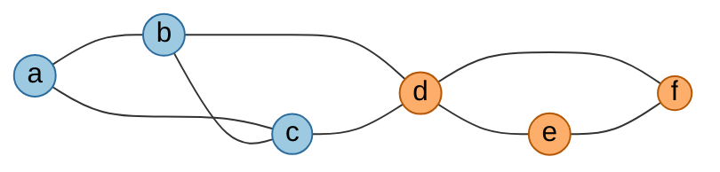
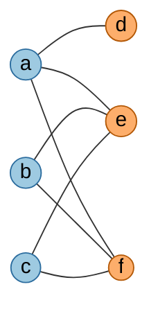
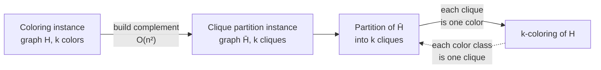
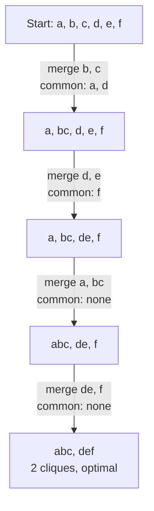
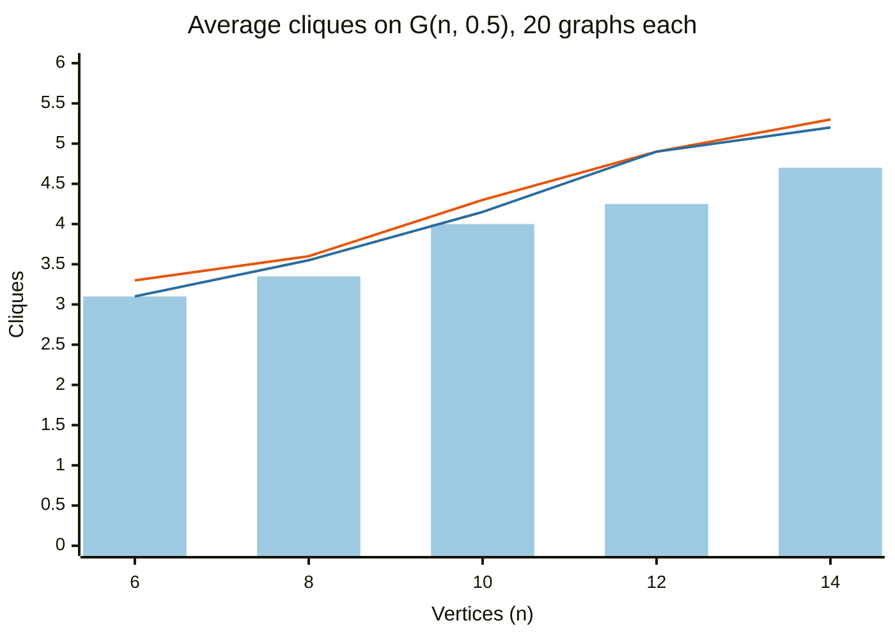

Imagine a social network where an edge means two people are mutual friends. You want to divide the network into groups where everyone in a group knows everyone else in that group. The **Clique Partition Problem** asks for the minimum number of such groups (cliques) that cover all vertices in a graph.

The problem sounds simple, but it is NP-complete. It connects to graph coloring, social network analysis, and machine learning. This post covers its computational complexity, some approximation algorithms, and applications from community detection to image segmentation.

If you are an undergraduate who studies graph theory, this problem is a good first look at NP-completeness. It also has practical uses in data analysis and network science.

## Understanding Cliques and Graph Partitioning

### What is a Clique?

**Definition**: A clique in an undirected graph G = (V, E) is a subset of vertices C ⊆ V in which every two distinct vertices are adjacent. An edge connects every pair of vertices in C.

**Intuition**: A clique is a group of people where everyone knows everyone else. In graph terms, it is a complete subgraph.

```python
import networkx as nx
import matplotlib.pyplot as plt
from itertools import combinations
from typing import List, Set, Tuple, Dict

class Graph:
    def __init__(self):
        self.vertices = set()
        self.edges = set()
        self.adjacency_list = {}

    def add_vertex(self, vertex):
        """Add a vertex to the graph"""
        self.vertices.add(vertex)
        if vertex not in self.adjacency_list:
            self.adjacency_list[vertex] = set()

    def add_edge(self, u, v):
        """Add an undirected edge between vertices u and v"""
        self.add_vertex(u)
        self.add_vertex(v)
        self.edges.add((min(u, v), max(u, v)))
        self.adjacency_list[u].add(v)
        self.adjacency_list[v].add(u)

    def is_clique(self, vertices_subset: Set) -> bool:
        """Check if a subset of vertices forms a clique"""
        vertices_list = list(vertices_subset)
        n = len(vertices_list)

        # A clique of size n should have n(n-1)/2 edges
        expected_edges = n * (n - 1) // 2
        actual_edges = 0

        for i in range(n):
            for j in range(i + 1, n):
                u, v = vertices_list[i], vertices_list[j]
                if v in self.adjacency_list[u]:
                    actual_edges += 1

        return actual_edges == expected_edges

    def find_all_cliques_naive(self) -> List[Set]:
        """Find all maximal cliques using naive approach (exponential time)"""
        all_cliques = []

        # Check all possible subsets of vertices
        vertices_list = list(self.vertices)
        n = len(vertices_list)

        for size in range(1, n + 1):
            for subset in combinations(vertices_list, size):
                subset_set = set(subset)
                if self.is_clique(subset_set):
                    # Check if it's maximal (can't be extended)
                    is_maximal = True
                    for v in self.vertices - subset_set:
                        extended_set = subset_set | {v}
                        if self.is_clique(extended_set):
                            is_maximal = False
                            break

                    if is_maximal:
                        all_cliques.append(subset_set)

        return all_cliques

# Example: Social network analysis
def create_social_network_example():
    """Create a sample social network for clique analysis"""
    graph = Graph()

    # Add friendships (edges)
    friendships = [
        ("Alice", "Bob"), ("Alice", "Carol"), ("Bob", "Carol"),  # Triangle clique
        ("David", "Eve"), ("David", "Frank"), ("Eve", "Frank"),  # Another triangle
        ("Carol", "David"),  # Bridge between groups
        ("Grace", "Henry"), ("Grace", "Ivy"), ("Henry", "Ivy"), ("Henry", "Jack")  # Mixed group
    ]

    for u, v in friendships:
        graph.add_edge(u, v)

    return graph

# Demonstrate clique detection
social_graph = create_social_network_example()
print("Social Network Analysis:")
print(f"Vertices: {social_graph.vertices}")
print(f"Edges: {social_graph.edges}")

# Check specific subsets
test_sets = [
    {"Alice", "Bob", "Carol"},
    {"David", "Eve", "Frank"},
    {"Grace", "Henry", "Ivy"},
    {"Alice", "David"}
]

for test_set in test_sets:
    is_clique = social_graph.is_clique(test_set)
    print(f"{test_set} is a clique: {is_clique}")
```

### Types of Cliques

The partition problem uses three related terms:

1. A **maximal clique** is a clique that you cannot extend with another vertex.
2. A **maximum clique** is the largest clique in the graph, by number of vertices.
3. A **clique cover** is a set of cliques that covers all vertices in the graph.

```python
class CliqueAnalyzer:
    def __init__(self, graph: Graph):
        self.graph = graph

    def find_maximal_cliques_bron_kerbosch(self) -> List[Set]:
        """
        Bron-Kerbosch algorithm for finding all maximal cliques
        More efficient than naive approach
        """
        def bron_kerbosch(R, P, X, cliques):
            if not P and not X:
                # R is a maximal clique
                cliques.append(R.copy())
                return

            # Choose pivot to minimize branching
            pivot = max(P | X, key=lambda v: len(P & self.graph.adjacency_list[v]), default=None)

            for v in P - (self.graph.adjacency_list[pivot] if pivot else set()):
                neighbors_v = self.graph.adjacency_list[v]
                bron_kerbosch(
                    R | {v},
                    P & neighbors_v,
                    X & neighbors_v,
                    cliques
                )
                P.remove(v)
                X.add(v)

        cliques = []
        bron_kerbosch(set(), self.graph.vertices.copy(), set(), cliques)
        return cliques

    def find_maximum_clique(self) -> Set:
        """Find the maximum clique (largest by size)"""
        maximal_cliques = self.find_maximal_cliques_bron_kerbosch()
        if not maximal_cliques:
            return set()

        return max(maximal_cliques, key=len)

    def clique_number(self) -> int:
        """Return the clique number (size of maximum clique)"""
        maximum_clique = self.find_maximum_clique()
        return len(maximum_clique)

# Analyze our social network
analyzer = CliqueAnalyzer(social_graph)
maximal_cliques = analyzer.find_maximal_cliques_bron_kerbosch()
maximum_clique = analyzer.find_maximum_clique()

print(f"\nClique Analysis Results:")
print(f"Number of maximal cliques: {len(maximal_cliques)}")
print(f"Maximal cliques: {maximal_cliques}")
print(f"Maximum clique: {maximum_clique}")
print(f"Clique number: {analyzer.clique_number()}")
```

## The Clique Partition Problem: Formal Definition

### Problem Statement

**Clique Partition Problem**: Given an undirected graph G = (V, E), find the minimum number of vertex-disjoint cliques that cover all vertices in V.

**Formal Definition**:

- **Input**: An undirected graph G = (V, E)
- **Output**: A partition P = {C₁, C₂, ..., Cₖ} of V such that:
  1. Each Cᵢ is a clique in G
  2. ⋃ᵢ Cᵢ = V (covers all vertices)
  3. Cᵢ ∩ Cⱼ = ∅ for i ≠ j (vertex-disjoint)
  4. k is minimized

**Clique Partition Number**: The minimum number of cliques needed to partition the graph. It is often written θ(G) or cp(G), and it equals χ(Ḡ), the chromatic number of the complement Ḡ.

Karp called this problem **clique cover**. Garey and Johnson list it as **partition into cliques**. Do not confuse it with the edge-weighted "clique partitioning problem" from clustering, which is a different problem.

The figure below shows a six-vertex example. The graph has eight edges, and its minimum clique partition uses two cliques: {a, b, c} in blue and {d, e, f} in orange.



### The Complement Graph Connection

The clique partition problem on graph G is equivalent to the **chromatic number** problem on the complement graph Ḡ.

A clique in G is an independent set in Ḡ. So a minimum clique partition of G is the same as a minimum coloring of Ḡ.

The next figure shows the complement of the example graph. Its seven edges are exactly the seven pairs that the original graph lacks. The two cliques become the two color classes, and no edge joins two vertices of the same color.



```python
class CliquePartitionSolver:
    def __init__(self, graph: Graph):
        self.graph = graph
        self.complement_graph = self._compute_complement()

    def _compute_complement(self) -> Graph:
        """Compute the complement graph"""
        complement = Graph()

        # Add all vertices
        for v in self.graph.vertices:
            complement.add_vertex(v)

        # Add edges that are NOT in the original graph
        vertices_list = list(self.graph.vertices)
        for i in range(len(vertices_list)):
            for j in range(i + 1, len(vertices_list)):
                u, v = vertices_list[i], vertices_list[j]
                edge = (min(u, v), max(u, v))

                if edge not in self.graph.edges:
                    complement.add_edge(u, v)

        return complement

    def greedy_clique_partition(self) -> Tuple[List[Set], int]:
        """
        Greedy algorithm for clique partition
        Not optimal but gives reasonable approximation
        """
        remaining_vertices = self.graph.vertices.copy()
        partition = []

        while remaining_vertices:
            # Find a maximal clique in the remaining subgraph
            current_clique = self._find_greedy_clique(remaining_vertices)
            partition.append(current_clique)
            remaining_vertices -= current_clique

        return partition, len(partition)

    def _find_greedy_clique(self, vertices: Set) -> Set:
        """Find a maximal clique greedily from given vertices"""
        if not vertices:
            return set()

        # Start with highest degree vertex
        degrees = {v: len(self.graph.adjacency_list[v] & vertices) for v in vertices}
        start_vertex = max(degrees, key=degrees.get)

        clique = {start_vertex}
        candidates = self.graph.adjacency_list[start_vertex] & vertices

        # Greedily add vertices that are connected to all vertices in current clique
        while candidates:
            # Choose vertex with highest degree among candidates
            next_vertex = max(candidates,
                            key=lambda v: len(self.graph.adjacency_list[v] & candidates))

            clique.add(next_vertex)
            # Update candidates to only those connected to all vertices in clique
            candidates &= self.graph.adjacency_list[next_vertex]

        return clique

    def brute_force_partition(self) -> Tuple[List[Set], int]:
        """
        Brute force approach for small graphs
        Tries all possible partitions (exponential time)
        """
        n = len(self.graph.vertices)
        vertices_list = list(self.graph.vertices)

        min_partitions = float('inf')
        best_partition = None

        # Generate all possible partitions using Bell numbers approach
        for k in range(1, n + 1):
            partitions = self._generate_partitions(vertices_list, k)

            for partition in partitions:
                # Check if all parts are cliques
                if all(self.graph.is_clique(part) for part in partition):
                    if len(partition) < min_partitions:
                        min_partitions = len(partition)
                        best_partition = partition
                        break  # Found optimal for this k

            if best_partition:
                break  # Found optimal solution

        return best_partition if best_partition else [set(vertices_list)], min_partitions

    def _generate_partitions(self, vertices: List, k: int):
        """Generate every partition of vertices into exactly k non-empty blocks"""
        if len(vertices) < k or (k == 0 and vertices):
            return
        if not vertices:
            yield []
            return
        first, rest = vertices[0], vertices[1:]
        # Either the first vertex forms a block of its own...
        for p in self._generate_partitions(rest, k - 1):
            yield [{first}] + p
        # ...or it joins one of the k blocks of a partition of the rest
        for p in self._generate_partitions(rest, k):
            for i in range(k):
                yield p[:i] + [p[i] | {first}] + p[i + 1:]

# Example analysis
print("\nClique Partition Analysis:")
solver = CliquePartitionSolver(social_graph)

# Greedy solution
greedy_partition, greedy_size = solver.greedy_clique_partition()
print(f"Greedy partition ({greedy_size} cliques): {greedy_partition}")

# Verify partition validity
total_vertices = set()
for clique in greedy_partition:
    total_vertices |= clique
    print(f"  Clique {clique}: is_clique = {social_graph.is_clique(clique)}")

print(f"Covers all vertices: {total_vertices == social_graph.vertices}")
```

## NP-Completeness of the Clique Partition Problem

### Complexity Class and Hardness

**Theorem**: The decision version of the Clique Partition Problem is NP-complete. The decision version asks whether G can be partitioned into at most k cliques.

Karp proved this in 1972. Clique cover is one of his 21 NP-complete problems, and he reduced it from chromatic number.

**Proof Sketch**: The problem is in NP, because you can check a proposed partition in polynomial time. For hardness, we reduce from Graph Coloring, a known NP-complete problem.

### Reduction from Graph Coloring

The reduction uses the duality between clique partitions and graph coloring.

**Lemma**: A graph G can be partitioned into k cliques if and only if its complement Ḡ can be colored with k colors.

Given a coloring instance (H, k), build the complement of H and ask for a partition into k cliques. The complement takes O(n²) time to build. Each color class of H is a clique in the complement, and each clique in the complement is a color class of H.



```python
class NPCompletenessDemo:
    """Demonstration of NP-completeness concepts"""

    @staticmethod
    def graph_coloring_to_clique_partition(graph: Graph, coloring: Dict) -> List[Set]:
        """
        Convert a graph coloring to a clique partition of the complement graph
        This demonstrates the reduction between the two problems
        """
        # Group vertices by color
        color_classes = {}
        for vertex, color in coloring.items():
            if color not in color_classes:
                color_classes[color] = set()
            color_classes[color].add(vertex)

        return list(color_classes.values())

    @staticmethod
    def clique_partition_to_graph_coloring(partition: List[Set]) -> Dict:
        """
        Convert a clique partition to a graph coloring
        """
        coloring = {}
        for color, clique in enumerate(partition):
            for vertex in clique:
                coloring[vertex] = color

        return coloring

    @staticmethod
    def verify_reduction(original_graph: Graph, complement_graph: Graph,
                        partition: List[Set]) -> bool:
        """
        Verify that a clique partition of the original graph
        corresponds to a valid coloring of the complement graph
        """
        # Check that partition consists of cliques in original graph
        for clique in partition:
            if not original_graph.is_clique(clique):
                return False

        # Check that coloring is valid in complement graph
        coloring = NPCompletenessDemo.clique_partition_to_graph_coloring(partition)

        for u, v in complement_graph.edges:
            if coloring[u] == coloring[v]:
                return False  # Adjacent vertices have same color - invalid

        return True

# Demonstrate the reduction
print("\nNP-Completeness Demonstration:")
demo = NPCompletenessDemo()

# Use our previous partition
if 'greedy_partition' in locals():
    is_valid_reduction = demo.verify_reduction(social_graph, solver.complement_graph, greedy_partition)
    print(f"Reduction verification: {is_valid_reduction}")

    # Show corresponding coloring
    coloring = demo.clique_partition_to_graph_coloring(greedy_partition)
    print(f"Corresponding coloring: {coloring}")
```

### Implications of NP-Completeness

NP-completeness has four consequences:

1. No polynomial-time exact algorithm exists, unless P = NP.
2. Large instances need heuristics, and approximation guarantees are weak.
3. In practice, people often use heuristic and metaheuristic approaches.
4. Special cases with polynomial-time solutions are valuable.

### Hardness of Approximation

The reduction preserves the number of cliques exactly. So any approximation result for chromatic number carries over to clique partition, and the reverse also holds.

Zuckerman (2007) showed that approximating chromatic number within n^(1−ε) is NP-hard for every ε > 0. The same bound therefore holds for clique partition. A heuristic can return n singleton cliques, which is never worse than a factor n. So up to the ε, no polynomial algorithm beats the trivial answer in the worst case, unless P = NP.

### Polynomial Special Cases

Some graph classes allow exact answers in polynomial time:

- **Triangle-free graphs.** Every clique has at most two vertices. The optimum is n minus the size of a maximum matching.
- **Chordal graphs.** Gavril (1972) gave a polynomial algorithm for minimum clique cover that uses a perfect elimination ordering.
- **Comparability graphs.** A clique is a chain of the underlying partial order. A minimum chain partition follows from Dilworth's theorem and bipartite matching.
- **Perfect graphs.** The complement of a perfect graph is perfect (Lovász, 1972). Grötschel, Lovász, and Schrijver (1984) showed how to color perfect graphs in polynomial time. Coloring the complement gives the clique partition.

## Tseng's Algorithm: A Merging Heuristic

C.-J. Tseng and D. P. Siewiorek introduced this heuristic in 1986, in their paper on automated data-path synthesis. Their tool used clique partitioning to allocate registers, functional units, and interconnections. Two operations or variables that can share hardware are joined by an edge, and each clique shares one unit.

### Algorithm Description

The algorithm merges vertices instead of growing cliques one vertex at a time:

1. Put each vertex in its own super-node.
2. Among all edges, pick the pair of super-nodes with the most common neighbors.
3. Delete every edge at the two super-nodes and merge them into one super-node.
4. Connect the new super-node only to the common neighbors of the pair.
5. Repeat until no edges remain. Each super-node is a clique of G.

Step 4 keeps the invariant. A super-node is adjacent only to super-nodes whose vertices all connect to all of its own vertices. So every merge produces a clique.

```python
class TsengAlgorithm:
    """
    Tseng & Siewiorek (1986) clique partitioning heuristic.
    Repeatedly merge the two adjacent super-nodes with the most common
    neighbors. Ties go to the first pair in sorted order.
    """

    def __init__(self, graph: Graph):
        self.graph = graph
        self.trace = []  # (super-node 1, super-node 2, common neighbors) per merge

    @staticmethod
    def _name(super_node) -> Tuple:
        return tuple(sorted(map(str, super_node)))

    def tseng_clique_partition(self) -> Tuple[List[Set], int]:
        # Super-graph: each super-node is a frozenset of original vertices
        adj = {frozenset([v]): {frozenset([u]) for u in self.graph.adjacency_list[v]}
               for v in self.graph.vertices}
        self.trace = []

        while any(adj.values()):
            edges = sorted(((s, t) for s in adj for t in adj[s]
                            if self._name(s) < self._name(t)),
                           key=lambda e: (self._name(e[0]), self._name(e[1])))
            s1, s2 = max(edges, key=lambda e: len(adj[e[0]] & adj[e[1]]))
            common = adj[s1] & adj[s2]

            # Delete all edges at s1 and s2, then merge them
            for s in (adj.pop(s1) | adj.pop(s2)) - {s1, s2}:
                adj[s] -= {s1, s2}
            merged = s1 | s2

            # The merged node keeps only the common neighbors
            adj[merged] = set(common)
            for s in common:
                adj[s].add(merged)
            self.trace.append((s1, s2, common))

        partition = [set(s) for s in adj]
        return partition, len(partition)

# Apply Tseng's algorithm
print("\nTseng's Algorithm Analysis:")
tseng_solver = TsengAlgorithm(social_graph)

# Find partition using Tseng's approach
tseng_partition, tseng_size = tseng_solver.tseng_clique_partition()
print(f"Tseng partition ({tseng_size} cliques): {tseng_partition}")

# Verify validity
for i, clique in enumerate(tseng_partition):
    is_valid_clique = social_graph.is_clique(clique)
    print(f"  Clique {i+1} {clique}: valid = {is_valid_clique}")

# Compare with greedy approach
print(f"\nComparison:")
print(f"Greedy approach: {greedy_size} cliques")
print(f"Tseng's approach: {tseng_size} cliques")
```

### A Worked Trace

Here is the algorithm on the six-vertex example from earlier. In round 1, edge b–c has two common neighbors, a and d. Every other edge has at most one, so b and c merge first. The merged node keeps edges to a and d, because both are common neighbors.

In round 2, no edge at {b, c} has a common neighbor left. Edge d–e has one, f, so d and e merge. Rounds 3 and 4 merge the remaining pairs, which have zero common neighbors.



### Algorithm Analysis

**Time complexity.** Each round scans all edges of the super-graph and intersects two neighbor sets. That costs O(nm) per round, where m is the number of edges. There are at most n − 1 merges, so the total is O(n²m), or O(n⁴) on dense graphs. **Space complexity** is O(n + m) for the super-graph.

The result is deterministic once you fix a tie-breaking rule. Tseng's algorithm has no worst-case approximation guarantee, and the hardness result above rules out a strong one. Its main use has been allocation in high-level synthesis. The comparison chart later in this post shows how it does on small random graphs.

## Advanced Algorithmic Approaches

Other approaches also solve the clique partition problem.

### Branch and Bound Algorithm

Branch and bound gives exact solutions on small graphs. It picks the remaining vertex with the fewest neighbors and branches on every maximal clique that contains it. An independent set in the remaining graph gives a lower bound for pruning, because its vertices need separate cliques.

```python
class BranchAndBoundCliquePartition:
    """
    Branch and bound algorithm for exact clique partition
    """

    def __init__(self, graph: Graph):
        self.graph = graph
        self.best_partition_size = float('inf')
        self.best_partition = None

    def solve(self) -> Tuple[List[Set], int]:
        """
        Find optimal clique partition using branch and bound
        """
        vertices_list = list(self.graph.vertices)
        initial_partition = []
        remaining_vertices = set(vertices_list)

        self._branch_and_bound(initial_partition, remaining_vertices, 0)

        return self.best_partition, self.best_partition_size

    def _branch_and_bound(self, current_partition: List[Set],
                         remaining_vertices: Set, current_size: int):
        """
        Recursive branch and bound procedure
        """
        # Pruning: if current size already exceeds best known, stop
        if current_size >= self.best_partition_size:
            return

        # Base case: no vertices remaining
        if not remaining_vertices:
            if current_size < self.best_partition_size:
                self.best_partition_size = current_size
                self.best_partition = [clique.copy() for clique in current_partition]
            return

        # Lower bound estimation
        lower_bound = current_size + self._estimate_lower_bound(remaining_vertices)
        if lower_bound >= self.best_partition_size:
            return  # Prune this branch

        # Try different maximal cliques starting from remaining vertices
        cliques_to_try = self._generate_maximal_cliques(remaining_vertices)

        for clique in cliques_to_try:
            # Create new partition with this clique
            new_partition = current_partition + [clique]
            new_remaining = remaining_vertices - clique

            # Recurse
            self._branch_and_bound(new_partition, new_remaining, current_size + 1)

    def _estimate_lower_bound(self, vertices: Set) -> int:
        """
        Lower bound on the number of cliques needed for the remaining vertices.
        Pairwise non-adjacent vertices need different cliques, so the size of
        any independent set is a valid bound. Build one greedily.
        """
        independent = set()
        for v in sorted(vertices, key=lambda u: len(self.graph.adjacency_list[u] & vertices)):
            if not (self.graph.adjacency_list[v] & independent):
                independent.add(v)
        return len(independent)

    def _generate_maximal_cliques(self, vertices: Set) -> List[Set]:
        """
        All maximal cliques of the induced subgraph that contain one fixed
        vertex v. Some optimal partition puts v in one of them, so branching
        on these cliques keeps the search exact.
        """
        v = min(vertices, key=lambda u: len(self.graph.adjacency_list[u] & vertices))
        cliques = []

        def extend(clique, candidates, excluded):
            if not candidates and not excluded:
                cliques.append(clique)
                return
            for u in list(candidates):
                neighbors_u = self.graph.adjacency_list[u]
                extend(clique | {u}, candidates & neighbors_u, excluded & neighbors_u)
                candidates = candidates - {u}
                excluded = excluded | {u}

        extend({v}, self.graph.adjacency_list[v] & vertices, set())
        # Larger cliques first, so good solutions appear early
        return sorted(cliques, key=len, reverse=True)

# For small graphs, we can try exact solution
print("\nBranch and Bound (for small graphs):")
if len(social_graph.vertices) <= 12:  # Exponential time: keep examples small
    bb_solver = BranchAndBoundCliquePartition(social_graph)
    bb_partition, bb_size = bb_solver.solve()
    print(f"Optimal partition ({bb_size} cliques): {bb_partition}")
else:
    print("Graph too large for demonstration - would use approximation in practice")
```

### Approximation Algorithms

The problem is NP-complete, so large instances need heuristics. None of the methods below has a strong worst-case guarantee.

```python
class ApproximationAlgorithms:
    """
    Collection of approximation algorithms for clique partition
    """

    def __init__(self, graph: Graph):
        self.graph = graph

    def sequential_greedy_approximation(self) -> Tuple[List[Set], int]:
        """
        Sequential greedy heuristic.
        With an exact maximum clique each round, this is greedy set cover
        and stays within a factor H(n) ~ ln n of optimal. Finding that clique
        is NP-hard, so this version approximates it and has no guarantee.
        """
        remaining_vertices = self.graph.vertices.copy()
        partition = []

        while remaining_vertices:
            # Find the largest clique in the current subgraph
            best_clique = self._find_largest_clique_approximation(remaining_vertices)
            partition.append(best_clique)
            remaining_vertices -= best_clique

        return partition, len(partition)

    def _find_largest_clique_approximation(self, vertices: Set) -> Set:
        """
        Approximation for finding largest clique in subgraph
        """
        if not vertices:
            return set()

        # Use greedy approach: start with highest degree vertex
        degrees = {v: len(self.graph.adjacency_list[v] & vertices) for v in vertices}
        current_vertex = max(degrees, key=degrees.get)

        clique = {current_vertex}
        candidates = self.graph.adjacency_list[current_vertex] & vertices

        # Greedy extension
        while candidates:
            # Choose vertex with maximum degree in current candidate set
            degrees_in_candidates = {v: len(self.graph.adjacency_list[v] & candidates)
                                   for v in candidates}
            next_vertex = max(degrees_in_candidates, key=degrees_in_candidates.get)

            clique.add(next_vertex)
            candidates &= self.graph.adjacency_list[next_vertex]

        return clique

    def randomized_approximation(self, iterations: int = 100) -> Tuple[List[Set], int]:
        """
        Randomized approximation algorithm
        Runs multiple random trials and returns best result
        """
        best_partition = None
        best_size = float('inf')

        for _ in range(iterations):
            partition = self._randomized_single_trial()
            if len(partition) < best_size:
                best_size = len(partition)
                best_partition = partition

        return best_partition, best_size

    def _randomized_single_trial(self) -> List[Set]:
        """Single trial of randomized algorithm"""
        import random

        remaining_vertices = list(self.graph.vertices)
        random.shuffle(remaining_vertices)  # Randomize order
        remaining_set = set(remaining_vertices)
        partition = []

        while remaining_set:
            # Random starting vertex from remaining
            start_vertex = random.choice(list(remaining_set))
            clique = self._build_clique_randomly(start_vertex, remaining_set)
            partition.append(clique)
            remaining_set -= clique

        return partition

    def _build_clique_randomly(self, start_vertex: str, available_vertices: Set) -> Set:
        """Build clique randomly starting from given vertex"""
        import random

        clique = {start_vertex}
        candidates = list(self.graph.adjacency_list[start_vertex] & available_vertices)

        while candidates:
            # Randomly choose next vertex with some bias toward higher degree
            weights = [len(self.graph.adjacency_list[v] & set(candidates)) + 1
                      for v in candidates]
            next_vertex = random.choices(candidates, weights=weights)[0]

            clique.add(next_vertex)
            candidates = [v for v in candidates
                         if v in self.graph.adjacency_list[next_vertex]]

        return clique

# Compare approximation algorithms
print("\nApproximation Algorithms Comparison:")
approx_solver = ApproximationAlgorithms(social_graph)

# Sequential greedy
seq_partition, seq_size = approx_solver.sequential_greedy_approximation()
print(f"Sequential greedy: {seq_size} cliques")

# Randomized approach
rand_partition, rand_size = approx_solver.randomized_approximation(iterations=50)
print(f"Randomized (50 trials): {rand_size} cliques")

print(f"\nAlgorithm Performance Summary:")
print(f"Greedy:           {greedy_size} cliques")
print(f"Tseng's:          {tseng_size} cliques")
print(f"Sequential Greedy: {seq_size} cliques")
print(f"Randomized:       {rand_size} cliques")
```

### How Far from Optimal?

The chart below compares partition sizes on random graphs. For each n, I ran the classes above on 20 random graphs G(n, 0.5) with a fixed seed and averaged the results. The light blue bars are the exact optimum from branch and bound. The orange line is the greedy partition, and the dark blue line is Tseng's algorithm.



Both heuristics stay within one clique of the optimum on average at these sizes. The gap tends to grow with n. Tseng's algorithm is never worse than greedy on average here, and the two tie at n = 12. These graphs are tiny, so do not read the numbers as a general ranking.

## Real-World Applications

### 1. Social Network Analysis

In social networks, clique partitions find tight-knit communities.

```python
class SocialNetworkAnalysis:
    """
    Application of clique partition to social network analysis
    """

    def __init__(self):
        self.network = Graph()
        self.user_metadata = {}

    def add_user(self, user_id: str, metadata: Dict):
        """Add user with metadata"""
        self.network.add_vertex(user_id)
        self.user_metadata[user_id] = metadata

    def add_friendship(self, user1: str, user2: str):
        """Add friendship between users"""
        self.network.add_edge(user1, user2)

    def detect_communities(self) -> Dict:
        """
        Detect tight communities using clique partition
        """
        # Use Tseng's algorithm for community detection
        tseng_solver = TsengAlgorithm(self.network)
        communities, num_communities = tseng_solver.tseng_clique_partition()

        # Analyze communities
        community_analysis = {}
        for i, community in enumerate(communities):
            analysis = {
                'members': list(community),
                'size': len(community),
                'density': self._compute_community_density(community),
                'common_interests': self._find_common_interests(community)
            }
            community_analysis[f'Community_{i+1}'] = analysis

        return community_analysis

    def _compute_community_density(self, community: Set) -> float:
        """Compute density of connections within community"""
        if len(community) < 2:
            return 1.0

        possible_edges = len(community) * (len(community) - 1) // 2
        actual_edges = 0

        community_list = list(community)
        for i in range(len(community_list)):
            for j in range(i + 1, len(community_list)):
                u, v = community_list[i], community_list[j]
                if (min(u, v), max(u, v)) in self.network.edges:
                    actual_edges += 1

        return actual_edges / possible_edges if possible_edges > 0 else 0

    def _find_common_interests(self, community: Set) -> List[str]:
        """Find common interests among community members"""
        if not community:
            return []

        # Find intersection of interests
        common_interests = None
        for user in community:
            user_interests = set(self.user_metadata.get(user, {}).get('interests', []))
            if common_interests is None:
                common_interests = user_interests
            else:
                common_interests &= user_interests

        return list(common_interests) if common_interests else []

# Create a more complex social network
print("\nSocial Network Community Detection:")
social_analyzer = SocialNetworkAnalysis()

# Add users with interests
users_data = [
    ("Alice", {"interests": ["sports", "music", "travel"]}),
    ("Bob", {"interests": ["sports", "gaming", "music"]}),
    ("Carol", {"interests": ["sports", "travel", "food"]}),
    ("David", {"interests": ["tech", "gaming", "programming"]}),
    ("Eve", {"interests": ["tech", "programming", "AI"]}),
    ("Frank", {"interests": ["tech", "AI", "research"]}),
    ("Grace", {"interests": ["art", "music", "photography"]}),
    ("Henry", {"interests": ["art", "photography", "design"]}),
    ("Ivy", {"interests": ["music", "photography", "travel"]})
]

for user_id, metadata in users_data:
    social_analyzer.add_user(user_id, metadata)

# Add friendships
friendships = [
    ("Alice", "Bob"), ("Alice", "Carol"), ("Bob", "Carol"),  # Sports group
    ("David", "Eve"), ("David", "Frank"), ("Eve", "Frank"),  # Tech group
    ("Grace", "Henry"), ("Grace", "Ivy"), ("Henry", "Ivy"),  # Art group
    ("Carol", "David"), ("Bob", "Grace"), ("Ivy", "Alice")   # Bridge connections
]

for u, v in friendships:
    social_analyzer.add_friendship(u, v)

# Detect communities
communities = social_analyzer.detect_communities()
for community_name, analysis in communities.items():
    print(f"\n{community_name}:")
    print(f"  Members: {analysis['members']}")
    print(f"  Size: {analysis['size']}")
    print(f"  Density: {analysis['density']:.2f}")
    print(f"  Common interests: {analysis['common_interests']}")
```

### 2. Image Segmentation

For image segmentation, each pixel becomes a vertex. An edge joins two neighboring pixels with similar intensity. With 8-connected neighbors, a clique holds at most four pixels, a 2×2 block. So even a uniform region splits into several small segments, as the output shows for the black background.

```python
import numpy as np
from typing import Tuple

class ImageSegmentationCliquePartition:
    """
    Image segmentation using clique partition on pixel similarity graph
    """

    def __init__(self, image_array: np.ndarray, similarity_threshold: float = 0.8):
        self.image = image_array
        self.height, self.width = image_array.shape[:2]
        self.similarity_threshold = similarity_threshold
        self.pixel_graph = self._build_pixel_graph()

    def _build_pixel_graph(self) -> Graph:
        """
        Build graph where pixels are vertices and edges represent similarity
        """
        graph = Graph()

        # Add all pixels as vertices
        for i in range(self.height):
            for j in range(self.width):
                pixel_id = f"({i},{j})"
                graph.add_vertex(pixel_id)

        # Add edges based on pixel similarity
        for i in range(self.height):
            for j in range(self.width):
                current_pixel = f"({i},{j})"

                # Check 8-connected neighbors
                for di in [-1, 0, 1]:
                    for dj in [-1, 0, 1]:
                        if di == 0 and dj == 0:
                            continue

                        ni, nj = i + di, j + dj
                        if 0 <= ni < self.height and 0 <= nj < self.width:
                            neighbor_pixel = f"({ni},{nj})"

                            # Calculate similarity
                            if self._pixel_similarity(i, j, ni, nj) > self.similarity_threshold:
                                graph.add_edge(current_pixel, neighbor_pixel)

        return graph

    def _pixel_similarity(self, i1: int, j1: int, i2: int, j2: int) -> float:
        """
        Calculate similarity between two pixels
        """
        if len(self.image.shape) == 2:  # Grayscale
            # Cast first: uint8 subtraction would wrap around
            val1, val2 = int(self.image[i1, j1]), int(self.image[i2, j2])
            return 1.0 - abs(val1 - val2) / 255.0
        else:  # Color
            val1 = self.image[i1, j1].astype(float)
            val2 = self.image[i2, j2].astype(float)
            diff = np.linalg.norm(val1 - val2)
            max_diff = np.sqrt(3 * 255**2)  # Maximum possible difference
            return 1.0 - diff / max_diff

    def segment_image(self) -> Tuple[List[Set], np.ndarray]:
        """
        Segment image using clique partition
        """
        # Use greedy clique partition for efficiency
        solver = CliquePartitionSolver(self.pixel_graph)
        segments, num_segments = solver.greedy_clique_partition()

        # Create segmentation mask
        segment_mask = np.zeros((self.height, self.width), dtype=int)

        for segment_id, segment in enumerate(segments):
            for pixel_id in segment:
                # Parse pixel coordinates
                coords = pixel_id.strip('()').split(',')
                i, j = int(coords[0]), int(coords[1])
                segment_mask[i, j] = segment_id

        return segments, segment_mask

    def analyze_segments(self, segments: List[Set]) -> Dict:
        """
        Analyze properties of image segments
        """
        analysis = {}

        for i, segment in enumerate(segments):
            # Calculate segment properties
            pixels = []
            for pixel_id in segment:
                coords = pixel_id.strip('()').split(',')
                pi, pj = int(coords[0]), int(coords[1])
                pixels.append((pi, pj))

            # Calculate average color/intensity
            if len(self.image.shape) == 2:  # Grayscale
                avg_intensity = np.mean([self.image[pi, pj] for pi, pj in pixels])
                properties = {'avg_intensity': avg_intensity}
            else:  # Color
                avg_color = np.mean([self.image[pi, pj] for pi, pj in pixels], axis=0)
                properties = {'avg_color': avg_color.tolist()}

            properties.update({
                'size': len(segment),
                'bounding_box': self._get_bounding_box(pixels)
            })

            analysis[f'Segment_{i}'] = properties

        return analysis

    def _get_bounding_box(self, pixels: List[Tuple[int, int]]) -> Dict:
        """Calculate bounding box of pixel set"""
        if not pixels:
            return {}

        min_i = min(p[0] for p in pixels)
        max_i = max(p[0] for p in pixels)
        min_j = min(p[1] for p in pixels)
        max_j = max(p[1] for p in pixels)

        return {
            'top_left': (min_i, min_j),
            'bottom_right': (max_i, max_j),
            'width': max_j - min_j + 1,
            'height': max_i - min_i + 1
        }

# Demonstrate with synthetic image
print("\nImage Segmentation Application:")

# Create simple synthetic image for demonstration
synthetic_image = np.zeros((6, 6), dtype=np.uint8)
synthetic_image[0:2, 0:2] = 100  # Top-left region
synthetic_image[0:2, 4:6] = 200  # Top-right region
synthetic_image[4:6, 0:2] = 150  # Bottom-left region
synthetic_image[4:6, 4:6] = 250  # Bottom-right region

print("Synthetic image (6x6):")
print(synthetic_image)

# Apply clique partition segmentation
segmenter = ImageSegmentationCliquePartition(synthetic_image, similarity_threshold=0.9)
segments, segment_mask = segmenter.segment_image()

print(f"\nFound {len(segments)} segments")
print("Segment mask:")
print(segment_mask)

# Analyze segments
segment_analysis = segmenter.analyze_segments(segments)
for segment_name, properties in segment_analysis.items():
    print(f"\n{segment_name}:")
    for prop, value in properties.items():
        print(f"  {prop}: {value}")
```

### 3. Data Clustering

For data clustering, each data point becomes a vertex, and an edge joins two similar points.

```python
class DataClusteringCliquePartition:
    """
    Data clustering using clique partition on similarity graph
    """

    def __init__(self, data_points: List[List[float]], similarity_threshold: float = 0.7):
        self.data_points = data_points
        self.similarity_threshold = similarity_threshold
        self.similarity_graph = self._build_similarity_graph()

    def _build_similarity_graph(self) -> Graph:
        """
        Build similarity graph from data points
        """
        graph = Graph()
        n = len(self.data_points)

        # Add vertices for each data point
        for i in range(n):
            graph.add_vertex(f"point_{i}")

        # Add edges based on similarity
        for i in range(n):
            for j in range(i + 1, n):
                similarity = self._compute_similarity(i, j)
                if similarity > self.similarity_threshold:
                    graph.add_edge(f"point_{i}", f"point_{j}")

        return graph

    def _compute_similarity(self, i: int, j: int) -> float:
        """
        Compute similarity between two data points from Euclidean distance.
        Cosine similarity would ignore magnitude, so points at (1, 1) and
        (3, 3) would look identical.
        """
        point1 = np.array(self.data_points[i])
        point2 = np.array(self.data_points[j])

        return 1.0 / (1.0 + np.linalg.norm(point1 - point2))

    def cluster_data(self) -> Tuple[List[List[int]], Dict]:
        """
        Cluster data using clique partition
        """
        # Apply clique partition
        solver = CliquePartitionSolver(self.similarity_graph)
        clique_partition, num_clusters = solver.greedy_clique_partition()

        # Convert to data point indices
        clusters = []
        for clique in clique_partition:
            cluster_indices = [int(vertex.split('_')[1]) for vertex in clique]
            clusters.append(cluster_indices)

        # Analyze clusters
        cluster_analysis = self._analyze_clusters(clusters)

        return clusters, cluster_analysis

    def _analyze_clusters(self, clusters: List[List[int]]) -> Dict:
        """
        Analyze properties of discovered clusters
        """
        analysis = {}

        for i, cluster in enumerate(clusters):
            cluster_points = [self.data_points[idx] for idx in cluster]
            cluster_array = np.array(cluster_points)

            properties = {
                'size': len(cluster),
                'centroid': np.mean(cluster_array, axis=0).tolist(),
                'variance': np.var(cluster_array, axis=0).tolist(),
                'intra_cluster_similarity': self._compute_intra_cluster_similarity(cluster)
            }

            analysis[f'Cluster_{i}'] = properties

        return analysis

    def _compute_intra_cluster_similarity(self, cluster: List[int]) -> float:
        """
        Compute average similarity within cluster
        """
        if len(cluster) < 2:
            return 1.0

        similarities = []
        for i in range(len(cluster)):
            for j in range(i + 1, len(cluster)):
                sim = self._compute_similarity(cluster[i], cluster[j])
                similarities.append(sim)

        return np.mean(similarities)

# Demonstrate data clustering
print("\nData Clustering Application:")

# Generate synthetic data clusters
np.random.seed(42)
cluster1 = np.random.multivariate_normal([1, 1], [[0.1, 0], [0, 0.1]], 4)
cluster2 = np.random.multivariate_normal([3, 3], [[0.1, 0], [0, 0.1]], 3)
cluster3 = np.random.multivariate_normal([1, 3], [[0.1, 0], [0, 0.1]], 3)

synthetic_data = np.vstack([cluster1, cluster2, cluster3]).tolist()

print(f"Synthetic data points ({len(synthetic_data)} points):")
for i, point in enumerate(synthetic_data):
    print(f"  Point {i}: {[round(x, 2) for x in point]}")

# Apply clique partition clustering
clustering = DataClusteringCliquePartition(synthetic_data, similarity_threshold=0.5)  # distance < 1
clusters, cluster_analysis = clustering.cluster_data()

print(f"\nDiscovered {len(clusters)} clusters:")
for i, cluster in enumerate(clusters):
    print(f"Cluster {i}: points {cluster}")

print(f"\nCluster Analysis:")
for cluster_name, properties in cluster_analysis.items():
    print(f"\n{cluster_name}:")
    for prop, value in properties.items():
        if isinstance(value, list):
            print(f"  {prop}: {[round(x, 3) for x in value]}")
        else:
            print(f"  {prop}: {round(value, 3) if isinstance(value, float) else value}")
```

## Advanced Topics and Research Directions

### Parameterized Complexity

The code below checks two structural parameters: the clique number ω and the treewidth.

If ω ≤ 2, the graph is triangle-free. Every clique is a single vertex or an edge, so the optimum is n minus a maximum matching. Treewidth helps in a different way. Every clique fits inside one bag of a tree decomposition. So dynamic programming over the decomposition solves the problem in time that is exponential only in the width.

```python
from networkx.algorithms.approximation import treewidth_min_degree

class ParameterizedComplexityAnalysis:
    """
    Check a graph against two structural parameters
    """

    @staticmethod
    def _to_networkx(graph: Graph) -> nx.Graph:
        g = nx.Graph()
        g.add_nodes_from(graph.vertices)
        g.add_edges_from(graph.edges)
        return g

    @staticmethod
    def analyze_by_clique_number(graph: Graph) -> Dict:
        """
        Triangle-free graphs (omega <= 2) are solved exactly by maximum matching
        """
        omega = CliqueAnalyzer(graph).clique_number()
        analysis = {'clique_number': omega}
        if omega <= 2:
            g = ParameterizedComplexityAnalysis._to_networkx(graph)
            matching = nx.max_weight_matching(g, maxcardinality=True)
            analysis['optimum'] = len(graph.vertices) - len(matching)
            analysis['complexity_note'] = "Triangle-free: optimum = n - maximum matching"
        else:
            analysis['complexity_note'] = "omega >= 3: matching shortcut does not apply"
        return analysis

    @staticmethod
    def analyze_by_treewidth(graph: Graph) -> Dict:
        """
        Upper bound on treewidth from the min-degree heuristic
        """
        g = ParameterizedComplexityAnalysis._to_networkx(graph)
        width, _ = treewidth_min_degree(g)
        return {
            'graph_size': len(graph.vertices),
            'treewidth_upper_bound': width,
            'complexity_note': "Each clique lies in one bag, so DP is exponential only in the width"
        }

# Parameterized analysis
print("\nParameterized Complexity Analysis:")
param_analysis = ParameterizedComplexityAnalysis()

clique_analysis = param_analysis.analyze_by_clique_number(social_graph)
print("Analysis by clique number:")
for key, value in clique_analysis.items():
    print(f"  {key}: {value}")

treewidth_analysis = param_analysis.analyze_by_treewidth(social_graph)
print("\nAnalysis by treewidth:")
for key, value in treewidth_analysis.items():
    print(f"  {key}: {value}")
```

### Online and Dynamic Algorithms

In the online version of the problem, vertices arrive one at a time.

```python
class OnlineCliquePartition:
    """
    Online algorithm for clique partition where vertices arrive sequentially
    """

    def __init__(self):
        self.current_partition = []
        self.graph = Graph()
        self.vertices_processed = 0

    def process_vertex(self, new_vertex: str, neighbors: Set[str]):
        """
        Process a new vertex with its connections to previously seen vertices
        """
        self.vertices_processed += 1

        # Add vertex and edges to graph
        self.graph.add_vertex(new_vertex)
        for neighbor in neighbors:
            if neighbor in self.graph.vertices:
                self.graph.add_edge(new_vertex, neighbor)

        # Find best clique to add this vertex to
        best_clique_idx = self._find_best_clique_for_vertex(new_vertex)

        if best_clique_idx is not None:
            # Add to existing clique
            self.current_partition[best_clique_idx].add(new_vertex)
        else:
            # Create new clique
            self.current_partition.append({new_vertex})

        return len(self.current_partition)

    def _find_best_clique_for_vertex(self, vertex: str) -> int:
        """
        Find best existing clique to add the vertex to
        """
        for i, clique in enumerate(self.current_partition):
            # Check if vertex is connected to all vertices in clique
            if all(neighbor in self.graph.adjacency_list[vertex] for neighbor in clique):
                return i

        return None  # No suitable clique found

    def get_current_partition(self) -> List[Set]:
        """Get current partition"""
        return self.current_partition.copy()

    def competitive_ratio_analysis(self, offline_optimal: int) -> float:
        """
        Analyze competitive ratio compared to offline optimal
        """
        online_size = len(self.current_partition)
        return online_size / offline_optimal if offline_optimal > 0 else float('inf')

# Demonstrate online algorithm
print("\nOnline Clique Partition:")
online_solver = OnlineCliquePartition()

# Simulate online arrival of vertices
online_sequence = [
    ("Alice", set()),
    ("Bob", {"Alice"}),
    ("Carol", {"Alice", "Bob"}),
    ("David", set()),
    ("Eve", {"David"}),
    ("Frank", {"David", "Eve"}),
    ("Grace", set())
]

for vertex, neighbors in online_sequence:
    num_cliques = online_solver.process_vertex(vertex, neighbors)
    print(f"Added {vertex} (neighbors: {neighbors}): {num_cliques} cliques")

final_online_partition = online_solver.get_current_partition()
print(f"\nFinal online partition: {final_online_partition}")

# Compare with offline optimal (exact, via branch and bound)
offline_graph = online_solver.graph
offline_solver = BranchAndBoundCliquePartition(offline_graph)
offline_partition, offline_size = offline_solver.solve()

print(f"Offline optimal partition: {offline_partition}")
print(f"Competitive ratio: {len(final_online_partition) / offline_size:.2f}")
```

### Machine Learning Integration

Some approaches combine clique partitioning with machine learning.

```python
class MLEnhancedCliquePartition:
    """
    Machine learning enhanced clique partition algorithm
    """

    def __init__(self, graph: Graph):
        self.graph = graph
        self.vertex_features = self._extract_vertex_features()

    def _extract_vertex_features(self) -> Dict[str, List[float]]:
        """
        Extract features for each vertex for ML prediction
        """
        features = {}

        for vertex in self.graph.vertices:
            # Graph-based features
            degree = len(self.graph.adjacency_list[vertex])
            clustering_coeff = self._local_clustering_coefficient(vertex)

            # Structural features
            num_triangles = self._count_triangles(vertex)

            features[vertex] = [degree, clustering_coeff, num_triangles]

        return features

    def _local_clustering_coefficient(self, vertex: str) -> float:
        """
        Compute local clustering coefficient
        """
        neighbors = self.graph.adjacency_list[vertex]
        if len(neighbors) < 2:
            return 0.0

        # Count edges between neighbors
        edges_between_neighbors = 0
        neighbors_list = list(neighbors)

        for i in range(len(neighbors_list)):
            for j in range(i + 1, len(neighbors_list)):
                u, v = neighbors_list[i], neighbors_list[j]
                if (min(u, v), max(u, v)) in self.graph.edges:
                    edges_between_neighbors += 1

        possible_edges = len(neighbors) * (len(neighbors) - 1) // 2
        return edges_between_neighbors / possible_edges

    def _count_triangles(self, vertex: str) -> int:
        """
        Count number of triangles containing the vertex
        """
        neighbors = self.graph.adjacency_list[vertex]
        triangles = 0

        neighbors_list = list(neighbors)
        for i in range(len(neighbors_list)):
            for j in range(i + 1, len(neighbors_list)):
                u, v = neighbors_list[i], neighbors_list[j]
                if (min(u, v), max(u, v)) in self.graph.edges:
                    triangles += 1

        return triangles

    def ml_guided_partition(self) -> Tuple[List[Set], int]:
        """
        Use ML to guide clique partition decisions
        """
        # Simplified ML approach: use features to predict vertex ordering
        vertex_scores = {}

        for vertex, features in self.vertex_features.items():
            # Simple scoring function (in practice, would use trained model)
            score = features[0] * 0.4 + features[1] * 0.4 + features[2] * 0.2
            vertex_scores[vertex] = score

        # Order vertices by predicted importance
        ordered_vertices = sorted(vertex_scores.keys(),
                                key=lambda v: vertex_scores[v], reverse=True)

        # Build partition using this ordering
        partition = []
        remaining_vertices = set(ordered_vertices)

        while remaining_vertices:
            # Start with highest-scored remaining vertex
            start_vertex = next(v for v in ordered_vertices if v in remaining_vertices)

            # Build clique greedily, prioritizing high-scored vertices
            clique = self._build_ml_guided_clique(start_vertex, remaining_vertices, vertex_scores)
            partition.append(clique)
            remaining_vertices -= clique

        return partition, len(partition)

    def _build_ml_guided_clique(self, start_vertex: str, available: Set[str],
                               scores: Dict[str, float]) -> Set:
        """
        Build clique guided by ML scores
        """
        clique = {start_vertex}
        candidates = self.graph.adjacency_list[start_vertex] & available

        while candidates:
            # Choose candidate with highest ML score
            best_candidate = max(candidates, key=lambda v: scores[v])

            clique.add(best_candidate)
            candidates &= self.graph.adjacency_list[best_candidate]

        return clique

# Demonstrate ML-enhanced approach
print("\nML-Enhanced Clique Partition:")
ml_solver = MLEnhancedCliquePartition(social_graph)

print("Vertex features:")
for vertex, features in ml_solver.vertex_features.items():
    print(f"  {vertex}: degree={features[0]}, clustering={features[1]:.3f}, triangles={features[2]}")

ml_partition, ml_size = ml_solver.ml_guided_partition()
print(f"\nML-guided partition ({ml_size} cliques): {ml_partition}")

# Compare all approaches
print(f"\nFinal Algorithm Comparison:")
print(f"Greedy:           {greedy_size} cliques")
print(f"Tseng's:          {tseng_size} cliques")
print(f"Sequential Greedy: {seq_size} cliques")
print(f"Randomized:       {rand_size} cliques")
print(f"ML-guided:        {ml_size} cliques")
```

## Tools and Implementation Framework

This framework runs each algorithm on one graph and compares the results.

```python
class CliquePartitionFramework:
    """
    Comprehensive framework for clique partition analysis and solving
    """

    def __init__(self, graph: Graph):
        self.graph = graph
        self.algorithms = {
            'greedy': CliquePartitionSolver(graph),
            'tseng': TsengAlgorithm(graph),
            'approximation': ApproximationAlgorithms(graph)
        }
        self.results = {}

    def run_all_algorithms(self) -> Dict:
        """
        Run all available algorithms and compare results
        """
        results = {}

        # Greedy approach
        greedy_partition, greedy_size = self.algorithms['greedy'].greedy_clique_partition()
        results['greedy'] = {
            'partition': greedy_partition,
            'size': greedy_size,
            'runtime': self._measure_runtime(lambda: self.algorithms['greedy'].greedy_clique_partition())
        }

        # Tseng's algorithm
        tseng_partition, tseng_size = self.algorithms['tseng'].tseng_clique_partition()
        results['tseng'] = {
            'partition': tseng_partition,
            'size': tseng_size,
            'runtime': self._measure_runtime(lambda: self.algorithms['tseng'].tseng_clique_partition())
        }

        # Approximation algorithms
        seq_partition, seq_size = self.algorithms['approximation'].sequential_greedy_approximation()
        results['sequential_greedy'] = {
            'partition': seq_partition,
            'size': seq_size,
            'runtime': self._measure_runtime(lambda: self.algorithms['approximation'].sequential_greedy_approximation())
        }

        rand_partition, rand_size = self.algorithms['approximation'].randomized_approximation(50)
        results['randomized'] = {
            'partition': rand_partition,
            'size': rand_size,
            'runtime': self._measure_runtime(lambda: self.algorithms['approximation'].randomized_approximation(50))
        }

        self.results = results
        return results

    def _measure_runtime(self, algorithm_func) -> float:
        """
        Measure algorithm runtime
        """
        import time
        start_time = time.time()
        algorithm_func()
        end_time = time.time()
        return end_time - start_time

    def generate_report(self) -> str:
        """
        Generate comprehensive analysis report
        """
        if not self.results:
            self.run_all_algorithms()

        report = ["Clique Partition Analysis Report", "=" * 40]

        # Graph statistics
        report.append(f"\nGraph Statistics:")
        report.append(f"  Vertices: {len(self.graph.vertices)}")
        report.append(f"  Edges: {len(self.graph.edges)}")
        report.append(f"  Density: {2 * len(self.graph.edges) / (len(self.graph.vertices) * (len(self.graph.vertices) - 1)):.3f}")

        # Algorithm comparison
        report.append(f"\nAlgorithm Comparison:")
        report.append(f"{'Algorithm':<20} {'Cliques':<10} {'Runtime (s)':<12}")
        report.append("-" * 45)

        for alg_name, result in self.results.items():
            report.append(f"{alg_name:<20} {result['size']:<10} {result['runtime']:<12.6f}")

        # Best result
        best_algorithm = min(self.results.keys(), key=lambda k: self.results[k]['size'])
        report.append(f"\nBest Result: {best_algorithm} with {self.results[best_algorithm]['size']} cliques")

        # Partition analysis
        best_partition = self.results[best_algorithm]['partition']
        report.append(f"\nBest Partition Analysis:")
        for i, clique in enumerate(best_partition):
            report.append(f"  Clique {i+1}: {clique} (size: {len(clique)})")

        return "\n".join(report)

    def visualize_partition(self, algorithm_name: str = None):
        """
        Create visualization of partition (simplified text-based)
        """
        if not self.results:
            self.run_all_algorithms()

        if algorithm_name is None:
            algorithm_name = min(self.results.keys(), key=lambda k: self.results[k]['size'])

        partition = self.results[algorithm_name]['partition']

        print(f"\nPartition Visualization ({algorithm_name}):")
        print("-" * 50)

        for i, clique in enumerate(partition):
            print(f"Clique {i+1}: {', '.join(sorted(clique))}")

            # Show internal connections
            clique_list = list(clique)
            connections = []
            for j in range(len(clique_list)):
                for k in range(j + 1, len(clique_list)):
                    u, v = clique_list[j], clique_list[k]
                    if (min(u, v), max(u, v)) in self.graph.edges:
                        connections.append(f"{u}-{v}")

            if connections:
                print(f"  Connections: {', '.join(connections)}")
            print()

# Create comprehensive analysis framework
print("\nComprehensive Clique Partition Framework:")
framework = CliquePartitionFramework(social_graph)

# Run analysis
all_results = framework.run_all_algorithms()

# Generate report
report = framework.generate_report()
print(report)

# Visualize best partition
framework.visualize_partition()
```

## Research Tools and Resources

### Recommended Libraries and Tools

```python
def create_research_toolkit():
    """
    Tools and libraries for clique partition research
    """

    toolkit = {
        "graph_libraries": {
            "NetworkX": "Python library for graph analysis and algorithms",
            "igraph": "R/Python library with efficient graph algorithms",
            "SNAP": "Stanford Network Analysis Platform",
            "Boost Graph Library": "C++ graph algorithms library"
        },

        "optimization_solvers": {
            "Gurobi": "Commercial optimization solver for ILP formulations",
            "CPLEX": "IBM optimization solver",
            "OR-Tools": "Google's optimization tools",
            "SCIP": "Academic optimization solver"
        },

        "datasets": {
            "SNAP Datasets": "Stanford large network dataset collection",
            "KONECT": "Koblenz Network Collection",
            "Network Repository": "Interactive scientific network data repository",
            "Social Computing Data Repository": "ASU social network datasets"
        },

        "benchmarking": {
            "DIMACS Clique Benchmarks": "Standard benchmarks for clique problems",
            "BHOSLIB": "Hard clique and independent set instances with hidden optimum solutions",
            "Graph Coloring Instances": "Complement graphs for clique partition"
        }
    }

    return toolkit

# Implementation tips for researchers
def implementation_best_practices():
    """
    Best practices for implementing clique partition algorithms
    """

    practices = {
        "data_structures": [
            "Use adjacency lists for sparse graphs",
            "Consider adjacency matrices for dense graphs",
            "Implement efficient set operations for clique testing",
            "Use bit vectors for large graphs"
        ],

        "optimization_techniques": [
            "Implement early pruning in branch-and-bound",
            "Use upper and lower bounds effectively",
            "Consider parallel processing for independent subproblems",
            "Cache repeated computations"
        ],

        "testing_and_validation": [
            "Verify clique partition validity automatically",
            "Test on known benchmark instances",
            "Compare with optimal solutions on small graphs",
            "Measure runtime and memory usage systematically"
        ],

        "scalability": [
            "Profile code to identify bottlenecks",
            "Consider approximation algorithms for large instances",
            "Implement streaming algorithms for dynamic graphs",
            "Use graph preprocessing techniques"
        ]
    }

    return practices

print("\nResearch Tools and Resources:")
toolkit = create_research_toolkit()
for category, tools in toolkit.items():
    print(f"\n{category.replace('_', ' ').title()}:")
    for tool, description in tools.items():
        print(f"  • {tool}: {description}")

print("\nImplementation Best Practices:")
practices = implementation_best_practices()
for category, tips in practices.items():
    print(f"\n{category.replace('_', ' ').title()}:")
    for tip in tips:
        print(f"  • {tip}")
```

### Academic Resources

1. **"Graph Theory"** by J. A. Bondy and U. S. R. Murty (Springer, Graduate Texts in Mathematics 244, 2008)
   - Introduction to graph theory fundamentals
   - Available at: https://link.springer.com/book/9781846289699

2. **"Computers and Intractability: A Guide to the Theory of NP-Completeness"** by M. R. Garey and D. S. Johnson (W. H. Freeman, 1979)
   - Classic reference for NP-completeness theory. Lists the problem as "Partition into Cliques".
   - Available at: https://www.amazon.com/Computers-Intractability-NP-Completeness-Mathematical/dp/0716710455

3. **"Parameterized Complexity"** by R. G. Downey and M. R. Fellows (Springer, 1999)
   - Advanced treatment of parameterized algorithms
   - Available at: https://link.springer.com/book/10.1007/978-1-4612-0515-9

4. **"Reducibility among Combinatorial Problems"** by R. M. Karp, in _Complexity of Computer Computations_ (Plenum Press, 1972), pp. 85–103
   - Proves clique cover NP-complete, among 21 problems
   - Available at: https://doi.org/10.1007/978-1-4684-2001-2_9

5. **"Automated Synthesis of Data Paths in Digital Systems"** by C.-J. Tseng and D. P. Siewiorek, _IEEE Transactions on Computer-Aided Design_ 5(3):379–395, 1986
   - Source of the merging heuristic in this post
   - Available at: https://doi.org/10.1109/TCAD.1986.1270207

6. **"Linear Degree Extractors and the Inapproximability of Max Clique and Chromatic Number"** by D. Zuckerman, _Theory of Computing_ 3:103–128, 2007
   - Proves the n^(1−ε) hardness of approximation for chromatic number
   - Available at: https://doi.org/10.4086/toc.2007.v003a006

7. **"Algorithms for Minimum Coloring, Maximum Clique, Minimum Covering by Cliques, and Maximum Independent Set of a Chordal Graph"** by F. Gavril, _SIAM Journal on Computing_ 1(2):180–187, 1972
   - Polynomial clique cover on chordal graphs
   - Available at: https://doi.org/10.1137/0201013

## Conclusion: The Continuing Challenge of Clique Partitioning

The problem is NP-complete, but it still drives work in algorithm design, from approximation algorithms to machine learning.

### Key Insights

NP-completeness does not block practical solutions. It points you to approximation algorithms and heuristics. This post covers greedy, Tseng's, randomized, and branch-and-bound methods. Each trades solution quality against running time differently. The problem has uses in social networks, image processing, and data clustering. Machine learning, parameterized complexity, and online algorithms all give open research questions.

### Future Directions

Some natural next steps go beyond this post:

- Learned heuristics that choose which clique to take next
- Dynamic algorithms for graphs that change over time
- Distributed algorithms for very large networks

### Practical Takeaways

For undergraduate researchers and practitioners:

1. Learn the fundamental concepts before you study advanced algorithms.
2. Implement the algorithms and experiment. Coding builds intuition about how they behave.
3. Study applications. Real problems give motivation and show you how to design algorithms.
4. Compare approaches. No single algorithm wins on every graph, so learn the trade-offs.

---

_For current research, read recent proceedings of conferences such as SODA and ICALP, and graph theory journals._
