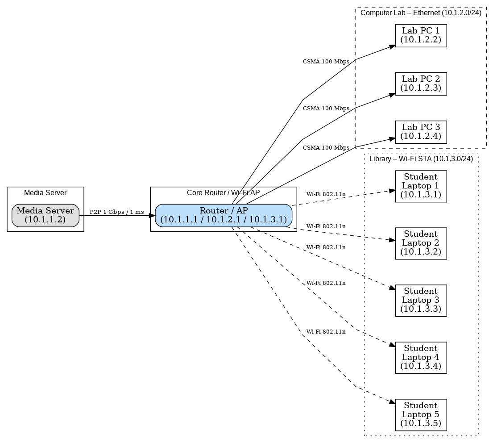
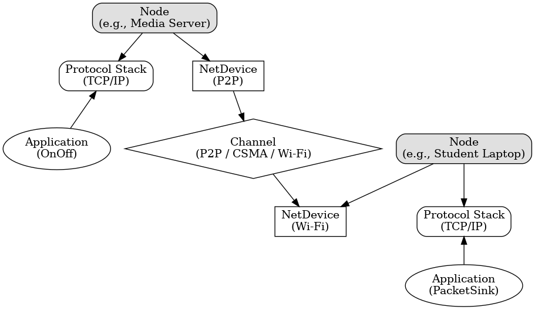

## What We're Building Today

Suppose you must design a campus network where students stream videos from a media server. Some students connect via WiFi in the library, and others use Ethernet in computer labs. Everyone wants smooth playback without buffering. How do you test your network design before you spend thousands on equipment?

NS3 answers that question. In this guide we build this simulation together and learn NS3's essential modules on the way. You will learn how to create nodes and connect them with different technologies. You will also run applications and check whether your network can handle the load.

## Setting Up Your NS3 Environment

First, install NS3. On Ubuntu (which I recommend for beginners), you need these prerequisites:

```bash
sudo apt-get update
sudo apt-get install g++ python3 python3-dev cmake git
sudo apt-get install python3-setuptools qtbase5-dev qtchooser qt5-qmake qtbase5-dev-tools
```

Next, download and build NS3:

```bash
# Download NS3 (using version 3.39 as an example)
wget https://www.nsnam.org/releases/ns-allinone-3.39.tar.bz2
tar xjf ns-allinone-3.39.tar.bz2
cd ns-allinone-3.39/ns-3.39

# Configure and build
./ns3 configure --enable-examples --enable-tests
./ns3 build
```

The build takes about 10-15 minutes. While it compiles, read about the parts we will use.

## Understanding NS3's Building Blocks

NS3 works like digital LEGO blocks. Each module is a different networking component:

- **Node module**: computers, phones, or any other device in your network
- **NetDevice module**: network cards, such as WiFi adapters and Ethernet ports
- **Channel module**: the medium between devices (air for WiFi, cables for Ethernet)
- **Protocol stack module**: the software that handles networking (like TCP/IP)
- **Application module**: programs that generate network traffic (video servers, web browsers)



The campus network simulation below shows how these pieces fit together.

## Creating Our First Simulation: The Campus Network

Create a new file called `campus-network.cc` in the `scratch` directory of your NS3 installation:

```cpp
#include "ns3/core-module.h"
#include "ns3/network-module.h"
#include "ns3/internet-module.h"
#include "ns3/point-to-point-module.h"
#include "ns3/csma-module.h"
#include "ns3/wifi-module.h"
#include "ns3/mobility-module.h"
#include "ns3/applications-module.h"
#include "ns3/flow-monitor-module.h"

using namespace ns3;

// This gives us logging capabilities - super useful for debugging!
NS_LOG_COMPONENT_DEFINE("CampusNetworkSimulation");

int main(int argc, char *argv[])
{
    // Enable logging so we can see what's happening
    LogComponentEnable("CampusNetworkSimulation", LOG_LEVEL_INFO);

    NS_LOG_INFO("Creating our campus network simulation");

    // Let's start building!
}
```

This basic structure imports all the modules we need. The logging component prints messages during the simulation, which helps us debug. Think of `NS_LOG_INFO` as a `printf` that you can turn on or off.

## Step 1: Creating Nodes (The Network Devices)

Next, add the network devices. Our campus has 1 media server and 1 router that connects everything. It also has 3 lab computers on Ethernet and 5 student laptops on WiFi.

```cpp
int main(int argc, char *argv[])
{
    LogComponentEnable("CampusNetworkSimulation", LOG_LEVEL_INFO);

    // Create the media server
    NS_LOG_INFO("Creating media server");
    NodeContainer mediaServer;
    mediaServer.Create(1);  // Just one server

    // Create the router that connects everything
    NS_LOG_INFO("Creating router");
    NodeContainer router;
    router.Create(1);

    // Create lab computers (connected via Ethernet)
    NS_LOG_INFO("Creating lab computers");
    NodeContainer labComputers;
    labComputers.Create(3);

    // Create student laptops (connected via WiFi)
    NS_LOG_INFO("Creating student laptops");
    NodeContainer wifiStudents;
    wifiStudents.Create(5);

    // The router will also act as the WiFi access point
    NodeContainer wifiAP = router;
}
```

We use `NodeContainer` to group similar nodes, so we can configure many nodes at once. A container is a list of devices that share properties.

## Step 2: Setting Up the Point-to-Point Connection (Server to Router)

A high-speed link connects our media server to the router. The `PointToPointHelper` module sets up this link:

```cpp
    // Configure the point-to-point link between server and router
    NS_LOG_INFO("Configuring server-to-router link");
    PointToPointHelper serverLink;

    // Set link properties: 1 Gbps bandwidth, 1ms delay
    // Think of this as a fiber optic connection
    serverLink.SetDeviceAttribute("DataRate", StringValue("1Gbps"));
    serverLink.SetChannelAttribute("Delay", StringValue("1ms"));

    // Install the link on both devices
    NetDeviceContainer serverDevices;
    serverDevices = serverLink.Install(mediaServer.Get(0), router.Get(0));
```

`DataRate` is how fast data can flow, like the width of a pipe. `Delay` is how long data takes to cross the link, like the length of the pipe. These parameters directly affect application performance.

## Step 3: Configuring Ethernet for Lab Computers

Lab computers connect through Ethernet. We use the CSMA (Carrier Sense Multiple Access) module, which simulates Ethernet behavior:

```cpp
    // Configure Ethernet for lab computers
    NS_LOG_INFO("Setting up Ethernet for lab computers");
    CsmaHelper csma;

    // 100 Mbps Ethernet with 2 microsecond delay
    csma.SetChannelAttribute("DataRate", StringValue("100Mbps"));
    csma.SetChannelAttribute("Delay", TimeValue(NanoSeconds(2000)));

    // Connect all lab computers and the router to the same Ethernet
    NodeContainer csmaNodes;
    csmaNodes.Add(router.Get(0));  // Router first
    csmaNodes.Add(labComputers);   // Then all lab computers

    NetDeviceContainer csmaDevices;
    csmaDevices = csma.Install(csmaNodes);
```

In CSMA, all devices share one medium, like computers on an old Ethernet hub. They take turns to transmit. NS3 uses a simplified carrier-sense model without collisions.

## Step 4: Creating the WiFi Network

WiFi is more complex because wireless signals can interfere and nodes can move. This code sets it up:

```cpp
    // Configure WiFi for student laptops
    NS_LOG_INFO("Setting up WiFi network");

    // The PHY layer (physical layer) handles radio transmission
    YansWifiPhyHelper wifiPhy;
    YansWifiChannelHelper wifiChannel = YansWifiChannelHelper::Default();
    wifiPhy.SetChannel(wifiChannel.Create());

    // The MAC layer handles when devices can transmit
    WifiMacHelper wifiMac;
    WifiHelper wifi;

    // Use 802.11n (common in campuses)
    wifi.SetStandard(WIFI_STANDARD_80211n);

    // Configure the access point (router)
    Ssid ssid = Ssid("CampusWiFi");
    wifiMac.SetType("ns3::ApWifiMac",
                    "Ssid", SsidValue(ssid));

    NetDeviceContainer apDevice;
    apDevice = wifi.Install(wifiPhy, wifiMac, wifiAP);

    // Configure the student devices
    wifiMac.SetType("ns3::StaWifiMac",
                    "Ssid", SsidValue(ssid),
                    "ActiveProbing", BooleanValue(false));

    NetDeviceContainer staDevices;
    staDevices = wifi.Install(wifiPhy, wifiMac, wifiStudents);
```

The WiFi setup has two layers. The **PHY (Physical)** layer handles radio waves, signal strength, and interference. The **MAC (Media Access Control)** layer decides who transmits when, so transmissions do not collide.

We configure one node as an Access Point (AP) and the others as Stations (STA) that connect to it.

## Step 5: Positioning WiFi Nodes

Wireless nodes need positions because signal strength depends on distance:

```cpp
    // Set up mobility (positions) for WiFi nodes
    NS_LOG_INFO("Positioning WiFi nodes");
    MobilityHelper mobility;

    // Access point is stationary at the origin
    mobility.SetMobilityModel("ns3::ConstantPositionMobilityModel");
    mobility.Install(wifiAP);

    // Students are scattered around the library
    mobility.SetPositionAllocator("ns3::RandomRectanglePositionAllocator",
                                  "X", StringValue("ns3::UniformRandomVariable[Min=0.0|Max=30.0]"),
                                  "Y", StringValue("ns3::UniformRandomVariable[Min=0.0|Max=30.0]"));

    // Students might move around slowly (studying, getting coffee)
    mobility.SetMobilityModel("ns3::RandomWalk2dMobilityModel",
                              "Bounds", RectangleValue(Rectangle(0, 30, 0, 30)),
                              "Speed", StringValue("ns3::ConstantRandomVariable[Constant=1.0]"));

    mobility.Install(wifiStudents);
```

The `MobilityHelper` module controls node positions and movement. Fixed nodes use `ConstantPositionMobilityModel`, and mobile nodes can use other movement patterns. Here, students move randomly within a 30x30 meter area.

## Step 6: Installing the Internet Stack

Next, give the nodes Internet protocols:

```cpp
    // Install Internet stack on all nodes
    NS_LOG_INFO("Installing Internet stack");
    InternetStackHelper internet;
    internet.Install(mediaServer);
    internet.Install(router);
    internet.Install(labComputers);
    internet.Install(wifiStudents);
```

This installs TCP/IP on each node. Without it, nodes can send raw frames, but they cannot use IP addresses or run typical Internet applications.

## Step 7: Assigning IP Addresses

Each network segment needs its own IP address range:

```cpp
    // Assign IP addresses to each network segment
    NS_LOG_INFO("Assigning IP addresses");
    Ipv4AddressHelper address;

    // Server-to-router link: 10.1.1.0/30
    address.SetBase("10.1.1.0", "255.255.255.252");
    Ipv4InterfaceContainer serverInterfaces;
    serverInterfaces = address.Assign(serverDevices);

    // Ethernet network: 10.1.2.0/24
    address.SetBase("10.1.2.0", "255.255.255.0");
    Ipv4InterfaceContainer csmaInterfaces;
    csmaInterfaces = address.Assign(csmaDevices);

    // WiFi network: 10.1.3.0/24
    address.SetBase("10.1.3.0", "255.255.255.0");
    Ipv4InterfaceContainer apInterface;
    apInterface = address.Assign(apDevice);
    Ipv4InterfaceContainer staInterfaces;
    staInterfaces = address.Assign(staDevices);

    // Enable routing
    Ipv4GlobalRoutingHelper::PopulateRoutingTables();
```

Each `SetBase` call defines a new subnet. The router connects all three subnets, and `PopulateRoutingTables()` configures routing between them automatically.

## Step 8: Creating the Video Streaming Application

Now we use the network. This code creates a video streaming server and clients:

```cpp
    // Create video streaming server on the media server
    NS_LOG_INFO("Creating video streaming application");
    uint16_t videoPort = 5000;

    // Server application - sends video data
    OnOffHelper videoServer("ns3::UdpSocketFactory",
                            InetSocketAddress(Ipv4Address::GetAny(), videoPort));

    // Configure to simulate 4K video streaming (25 Mbps)
    videoServer.SetAttribute("DataRate", StringValue("25Mbps"));
    videoServer.SetAttribute("PacketSize", UintegerValue(1400));
    // Send continuously (the default is 1 s on, 1 s off)
    videoServer.SetAttribute("OnTime", StringValue("ns3::ConstantRandomVariable[Constant=1]"));
    videoServer.SetAttribute("OffTime", StringValue("ns3::ConstantRandomVariable[Constant=0]"));

    // One sender app per client is added below
    ApplicationContainer serverApp;

    // Create video clients on all student devices
    PacketSinkHelper videoClient("ns3::UdpSocketFactory",
                                 InetSocketAddress(Ipv4Address::GetAny(), videoPort));

    // Install on lab computers
    ApplicationContainer labClientApps = videoClient.Install(labComputers);
    labClientApps.Start(Seconds(1.0));
    labClientApps.Stop(Seconds(30.0));

    // Install on WiFi students
    ApplicationContainer wifiClientApps = videoClient.Install(wifiStudents);
    wifiClientApps.Start(Seconds(1.0));
    wifiClientApps.Stop(Seconds(30.0));

    // Configure the server to send to all clients
    for (uint32_t i = 0; i < labComputers.GetN(); ++i)
    {
        videoServer.SetAttribute("Remote",
            AddressValue(InetSocketAddress(csmaInterfaces.GetAddress(i+1), videoPort)));
        serverApp.Add(videoServer.Install(mediaServer.Get(0)));
    }

    for (uint32_t i = 0; i < wifiStudents.GetN(); ++i)
    {
        videoServer.SetAttribute("Remote",
            AddressValue(InetSocketAddress(staInterfaces.GetAddress(i), videoPort)));
        serverApp.Add(videoServer.Install(mediaServer.Get(0)));
    }

    // Start and stop all sender apps after they are created
    serverApp.Start(Seconds(1.0));
    serverApp.Stop(Seconds(30.0));
```

The `OnOffHelper` creates an application that alternates between sending data (On) and silence (Off). We set the Off time to zero, so each stream sends a constant 25 Mbps. The `PacketSinkHelper` creates applications that receive and consume data.

## Step 9: Monitoring Network Performance

To know whether the network design works, add monitoring:

```cpp
    // Set up flow monitor to track performance
    NS_LOG_INFO("Setting up performance monitoring");
    FlowMonitorHelper flowHelper;
    Ptr<FlowMonitor> flowMonitor = flowHelper.InstallAll();

    // Also enable pcap tracing for detailed packet analysis
    serverLink.EnablePcap("campus-server", serverDevices.Get(0), true);
    csma.EnablePcap("campus-ethernet", csmaDevices.Get(1), true);
    wifiPhy.EnablePcap("campus-wifi", apDevice.Get(0), true);
```

The `FlowMonitor` tracks every flow (a stream of packets between two endpoints). It collects statistics like throughput, delay, and packet loss. You can open the PCAP files in Wireshark for detailed analysis.

## Step 10: Running the Simulation and Analyzing Results

Finally, run the simulation and print the results:

```cpp
    // Run the simulation
    NS_LOG_INFO("Starting simulation");
    Simulator::Stop(Seconds(31.0));
    Simulator::Run();

    // Print flow statistics
    flowMonitor->CheckForLostPackets();
    Ptr<Ipv4FlowClassifier> classifier = DynamicCast<Ipv4FlowClassifier>
        (flowHelper.GetClassifier());

    FlowMonitor::FlowStatsContainer stats = flowMonitor->GetFlowStats();

    std::cout << "\n=== Flow Statistics ===" << std::endl;
    for (auto iter = stats.begin(); iter != stats.end(); ++iter)
    {
        Ipv4FlowClassifier::FiveTuple t = classifier->FindFlow(iter->first);

        std::cout << "Flow " << iter->first << " ("
                  << t.sourceAddress << ":" << t.sourcePort << " -> "
                  << t.destinationAddress << ":" << t.destinationPort << ")"
                  << std::endl;

        std::cout << "  Tx Packets: " << iter->second.txPackets << std::endl;
        std::cout << "  Rx Packets: " << iter->second.rxPackets << std::endl;
        std::cout << "  Throughput: "
                  << iter->second.rxBytes * 8.0 / 30.0 / 1000000.0
                  << " Mbps" << std::endl;
        std::cout << "  Mean Delay: " << iter->second.delaySum.GetSeconds() /
                     iter->second.rxPackets << " s" << std::endl;
        std::cout << "  Packet Loss: "
                  << (iter->second.txPackets - iter->second.rxPackets) * 100.0 /
                     iter->second.txPackets << " %" << std::endl;
        std::cout << std::endl;
    }

    // Clean up
    Simulator::Destroy();

    return 0;
}
```

## Compiling and Running Your Simulation

Save your file and compile it:

```bash
cd ~/ns-allinone-3.39/ns-3.39
./ns3 build
```

Run the simulation:

```bash
./ns3 run campus-network
```

The output shows the performance of each flow. Check three values:

- **Throughput**: Is it close to 25 Mbps per stream?
- **Packet loss**: It should be near 0% for good video quality.
- **Delay**: Lower is better for real-time applications.

## Understanding What Just Happened

The simulation shows three things:

1. **Wired connections perform better.** Lab computers likely show a steady 25 Mbps throughput with minimal loss.
2. **WiFi varies with distance.** Students farther from the access point can get lower throughput.
3. **WiFi users share the medium.** They compete for airtime, which can reduce the throughput of each user.

A real campus network behaves the same way.

## Key Modules Deep Dive

This section looks at the modules we used in more detail.

### The Application Module

NS3 includes several application models:

- **OnOffApplication**: Generates traffic in bursts (good for video)
- **BulkSendApplication**: Sends data as fast as possible (good for file transfers)
- **UdpEchoClient/Server**: Simple request-response (useful for testing)
- **PacketSink**: Receives and discards packets (simulates consumers)

### The Mobility Module

Controls node movement with models like:

- **ConstantPositionMobilityModel**: Nodes don't move
- **RandomWalk2dMobilityModel**: Random movement in 2D
- **GaussMarkovMobilityModel**: Smooth, realistic movement
- **WaypointMobilityModel**: Movement between specific points

### The Energy Module (Not used above, but important)

Simulates battery-powered devices:

```cpp
// Example: Adding battery to a WiFi node
BasicEnergySourceHelper energyHelper;
energyHelper.Set("BasicEnergySourceInitialEnergyJ", DoubleValue(100.0));
EnergySourceContainer sources = energyHelper.Install(wifiStudents);

WifiRadioEnergyModelHelper radioEnergyHelper;
DeviceEnergyModelContainer deviceModels =
    radioEnergyHelper.Install(staDevices, sources);
```

## Experimenting and Learning More

You have a working simulation. Try these experiments:

1. **Increase WiFi users**: What happens with 20 students instead of 5?
2. **Change video bitrate**: Try 4K (25 Mbps) vs HD (5 Mbps)
3. **Add movement**: Make students move faster. Does it affect quality?
4. **Test different WiFi standards**: Try 802.11g vs 802.11n vs 802.11ac

Each experiment teaches you something about network behavior.

## Common Pitfalls and Debugging Tips

Things will go wrong. Use these steps to debug:

1. **Enable logging for specific modules**:

```cpp
LogComponentEnable("OnOffApplication", LOG_LEVEL_ALL);
LogComponentEnable("PacketSink", LOG_LEVEL_INFO);
```

2. **Use NS_ASSERT for sanity checks**:

```cpp
NS_ASSERT_MSG(nodes.GetN() > 0, "Must create at least one node!");
```

3. **Check your addressing**: IP conflicts cause silent failures
4. **Verify timing**: Applications must start after network setup
5. **Use visualization**: `./ns3 run campus-network --vis` shows animation (requires PyViz)

## Next Steps in Your NS3 Journey

You built a complete network simulation. These are good next steps:

1. **Explore more modules**: Try LTE, 5G, or IoT protocols
2. **Implement custom protocols**: Create your own transport or routing protocol
3. **Scale up**: Simulate hundreds or thousands of nodes
4. **Integrate with real code**: Use DCE to run real Linux applications
5. **Contribute**: Fix bugs or add features to NS3

Every expert started where you are now. Experiment, break things, and learn from what happens. In NS3 you cannot break real equipment, so experiment freely.

## Quick Reference: Essential NS3 Patterns

You will use these patterns again and again:

```cpp
// Creating nodes
NodeContainer nodes;
nodes.Create(n);

// Connecting nodes
HelperClass helper;
helper.SetAttribute("Name", Value(value));
NetDeviceContainer devices = helper.Install(nodes);

// Adding protocols
InternetStackHelper stack;
stack.Install(nodes);

// Assigning addresses
Ipv4AddressHelper address;
address.SetBase("10.1.1.0", "255.255.255.0");
Ipv4InterfaceContainer interfaces = address.Assign(devices);

// Creating applications
ApplicationHelper appHelper(...);
ApplicationContainer apps = appHelper.Install(nodes);
apps.Start(Seconds(1.0));
apps.Stop(Seconds(10.0));

// Running simulation
Simulator::Stop(Seconds(duration));
Simulator::Run();
Simulator::Destroy();
```

Every NS3 simulation uses these patterns. Learn them well, and complex networks become much easier to build.

Happy simulating! The best way to learn NS3 is to use it. Start with this example, then change it, break it, and fix it.
