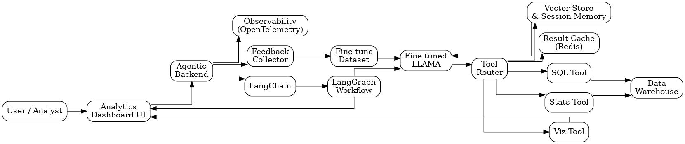

## Introduction: Why We Needed More Than Just a Chatbot

You are a data analyst, it is 9 PM, and you look at your company's analytics dashboard. You must find out why customer churn rose sharply last quarter. You must correlate it with marketing campaigns and prepare a report for tomorrow's board meeting. Traditional dashboards show you the numbers. They do not help you connect the dots or suggest next steps.

That problem started this project. We wanted more than a chat interface in our analytics dashboard. We wanted an agent that reasons about data, runs multi-step analyses, and gives insights that users can act on. The agent answers questions and also helps users explore their data.

## Understanding Agentic AI: Beyond Simple Question-Answering

First, what makes AI "agentic"? Compare a calculator and a mathematician. A calculator turns inputs into outputs. A mathematician divides a complex problem into steps and chooses the right tool for each step. A mathematician also reflects on intermediate results, changes approach after new findings, and explains the reasoning.

Agentic AI systems act like the mathematician. They process queries, plan, execute, observe, and adapt. In our analytics dashboard, the AI retrieves data, forms hypotheses, runs analyses, and iterates on the findings.

## The Architecture Stack: Why LangChain, LangGraph, and Fine-tuned LLAMA?

### LangChain: The Foundation

LangChain gives the building blocks for LLM applications. Think of it as a well-organized toolbox where each tool has one purpose. At a basic level, LangChain helps us:

1. **Chain operations**: Connect LLM calls with data retrievals, API calls, and computations
2. **Manage prompts**: Structure and version our prompts systematically
3. **Handle memory**: Keep context across interactions
4. **Integrate tools**: Connect to databases, APIs, and computation engines

This simple example shows the idea:

```python
from langchain.chains import LLMChain
from langchain.prompts import PromptTemplate
from langchain.llms import LlamaCpp

# Without LangChain - manual string formatting, no structure
def analyze_data_manual(data, question):
    prompt = f"Given this data: {data}, answer: {question}"
    # Manual API call, error handling, parsing...
    
# With LangChain - structured, reusable, maintainable
prompt_template = PromptTemplate(
    input_variables=["data", "question"],
    template="""You are a data analyst. 
    
    Data: {data}
    Question: {question}
    
    Provide a detailed analysis with reasoning steps."""
)

llm = LlamaCpp(model_path="path/to/model")
chain = LLMChain(llm=llm, prompt=prompt_template)

# Clean, reusable interface
result = chain.run(data=sales_data, question="What drives revenue?")
```

### LangGraph: Orchestrating Complex Workflows

LangChain is good at linear chains of operations. Real-world analytics often needs conditional logic, loops, and parallel processing. LangGraph adds these.

LangGraph models your AI workflow as a graph. **Nodes** are actions, such as LLM calls, tool uses, and computations. **Edges** are transitions that depend on conditions. **State** moves through the graph and collects context.

Imagine you plan a road trip. LangChain is like a fixed route. LangGraph is like a GPS that reroutes around traffic and suggests detours to interesting places. It can even change the destination when new information arrives.

This is how we structure an analytical workflow:

```python
from langgraph.graph import StateGraph, END
from typing import TypedDict, List

class AnalyticsState(TypedDict):
    query: str
    data_sources: List[str]
    findings: List[str]
    hypotheses: List[str]
    final_report: str

# Define our workflow graph
workflow = StateGraph(AnalyticsState)

# Add nodes for different analytical steps
workflow.add_node("understand_query", understand_user_query)
workflow.add_node("identify_data", identify_relevant_data)
workflow.add_node("generate_hypotheses", create_hypotheses)
workflow.add_node("test_hypothesis", run_analysis)
workflow.add_node("synthesize", create_report)

# Add conditional edges
workflow.add_conditional_edges(
    "test_hypothesis",
    should_continue_testing,
    {
        "continue": "generate_hypotheses",
        "done": "synthesize"
    }
)
```

### Fine-tuned LLAMA: The Domain Expert

Generic language models are like talented generalists. They know a little about everything, but they can be weak in your specific domain. We fine-tuned LLAMA on our analytics domain. The result was like a specialist who understands our business context, metrics, and analytical patterns.

## The Fine-tuning Journey: Creating Our Analytics Expert

Fine-tuning makes the model better for your use case, not "better" in general. These were our steps.

### Step 1: Data Collection and Curation

We gathered three types of training data:

1. **Historical analytics conversations**: Real interactions between analysts and our data
2. **Domain documentation**: Our metrics definitions, business logic, and best practices
3. **Synthetic examples**: Generated scenarios that cover edge cases

```python
# Example of our training data structure
training_example = {
    "instruction": "Analyze the customer churn rate for Q3 2023",
    "context": {
        "available_metrics": ["churn_rate", "customer_lifetime_value", "nps_score"],
        "time_period": "Q3 2023",
        "previous_period": "Q2 2023"
    },
    "response": """I'll analyze the customer churn rate for Q3 2023.

First, let me retrieve the churn data:
- Q3 2023 churn rate: 5.2%
- Q2 2023 churn rate: 3.8%

This represents a 1.4 percentage point increase. Let me investigate potential causes:

1. Examining cohort behavior...
2. Checking for product changes...
3. Analyzing customer feedback...

[Detailed analysis continues...]"""
}
```

### Step 2: Implementing QLoRA for Efficient Fine-tuning

We used QLoRA (Quantized Low-Rank Adaptation) to fine-tune LLAMA efficiently. It is like teaching someone a specialty, and they keep their general knowledge.

```python
from transformers import AutoModelForCausalLM, AutoTokenizer
from peft import LoraConfig, get_peft_model, prepare_model_for_kbit_training
from transformers import BitsAndBytesConfig
import torch

# Configure 4-bit quantization
bnb_config = BitsAndBytesConfig(
    load_in_4bit=True,
    bnb_4bit_quant_type="nf4",
    bnb_4bit_compute_dtype=torch.bfloat16,
    bnb_4bit_use_double_quant=True
)

# Load base model with quantization
model = AutoModelForCausalLM.from_pretrained(
    "meta-llama/Llama-2-7b-hf",
    quantization_config=bnb_config,
    device_map="auto"
)

# Prepare for training
model = prepare_model_for_kbit_training(model)

# Configure LoRA
peft_config = LoraConfig(
    r=16,  # Rank - think of this as the "capacity" for new knowledge
    lora_alpha=32,  # Scaling parameter
    target_modules=["q_proj", "v_proj"],  # Which parts of the model to adapt
    lora_dropout=0.1,
    bias="none",
    task_type="CAUSAL_LM"
)

model = get_peft_model(model, peft_config)
```

We do not retrain the whole model. We add small, trainable matrices (LoRA adapters) that specialize the model's behavior. It is like adding a special lens to a camera instead of rebuilding the whole optical system.

### Step 3: Training Process and Optimization

Our training had three objectives:

1. **Accuracy**: Interpret analytical queries correctly
2. **Reasoning**: Show clear analytical thinking
3. **Tool usage**: Know when and how to use our analytics tools

```python
from transformers import TrainingArguments, Trainer
from datasets import Dataset

# Prepare dataset
def prepare_dataset(examples):
    # Format examples for instruction tuning
    formatted = []
    for ex in examples:
        text = f"""### Instruction: {ex['instruction']}
### Context: {json.dumps(ex['context'])}
### Response: {ex['response']}"""
        formatted.append(text)
    return formatted

# Training configuration
training_args = TrainingArguments(
    output_dir="./analytics-llama-ft",
    num_train_epochs=3,
    per_device_train_batch_size=4,
    gradient_accumulation_steps=4,  # Effective batch size = 16
    warmup_steps=100,
    logging_steps=25,
    save_strategy="epoch",
    evaluation_strategy="epoch",
    learning_rate=2e-4,
    bf16=True,  # Use bfloat16 for training
    gradient_checkpointing=True,  # Save memory
    max_grad_norm=0.3,  # Gradient clipping
)

# Custom trainer with analytics-specific metrics
class AnalyticsTrainer(Trainer):
    def compute_loss(self, model, inputs, return_outputs=False):
        # Custom loss that weighs analytical reasoning higher
        outputs = model(**inputs)
        loss = outputs.loss
        
        # Add custom penalties/rewards based on output structure
        # (e.g., penalize responses without reasoning steps)
        
        return (loss, outputs) if return_outputs else loss
```

## Building the Analytics Agent: From Concept to Implementation

This section builds the agentic analytics system step by step.

### Core Agent Architecture

Our agent has five main components:

1. **Query Understanding Module**: Interprets user intent
2. **Data Discovery Engine**: Finds relevant data sources
3. **Hypothesis Generator**: Creates testable theories
4. **Analysis Executor**: Runs statistical tests and queries
5. **Insight Synthesizer**: Combines findings into insights that users can act on

```python
from langgraph.graph import StateGraph, END
from langchain.tools import Tool
from typing import List, Dict, Any

# Define our tools
sql_tool = Tool(
    name="execute_sql",
    description="Execute SQL queries against the data warehouse",
    func=execute_sql_query
)

stats_tool = Tool(
    name="statistical_analysis",
    description="Run statistical tests (correlation, regression, etc.)",
    func=run_statistical_analysis
)

viz_tool = Tool(
    name="create_visualization",
    description="Generate charts and graphs",
    func=create_visualization
)

# Agent state definition
class AgentState(TypedDict):
    user_query: str
    parsed_intent: Dict[str, Any]
    relevant_tables: List[str]
    hypotheses: List[str]
    analysis_results: List[Dict]
    visualizations: List[str]
    final_insights: str
    reasoning_trace: List[str]

# Node implementations
async def understand_query(state: AgentState) -> AgentState:
    """Parse user query and extract analytical intent"""
    
    prompt = f"""Analyze this analytics query and extract:
    1. Primary metric of interest
    2. Time period
    3. Comparison dimensions
    4. Analytical depth required (exploratory vs. specific)
    
    Query: {state['user_query']}
    """
    
    response = await llm.ainvoke(prompt)
    state['parsed_intent'] = parse_llm_response(response)
    state['reasoning_trace'].append(f"Understood query: {state['parsed_intent']}")
    
    return state

async def discover_data(state: AgentState) -> AgentState:
    """Find relevant data sources based on parsed intent"""
    
    # Use our fine-tuned model's knowledge of the data schema
    prompt = f"""Given this analytical intent: {state['parsed_intent']}
    
    List all relevant tables and columns from our data warehouse.
    Consider joining patterns and data freshness.
    """
    
    response = await llm.ainvoke(prompt)
    state['relevant_tables'] = extract_tables(response)
    
    # Verify tables exist and user has access
    verified_tables = await verify_table_access(state['relevant_tables'])
    state['relevant_tables'] = verified_tables
    
    return state
```

### The Hypothesis-Driven Analysis Loop

The center of our approach is the hypothesis-driven analysis loop. Our agent does more than run queries. It:

1. Generates hypotheses based on the question
2. Designs tests for each hypothesis
3. Executes analyses
4. Interprets results
5. Generates new hypotheses if needed

```python
async def generate_hypotheses(state: AgentState) -> AgentState:
    """Generate testable hypotheses based on the query and available data"""
    
    prompt = f"""Based on this analytics question: {state['user_query']}
    And available data: {state['relevant_tables']}
    
    Generate 3-5 testable hypotheses. Each hypothesis should:
    1. Be specific and measurable
    2. Include the expected relationship
    3. Specify how to test it
    
    Example format:
    Hypothesis: "Customer churn is positively correlated with support ticket volume"
    Test: "Calculate correlation between monthly churn rate and average tickets per customer"
    """
    
    response = await llm.ainvoke(prompt)
    state['hypotheses'] = parse_hypotheses(response)
    
    return state

async def test_hypothesis(state: AgentState) -> AgentState:
    """Execute analysis for each hypothesis"""
    
    for hypothesis in state['hypotheses']:
        # Design the analysis
        analysis_plan = await design_analysis(hypothesis, state['relevant_tables'])
        
        # Execute queries and statistical tests
        if analysis_plan['type'] == 'sql':
            result = await sql_tool.arun(analysis_plan['query'])
        elif analysis_plan['type'] == 'statistical':
            result = await stats_tool.arun(analysis_plan['params'])
        
        # Interpret results
        interpretation = await interpret_results(result, hypothesis)
        
        state['analysis_results'].append({
            'hypothesis': hypothesis,
            'result': result,
            'interpretation': interpretation,
            'confidence': calculate_confidence(result)
        })
        
        # Create visualization if appropriate
        if should_visualize(result):
            viz = await viz_tool.arun(result)
            state['visualizations'].append(viz)
    
    return state
```

### Implementing Reflection and Self-Correction

Agentic systems can reflect on their work and correct themselves. We built this as a reflection node:

```python
async def reflect_on_analysis(state: AgentState) -> AgentState:
    """Reflect on analysis completeness and quality"""
    
    reflection_prompt = f"""Review this analysis:
    Query: {state['user_query']}
    Hypotheses tested: {len(state['hypotheses'])}
    Results: {summarize_results(state['analysis_results'])}
    
    Consider:
    1. Did we fully answer the original question?
    2. Are there unexplored angles?
    3. Do the results make business sense?
    4. Should we dig deeper into any findings?
    
    Provide a reflection and recommendation.
    """
    
    reflection = await llm.ainvoke(reflection_prompt)
    
    # Decide next action based on reflection
    if should_continue_analysis(reflection):
        # Generate follow-up hypotheses
        state['hypotheses'] = await generate_followup_hypotheses(state)
        return state
    else:
        # Proceed to synthesis
        return state

# Conditional edge function
def should_continue_analysis(state: AgentState) -> str:
    """Decide whether to continue analysis or synthesize results"""
    
    # Check iteration count
    if state.get('iteration_count', 0) > 3:
        return "synthesize"
    
    # Check if reflection suggests more analysis
    if state.get('needs_deeper_analysis', False):
        return "generate_hypotheses"
    
    return "synthesize"
```

### Memory and Context Management

Analytics queries often build on previous interactions, so we built a memory system:

```python
from langchain.memory import ConversationSummaryBufferMemory
from langchain.schema import BaseMessage
import chromadb

class AnalyticsMemory:
    def __init__(self):
        # Short-term memory for current session
        self.session_memory = ConversationSummaryBufferMemory(
            llm=llm,
            max_token_limit=2000
        )
        
        # Long-term memory for insights and patterns
        self.vector_store = chromadb.Client()
        self.insights_collection = self.vector_store.create_collection(
            "analytics_insights"
        )
        
    async def remember_insight(self, insight: Dict[str, Any]):
        """Store important findings for future reference"""
        
        # Create embedding of the insight
        embedding = await create_embedding(insight['summary'])
        
        # Store with metadata
        self.insights_collection.add(
            embeddings=[embedding],
            documents=[insight['detailed_finding']],
            metadatas=[{
                'query': insight['original_query'],
                'timestamp': insight['timestamp'],
                'confidence': insight['confidence'],
                'related_metrics': insight['metrics']
            }],
            ids=[insight['id']]
        )
    
    async def recall_relevant_insights(self, query: str, n_results: int = 5):
        """Retrieve relevant past insights"""
        
        query_embedding = await create_embedding(query)
        
        results = self.insights_collection.query(
            query_embeddings=[query_embedding],
            n_results=n_results
        )
        
        return results
```

## Real-World Implementation: A Complete Example

This real scenario analyzes customer churn with several contributing factors.

```python
# Complete agent setup
class AnalyticsAgent:
    def __init__(self, llm, tools):
        self.llm = llm
        self.tools = tools
        self.memory = AnalyticsMemory()
        self.workflow = self._build_workflow()
        
    def _build_workflow(self):
        workflow = StateGraph(AgentState)
        
        # Add all nodes
        workflow.add_node("understand", understand_query)
        workflow.add_node("discover", discover_data)
        workflow.add_node("hypothesize", generate_hypotheses)
        workflow.add_node("analyze", test_hypothesis)
        workflow.add_node("reflect", reflect_on_analysis)
        workflow.add_node("synthesize", create_final_report)
        
        # Define flow
        workflow.set_entry_point("understand")
        workflow.add_edge("understand", "discover")
        workflow.add_edge("discover", "hypothesize")
        workflow.add_edge("hypothesize", "analyze")
        workflow.add_edge("analyze", "reflect")
        
        # Conditional edge from reflect
        workflow.add_conditional_edges(
            "reflect",
            should_continue_analysis,
            {
                "generate_hypotheses": "hypothesize",
                "synthesize": "synthesize"
            }
        )
        
        workflow.add_edge("synthesize", END)
        
        return workflow.compile()
    
    async def analyze(self, query: str) -> Dict[str, Any]:
        """Run complete analysis for a query"""
        
        # Check for relevant past insights
        past_insights = await self.memory.recall_relevant_insights(query)
        
        # Initialize state
        initial_state = {
            "user_query": query,
            "reasoning_trace": [],
            "past_insights": past_insights,
            "iteration_count": 0
        }
        
        # Run workflow
        result = await self.workflow.ainvoke(initial_state)
        
        # Store valuable insights
        if result.get('valuable_insights'):
            for insight in result['valuable_insights']:
                await self.memory.remember_insight(insight)
        
        return result

# Usage example
agent = AnalyticsAgent(llm=fine_tuned_llama, tools=[sql_tool, stats_tool, viz_tool])

# Complex multi-faceted query
result = await agent.analyze("""
    Why did customer churn increase by 40% last quarter? 
    I need to understand the root causes and predict if this trend will continue.
    Also suggest interventions to reduce churn.
""")

# The agent will:
# 1. Break down the question into components
# 2. Discover relevant data (customer tables, product usage, support tickets, etc.)
# 3. Generate hypotheses like:
#    - "Price increase led to churn"
#    - "Product quality issues increased complaints"
#    - "Competitor launched new feature"
# 4. Test each hypothesis with data
# 5. Reflect on findings and dig deeper where needed
# 6. Synthesize a comprehensive report with visualizations
```

## Handling Edge Cases and Errors

Production systems need good error handling. This is how we handle common scenarios:

```python
class SafeAnalyticsExecutor:
    def __init__(self, timeout: int = 300):
        self.timeout = timeout
        
    async def execute_with_fallback(self, func, *args, **kwargs):
        """Execute function with timeout and fallback strategies"""
        
        try:
            # Primary execution with timeout
            result = await asyncio.wait_for(
                func(*args, **kwargs), 
                timeout=self.timeout
            )
            return result
            
        except asyncio.TimeoutError:
            # Fallback to simpler analysis
            logger.warning(f"Analysis timeout for {func.__name__}")
            return await self.simplified_analysis(*args, **kwargs)
            
        except DatabaseConnectionError:
            # Try cached results
            return await self.get_cached_analysis(*args, **kwargs)
            
        except InsufficientDataError as e:
            # Provide partial analysis with caveats
            return {
                "status": "partial",
                "message": f"Limited analysis due to: {e}",
                "results": await self.partial_analysis(*args, **kwargs)
            }
    
    async def validate_sql_safety(self, query: str) -> bool:
        """Ensure SQL queries are safe to execute"""
        
        dangerous_patterns = [
            r'\bDROP\b', r'\bDELETE\b', r'\bUPDATE\b', 
            r'\bINSERT\b', r'\bCREATE\b', r'\bALTER\b'
        ]
        
        for pattern in dangerous_patterns:
            if re.search(pattern, query, re.IGNORECASE):
                raise SecurityError(f"Unsafe SQL pattern detected: {pattern}")
        
        # Additional checks for query complexity
        if query.count('JOIN') > 5:
            logger.warning("Complex query with many JOINs, may be slow")
        
        return True
```

## Performance Optimization Strategies

As our system grew, we added three optimizations.

### 1. Query Result Caching

```python
from functools import lru_cache
import hashlib

class QueryCache:
    def __init__(self, redis_client):
        self.redis = redis_client
        self.ttl = 3600  # 1 hour default
        
    def cache_key(self, query: str, params: Dict) -> str:
        """Generate deterministic cache key"""
        content = f"{query}:{json.dumps(params, sort_keys=True)}"
        return hashlib.sha256(content.encode()).hexdigest()
    
    async def get_or_compute(self, query: str, params: Dict, compute_func):
        """Try cache first, compute if miss"""
        
        key = self.cache_key(query, params)
        
        # Check cache
        cached = await self.redis.get(key)
        if cached:
            return json.loads(cached)
        
        # Compute and cache
        result = await compute_func(query, params)
        await self.redis.setex(
            key, 
            self.ttl, 
            json.dumps(result)
        )
        
        return result
```

### 2. Parallel Hypothesis Testing

```python
async def test_hypotheses_parallel(hypotheses: List[Dict]) -> List[Dict]:
    """Test multiple hypotheses in parallel"""
    
    # Group by data requirements to optimize queries
    grouped = group_by_data_needs(hypotheses)
    
    tasks = []
    for group, hyps in grouped.items():
        # Fetch data once for the group
        task = test_hypothesis_group(group, hyps)
        tasks.append(task)
    
    # Execute in parallel with concurrency limit
    semaphore = asyncio.Semaphore(5)  # Max 5 concurrent analyses
    
    async def bounded_task(task):
        async with semaphore:
            return await task
    
    results = await asyncio.gather(*[bounded_task(t) for t in tasks])
    
    return flatten_results(results)
```

### 3. Streaming Responses

For a better user experience, we stream results as soon as they are available:

```python
async def stream_analysis(query: str):
    """Stream analysis results as they're generated"""
    
    async def generate():
        # Initial understanding
        yield {"type": "status", "message": "Understanding your query..."}
        intent = await understand_query(query)
        yield {"type": "intent", "data": intent}
        
        # Data discovery
        yield {"type": "status", "message": "Finding relevant data..."}
        tables = await discover_data(intent)
        yield {"type": "data_sources", "data": tables}
        
        # Hypotheses
        yield {"type": "status", "message": "Generating hypotheses..."}
        hypotheses = await generate_hypotheses(intent, tables)
        
        for i, hyp in enumerate(hypotheses):
            yield {"type": "hypothesis", "index": i, "data": hyp}
            
            # Test and stream result
            result = await test_hypothesis(hyp)
            yield {"type": "result", "index": i, "data": result}
            
            # Generate visualization if applicable
            if result['visualizable']:
                viz = await create_visualization(result)
                yield {"type": "visualization", "index": i, "data": viz}
        
        # Final synthesis
        yield {"type": "status", "message": "Synthesizing insights..."}
        synthesis = await synthesize_results(all_results)
        yield {"type": "final_report", "data": synthesis}
    
    return generate()
```

## Lessons Learned and Best Practices

We ran the system in production for six months. These are our main lessons.

### 1. Fine-tuning Quality Matters More Than Quantity

We found that 1,000 high-quality, diverse examples gave better results than 10,000 repetitive ones. Focus on edge cases and complex scenarios, examples that show reasoning steps, and diverse query patterns and data types.

### 2. Agent Behavior Should Be Observable

Add full logging and tracing:

```python
from opentelemetry import trace

tracer = trace.get_tracer(__name__)

async def traced_node(func):
    """Decorator for tracing node execution"""
    async def wrapper(state):
        with tracer.start_as_current_span(func.__name__) as span:
            span.set_attribute("state.query", state.get("user_query", ""))
            span.set_attribute("state.iteration", state.get("iteration_count", 0))
            
            try:
                result = await func(state)
                span.set_attribute("success", True)
                return result
            except Exception as e:
                span.set_attribute("success", False)
                span.set_attribute("error", str(e))
                raise
    
    return wrapper
```

### 3. Graceful Degradation Is Essential

Not every query needs the full agent:

```python
def classify_query_complexity(query: str) -> str:
    """Classify query complexity to route appropriately"""
    
    simple_patterns = [
        r"what is the .+ for .+",
        r"show me .+ from last .+",
        r"how many .+ in .+"
    ]
    
    complex_indicators = [
        "why", "root cause", "correlation", "predict",
        "trend", "anomaly", "compare", "impact"
    ]
    
    if any(re.match(pattern, query.lower()) for pattern in simple_patterns):
        return "simple"
    elif any(indicator in query.lower() for indicator in complex_indicators):
        return "complex"
    else:
        return "medium"

# Route based on complexity
complexity = classify_query_complexity(user_query)

if complexity == "simple":
    # Direct SQL query
    result = await execute_simple_query(user_query)
elif complexity == "medium":
    # Use LangChain without full agent
    result = await run_analytics_chain(user_query)
else:
    # Full agent workflow
    result = await agent.analyze(user_query)
```

### 4. User Feedback Loops Improve the System

Add ways to learn from user interactions:

```python
class FeedbackCollector:
    async def collect_feedback(self, session_id: str, result: Dict):
        """Collect user feedback on analysis quality"""
        
        feedback = {
            "session_id": session_id,
            "result_helpful": None,  # User rates
            "missing_aspects": [],    # What was missed
            "unnecessary_parts": [],  # What was superfluous
            "followed_up": False      # Did user ask follow-up
        }
        
        # Store for future fine-tuning
        await self.store_feedback(feedback)
        
        # If consistently poor feedback, flag for review
        if await self.check_feedback_pattern(session_id):
            await self.alert_improvement_needed(session_id)
```

## Integration with Existing Systems

This is how we connected the agent to our existing analytics infrastructure:

```python
class AnalyticsDashboardIntegration:
    def __init__(self, agent, dashboard_api):
        self.agent = agent
        self.dashboard = dashboard_api
        
    async def handle_dashboard_interaction(self, event: Dict):
        """Handle interactions from the dashboard"""
        
        if event['type'] == 'chart_click':
            # Generate contextual analysis based on what user clicked
            context = await self.get_chart_context(event['chart_id'])
            query = f"Explain the {event['data_point']} in {context['metric']}"
            
        elif event['type'] == 'anomaly_detected':
            # Proactive analysis of anomalies
            query = f"Investigate the anomaly in {event['metric']} at {event['timestamp']}"
            
        result = await self.agent.analyze(query)
        
        # Update dashboard with insights
        await self.dashboard.add_insight_panel(result)
        
        return result
```

## Moving Forward: Advanced Techniques

To go further, explore these topics:

1. **Multi-agent systems**: Several specialized agents that work together
   - [Microsoft's AutoGen framework](https://github.com/microsoft/autogen)
2. **Retrieval Augmented Generation (RAG)** for documentation and historical reports
   - [LangChain's RAG guide](https://python.langchain.com/docs/use_cases/question_answering/)

3. **Advanced prompt engineering**: Few-shot learning and chain-of-thought
   - [Prompt Engineering Guide](https://www.promptingguide.ai/)

4. **Production deployment**: Scaling and monitoring
   - [LangSmith for LLM observability](https://docs.smith.langchain.com/)

## Conclusion: The Journey Continues

Our system keeps changing. We gather more domain-specific training data and improve the agent's reasoning. We add new data sources and analytical tools, and we learn from user interactions.

A successful agentic AI system does not need the most powerful model or the most complex architecture. It needs the right tools, careful fine-tuning for your domain, and a design that can reason, reflect, and improve.

Start small, iterate on real usage, and keep the user's analytical needs at the center of your design. Dashboards show data. Agents like this one also help us understand what the data means and what to do next.

## Code Repository and Resources

The complete implementation, including training scripts and example notebooks, is available at: []

Additional resources:

- [LangChain Documentation](https://python.langchain.com/docs/get_started/introduction)
- [LangGraph Tutorial](https://langchain-ai.github.io/langgraph/)
- [LLAMA Fine-tuning Guide](https://github.com/facebookresearch/llama-recipes)

The best way to learn is to build. Start with a simple analytics question and a basic agent. Add features as you learn more about your users' needs.

Happy building!
