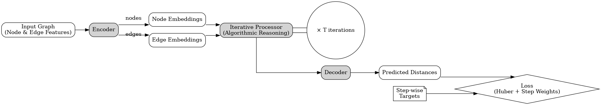
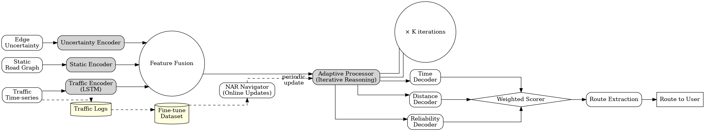

## Introduction: When Neural Networks Meet Classical Algorithms

Imagine you're planning a road trip across the country. You open your favorite navigation app, type in your destination, and within seconds you have the optimal route. Behind this task lie decades of algorithmic research: Dijkstra's algorithm, A\* search, and many optimizations. Can we teach a neural network to _reason_ like these classical algorithms, instead of only memorizing routes?

Neural Algorithmic Reasoning (NAR) tries to do this. It combines the precision of classical algorithms with the learning ability of neural networks. In this post, we explore NAR through a hands-on example. We build intuition for how neural networks can learn to execute algorithms, and why this matters for the future of AI.

## The Big Picture: Why Neural Algorithmic Reasoning?

Before we write code, it helps to see what NAR changes. Traditional approaches to problem-solving fall into two camps.

Classical algorithms are like precise recipes. Given the same input, they always produce the same output. They are interpretable, provably correct, and efficient for their designed purpose. But they are brittle. They cannot adapt to noisy data or learn from experience.

Neural networks are like talented improvisers. They are good at pattern recognition, can handle messy real-world data, and improve with experience. But they are often black boxes, and we cannot guarantee that they always give the correct answer.

Neural Algorithmic Reasoning tries to get both. The goal is a neural network that mimics the step-by-step reasoning of an algorithm and keeps its ability to handle noise and generalize beyond its training data.

## Our Real-World Challenge: Smart City Navigation

We use a concrete problem to ground the discussion. Imagine you design a navigation system for a smart city. The system must:

1. Find shortest paths between locations (classic algorithmic task)
2. Adapt to real-time traffic conditions (requires flexibility)
3. Handle incomplete or noisy sensor data (real-world messiness)
4. Learn from historical patterns (machine learning strength)

We build a neural network that learns to execute the Bellman-Ford algorithm, a classic shortest-path algorithm. The network must also cope with the problems of real-world data.

## Understanding the Bellman-Ford Algorithm

Before teaching a neural network to reason algorithmically, we need to understand the algorithm ourselves. The Bellman-Ford algorithm finds shortest paths from a source node to all other nodes in a weighted graph, even when edges have negative weights.

The algorithm repeatedly "relaxes" edges. If we find a shorter path to a node through a neighbor, we update our distance estimate. After enough iterations, we are guaranteed to find the shortest paths.

Here is a Python implementation:

```python
import numpy as np
import networkx as nx
import matplotlib.pyplot as plt
from typing import Dict, List, Tuple, Optional

def bellman_ford(graph: nx.DiGraph, source: int) -> Tuple[Dict[int, float], Dict[int, Optional[int]]]:
    """
    Classic Bellman-Ford algorithm implementation.

    Args:
        graph: Directed graph with edge weights
        source: Starting node

    Returns:
        distances: Shortest distances from source to all nodes
        predecessors: Previous node in shortest path
    """
    # Initialize distances to infinity, except source
    distances = {node: float('inf') for node in graph.nodes()}
    distances[source] = 0
    predecessors = {node: None for node in graph.nodes()}

    # Relax edges repeatedly
    for _ in range(len(graph.nodes()) - 1):
        for u, v, weight in graph.edges(data='weight'):
            if distances[u] + weight < distances[v]:
                distances[v] = distances[u] + weight
                predecessors[v] = u

    # Check for negative cycles (optional)
    for u, v, weight in graph.edges(data='weight'):
        if distances[u] + weight < distances[v]:
            raise ValueError("Graph contains negative cycle")

    return distances, predecessors

# Let's create a simple city network
def create_city_graph():
    """Create a graph representing city intersections and roads."""
    G = nx.DiGraph()

    # Add intersections (nodes)
    intersections = [
        (0, "Downtown"),
        (1, "University"),
        (2, "Shopping District"),
        (3, "Residential North"),
        (4, "Industrial Park"),
        (5, "Residential South"),
        (6, "Airport")
    ]

    for idx, name in intersections:
        G.add_node(idx, name=name)

    # Add roads (edges) with travel times
    roads = [
        (0, 1, 5),   # Downtown to University: 5 minutes
        (0, 2, 10),  # Downtown to Shopping: 10 minutes
        (1, 3, 7),   # University to Residential North: 7 minutes
        (1, 4, 3),   # University to Industrial: 3 minutes
        (2, 1, 2),   # Shopping to University: 2 minutes
        (2, 5, 8),   # Shopping to Residential South: 8 minutes
        (3, 6, 12),  # Residential North to Airport: 12 minutes
        (4, 6, 15),  # Industrial to Airport: 15 minutes
        (5, 6, 6),   # Residential South to Airport: 6 minutes
        (5, 4, 4)    # Residential South to Industrial: 4 minutes
    ]

    for u, v, weight in roads:
        G.add_edge(u, v, weight=weight)

    return G

# Visualize our city network
city_graph = create_city_graph()
distances, predecessors = bellman_ford(city_graph, 0)

print("Shortest distances from Downtown:")
for node, dist in distances.items():
    name = city_graph.nodes[node]['name']
    print(f"  To {name}: {dist} minutes")
```

## The Neural Algorithmic Reasoning Approach

Instead of hard-coding the Bellman-Ford algorithm, we train a neural network to learn its behavior. We do not train it only on input-output pairs. We teach it to mimic the _intermediate steps_ of the algorithm.

This is like teaching someone to solve math problems by showing every step of the working, not only the final answer. The network learns the algorithmic reasoning process instead of memorizing solutions.

### Architecture: Processor Networks

We use a Processor Network architecture with three main components:

1. **Encoder**: Transforms the input graph into neural representations
2. **Processor**: Performs iterative reasoning (mimicking algorithm steps)
3. **Decoder**: Extracts the final answer from neural representations



Here is the implementation, step by step:

```python
import torch
import torch.nn as nn
import torch.nn.functional as F
from torch_geometric.nn import MessagePassing
from torch_geometric.data import Data

class GraphEncoder(nn.Module):
    """Encode graph structure and features into neural representations."""

    def __init__(self, node_features: int, edge_features: int, hidden_dim: int):
        super().__init__()
        self.node_encoder = nn.Linear(node_features, hidden_dim)
        self.edge_encoder = nn.Linear(edge_features, hidden_dim)
        self.hidden_dim = hidden_dim

    def forward(self, node_features: torch.Tensor, edge_features: torch.Tensor):
        """
        Encode nodes and edges into hidden representations.

        This is like translating the problem into a language the neural network understands.
        """
        node_hidden = F.relu(self.node_encoder(node_features))
        edge_hidden = F.relu(self.edge_encoder(edge_features))
        return node_hidden, edge_hidden

class AlgorithmicProcessor(MessagePassing):
    """
    The heart of NAR: a neural network that mimics algorithmic steps.

    This uses message passing to simulate how algorithms propagate information
    through a graph structure.
    """

    def __init__(self, hidden_dim: int):
        super().__init__(aggr='min')  # Min aggregation mimics Bellman-Ford's relaxation
        self.hidden_dim = hidden_dim

        # Neural network components for processing messages
        self.message_mlp = nn.Sequential(
            nn.Linear(3 * hidden_dim, hidden_dim),
            nn.ReLU(),
            nn.Linear(hidden_dim, hidden_dim)
        )

        self.update_mlp = nn.Sequential(
            nn.Linear(2 * hidden_dim, hidden_dim),
            nn.ReLU(),
            nn.Linear(hidden_dim, hidden_dim)
        )

        # Gating mechanism for selective updates (mimics conditional logic)
        self.gate = nn.Sequential(
            nn.Linear(2 * hidden_dim, hidden_dim),
            nn.ReLU(),
            nn.Linear(hidden_dim, 1),
            nn.Sigmoid()
        )

    def forward(self, x: torch.Tensor, edge_index: torch.Tensor,
                edge_attr: torch.Tensor) -> torch.Tensor:
        """
        Perform one step of algorithmic reasoning.

        This is analogous to one iteration of the Bellman-Ford algorithm.
        """
        return self.propagate(edge_index, x=x, edge_attr=edge_attr)

    def message(self, x_i: torch.Tensor, x_j: torch.Tensor,
                edge_attr: torch.Tensor) -> torch.Tensor:
        """
        Compute messages between nodes.

        In Bellman-Ford, this would be: distance[u] + weight(u,v)
        """
        # Concatenate source node, destination node, and edge features
        combined = torch.cat([x_i, x_j, edge_attr], dim=-1)
        return self.message_mlp(combined)

    def update(self, aggr_out: torch.Tensor, x: torch.Tensor) -> torch.Tensor:
        """
        Update node representations based on aggregated messages.

        This mimics the relaxation step: if new_dist < current_dist, update
        """
        # Compute gate values (should we update?)
        gate_input = torch.cat([aggr_out, x], dim=-1)
        gate_values = self.gate(gate_input)

        # Compute potential new values
        update_input = torch.cat([aggr_out, x], dim=-1)
        new_values = self.update_mlp(update_input)

        # Selectively update (gating mechanism)
        return gate_values * new_values + (1 - gate_values) * x

class NeuralBellmanFord(nn.Module):
    """
    Complete Neural Algorithmic Reasoning model for shortest path computation.
    """

    def __init__(self, node_features: int, edge_features: int, hidden_dim: int,
                 num_iterations: int):
        super().__init__()
        self.encoder = GraphEncoder(node_features, edge_features, hidden_dim)
        self.processor = AlgorithmicProcessor(hidden_dim)
        self.decoder = nn.Linear(hidden_dim, 1)  # Output: distance value
        self.num_iterations = num_iterations

    def forward(self, data: Data) -> Tuple[torch.Tensor, List[torch.Tensor]]:
        """
        Execute neural algorithmic reasoning.

        Returns both final distances and intermediate steps for interpretability.
        """
        # Encode input
        node_hidden, edge_hidden = self.encoder(data.x, data.edge_attr)

        # Store intermediate steps (for visualization and learning)
        intermediate_distances = []

        # Iterative processing (mimicking algorithm iterations)
        current_hidden = node_hidden
        for _ in range(self.num_iterations):
            current_hidden = self.processor(current_hidden, data.edge_index, edge_hidden)

            # Decode current distances
            current_distances = self.decoder(current_hidden)
            intermediate_distances.append(current_distances)

        final_distances = intermediate_distances[-1]
        return final_distances, intermediate_distances
```

## Training the Neural Algorithmic Reasoner

NAR supervises every step. We show the network how the distances change at each iteration of the algorithm, not only the final shortest paths. This teaches the network the reasoning process as well as the answer.

```python
def generate_training_data(num_graphs: int, min_nodes: int = 5, max_nodes: int = 15):
    """
    Generate random graphs with ground truth Bellman-Ford executions.

    This creates our curriculum: from simple graphs to complex ones.
    """
    training_data = []

    for _ in range(num_graphs):
        # Create random graph
        num_nodes = np.random.randint(min_nodes, max_nodes + 1)
        G = nx.erdos_renyi_graph(num_nodes, 0.3, directed=True)

        # Add weights (including some negative ones for interesting cases)
        for (u, v) in G.edges():
            weight = np.random.uniform(-2, 10)
            G[u][v]['weight'] = weight

        # Choose random source
        source = np.random.randint(0, num_nodes)

        # Execute Bellman-Ford and record all intermediate steps
        distances_history = execute_bellman_ford_with_history(G, source)

        # Convert to PyTorch geometric data
        data = graph_to_pytorch_geometric(G, source, distances_history)
        training_data.append(data)

    return training_data

def execute_bellman_ford_with_history(graph: nx.DiGraph, source: int) -> List[Dict[int, float]]:
    """
    Execute Bellman-Ford while recording state at each iteration.

    This gives us the step-by-step supervision signal.
    """
    distances = {node: float('inf') for node in graph.nodes()}
    distances[source] = 0
    history = [distances.copy()]

    for iteration in range(len(graph.nodes()) - 1):
        updated = False
        for u, v, weight in graph.edges(data='weight'):
            if distances[u] + weight < distances[v]:
                distances[v] = distances[u] + weight
                updated = True

        history.append(distances.copy())

        if not updated:  # Early stopping if converged
            break

    return history

def train_neural_bellman_ford(model: NeuralBellmanFord, train_data: List[Data],
                            num_epochs: int = 100, lr: float = 0.01):
    """
    Train the neural network to mimic Bellman-Ford execution.

    Key insight: We supervise at every algorithmic step, not just the final output.
    """
    optimizer = torch.optim.Adam(model.parameters(), lr=lr)

    for epoch in range(num_epochs):
        total_loss = 0

        for data in train_data:
            optimizer.zero_grad()

            # Forward pass
            final_distances, intermediate_distances = model(data)

            # Compute loss at each step (algorithmic supervision)
            loss = 0
            for step, pred_distances in enumerate(intermediate_distances):
                if step < len(data.y_history):
                    target_distances = data.y_history[step]

                    # Use Huber loss (robust to outliers)
                    step_loss = F.huber_loss(pred_distances, target_distances)

                    # Weight later steps more (they're harder to predict)
                    weight = (step + 1) / len(intermediate_distances)
                    loss += weight * step_loss

            # Backward pass
            loss.backward()
            optimizer.step()

            total_loss += loss.item()

        if epoch % 10 == 0:
            print(f"Epoch {epoch}, Average Loss: {total_loss / len(train_data):.4f}")

    return model

# Let's see it in action!
def visualize_neural_reasoning(model: NeuralBellmanFord, test_graph: nx.DiGraph,
                              source: int):
    """
    Visualize how the neural network reasons through the problem.

    This shows the learned algorithmic behavior.
    """
    # Convert graph to model input
    data = graph_to_pytorch_geometric(test_graph, source, None)

    # Get predictions
    with torch.no_grad():
        final_distances, intermediate_distances = model(data)

    # Create visualization
    fig, axes = plt.subplots(2, 3, figsize=(15, 10))
    axes = axes.flatten()

    # Show first few iterations
    for i, (ax, distances) in enumerate(zip(axes, intermediate_distances[:6])):
        # Convert predictions to numpy
        pred_distances = distances.numpy().flatten()

        # Create node colors based on distances
        node_colors = plt.cm.viridis(pred_distances / pred_distances.max())

        # Draw graph
        pos = nx.spring_layout(test_graph, seed=42)
        nx.draw(test_graph, pos, ax=ax, node_color=node_colors,
                with_labels=True, node_size=500)

        ax.set_title(f"Iteration {i+1}")

    plt.tight_layout()
    plt.show()
```

## Beyond Simple Paths: Handling Real-World Complexity

Next, we make the system more realistic. Real city navigation must handle:

1. Dynamic traffic conditions
2. Road closures and construction
3. Multiple optimization criteria (time, distance, fuel efficiency)
4. Uncertainty in travel times

Here is how NAR handles these scenarios:

```python
class RobustNeuralNavigator(nn.Module):
    """
    Enhanced NAR model that handles real-world navigation challenges.
    """

    def __init__(self, hidden_dim: int, num_iterations: int):
        super().__init__()

        # Multiple encoders for different input modalities
        self.static_encoder = GraphEncoder(2, 3, hidden_dim)  # Road network
        self.dynamic_encoder = nn.LSTM(hidden_dim, hidden_dim, batch_first=True)  # Traffic patterns
        self.uncertainty_encoder = nn.Linear(2, hidden_dim)  # Mean and variance

        # Adaptive processor that adjusts to conditions
        self.processor = AdaptiveAlgorithmicProcessor(hidden_dim)

        # Multi-objective decoder
        self.time_decoder = nn.Linear(hidden_dim, 1)
        self.distance_decoder = nn.Linear(hidden_dim, 1)
        self.reliability_decoder = nn.Linear(hidden_dim, 1)

        self.num_iterations = num_iterations

    def forward(self, static_graph: Data, traffic_sequence: torch.Tensor,
                uncertainty_estimates: torch.Tensor) -> Dict[str, torch.Tensor]:
        """
        Compute routes considering multiple factors.
        """
        # Encode static road network
        node_hidden, edge_hidden = self.static_encoder(
            static_graph.x, static_graph.edge_attr
        )

        # Encode dynamic traffic patterns
        _, (traffic_hidden, _) = self.dynamic_encoder(traffic_sequence)
        traffic_hidden = traffic_hidden.squeeze(0)

        # Encode uncertainty
        uncertainty_hidden = self.uncertainty_encoder(uncertainty_estimates)

        # Combine all information
        combined_node_features = node_hidden + traffic_hidden + uncertainty_hidden

        # Run adaptive algorithmic reasoning
        current_hidden = combined_node_features
        for i in range(self.num_iterations):
            # Adjust processing based on uncertainty
            adaptation_factor = torch.sigmoid(uncertainty_estimates[:, 1].mean())
            current_hidden = self.processor(
                current_hidden, static_graph.edge_index, edge_hidden,
                adaptation_factor
            )

        # Decode multiple objectives
        return {
            'time': self.time_decoder(current_hidden),
            'distance': self.distance_decoder(current_hidden),
            'reliability': self.reliability_decoder(current_hidden)
        }

class AdaptiveAlgorithmicProcessor(MessagePassing):
    """
    Processor that adapts its behavior based on uncertainty and conditions.

    This goes beyond standard algorithms by adjusting to real-world messiness.
    """

    def __init__(self, hidden_dim: int):
        super().__init__(aggr='add')
        self.hidden_dim = hidden_dim

        # Learnable algorithm components
        self.deterministic_processor = AlgorithmicProcessor(hidden_dim)
        self.stochastic_processor = nn.GRUCell(hidden_dim, hidden_dim)

        # Adaptation network
        self.adaptation_mlp = nn.Sequential(
            nn.Linear(hidden_dim + 1, hidden_dim),
            nn.ReLU(),
            nn.Linear(hidden_dim, hidden_dim),
            nn.Sigmoid()
        )

    def forward(self, x: torch.Tensor, edge_index: torch.Tensor,
                edge_attr: torch.Tensor, adaptation_factor: float) -> torch.Tensor:
        """
        Blend deterministic and stochastic processing based on conditions.
        """
        # Deterministic processing (standard algorithm)
        deterministic_output = self.deterministic_processor(x, edge_index, edge_attr)

        # Stochastic processing (handles uncertainty)
        stochastic_output = self.stochastic_processor(x, deterministic_output)

        # Adaptive blending
        adaptation_weights = self.adaptation_mlp(
            torch.cat([x, adaptation_factor.unsqueeze(-1).expand(-1, 1)], dim=-1)
        )

        return adaptation_weights * stochastic_output + (1 - adaptation_weights) * deterministic_output
```

## Putting It All Together: A Complete Navigation System

This complete example combines the pieces:



```python
class SmartCityNavigationSystem:
    """
    Complete navigation system using Neural Algorithmic Reasoning.
    """

    def __init__(self, city_graph: nx.DiGraph):
        self.city_graph = city_graph
        self.model = RobustNeuralNavigator(hidden_dim=64, num_iterations=10)
        self.traffic_history = []
        self.model_trained = False

    def collect_traffic_data(self, num_days: int = 30):
        """
        Simulate collecting real-world traffic data.
        """
        print("Collecting traffic patterns...")

        for day in range(num_days):
            daily_traffic = {}

            for u, v in self.city_graph.edges():
                base_time = self.city_graph[u][v]['weight']

                # Morning rush hour
                morning_factor = np.random.normal(1.5, 0.3) if 7 <= (day % 24) <= 9 else 1.0

                # Evening rush hour
                evening_factor = np.random.normal(1.8, 0.4) if 17 <= (day % 24) <= 19 else 1.0

                # Random events (accidents, construction)
                random_event = np.random.exponential(0.1) if np.random.random() < 0.05 else 0

                actual_time = base_time * max(morning_factor, evening_factor) + random_event
                uncertainty = np.random.gamma(2, 0.5)

                daily_traffic[(u, v)] = {
                    'time': actual_time,
                    'uncertainty': uncertainty
                }

            self.traffic_history.append(daily_traffic)

    def train_navigation_model(self):
        """
        Train the neural reasoner on collected data.
        """
        print("Training neural navigation model...")

        # Generate training examples
        training_data = []

        for traffic_snapshot in self.traffic_history:
            # Update graph with current traffic
            for (u, v), data in traffic_snapshot.items():
                self.city_graph[u][v]['current_weight'] = data['time']
                self.city_graph[u][v]['uncertainty'] = data['uncertainty']

            # Generate multiple source-destination pairs
            for source in range(len(self.city_graph.nodes())):
                # Run classical algorithm for ground truth
                try:
                    distances, _ = bellman_ford(self.city_graph, source)

                    # Create training example
                    example = self.create_training_example(
                        self.city_graph, source, distances, traffic_snapshot
                    )
                    training_data.append(example)
                except ValueError:
                    continue  # Skip if negative cycle

        # Train model
        self.model = train_neural_bellman_ford(self.model, training_data)
        self.model_trained = True

    def find_route(self, start: str, destination: str,
                   preferences: Dict[str, float] = None) -> Dict[str, any]:
        """
        Find optimal route using trained neural reasoner.
        """
        if not self.model_trained:
            raise RuntimeError("Model must be trained before routing")

        # Default preferences
        if preferences is None:
            preferences = {
                'time': 0.6,
                'distance': 0.2,
                'reliability': 0.2
            }

        # Convert location names to node indices
        node_names = nx.get_node_attributes(self.city_graph, 'name')
        name_to_node = {v: k for k, v in node_names.items()}

        start_node = name_to_node[start]
        dest_node = name_to_node[destination]

        # Prepare current traffic data
        current_traffic = self.get_current_traffic()

        # Run neural reasoner
        with torch.no_grad():
            predictions = self.model(
                graph_to_pytorch_geometric(self.city_graph, start_node, None),
                current_traffic['sequence'],
                current_traffic['uncertainty']
            )

        # Combine objectives based on preferences
        combined_score = sum(
            preferences[obj] * predictions[obj]
            for obj in ['time', 'distance', 'reliability']
        )

        # Extract path using learned representations
        path = self.extract_path(start_node, dest_node, combined_score)

        # Calculate route statistics
        total_time = sum(
            self.city_graph[u][v].get('current_weight', self.city_graph[u][v]['weight'])
            for u, v in zip(path[:-1], path[1:])
        )

        reliability = np.mean([
            1.0 / (1.0 + self.city_graph[u][v].get('uncertainty', 0.1))
            for u, v in zip(path[:-1], path[1:])
        ])

        return {
            'path': [node_names[node] for node in path],
            'estimated_time': total_time,
            'reliability': reliability,
            'alternative_routes': self.find_alternative_routes(
                start_node, dest_node, path
            )
        }

# Let's test our system!
def demo_smart_navigation():
    """
    Demonstrate the complete navigation system in action.
    """
    # Create city network
    city = create_city_graph()

    # Initialize navigation system
    nav_system = SmartCityNavigationSystem(city)

    # Collect traffic data
    nav_system.collect_traffic_data(num_days=30)

    # Train neural reasoner
    nav_system.train_navigation_model()

    # Find routes with different preferences
    print("\n=== Route Planning Demo ===\n")

    # Fastest route
    print("1. Fastest Route (Time-optimized):")
    route1 = nav_system.find_route(
        "Downtown", "Airport",
        preferences={'time': 0.8, 'distance': 0.1, 'reliability': 0.1}
    )
    print(f"   Path: {' -> '.join(route1['path'])}")
    print(f"   Estimated time: {route1['estimated_time']:.1f} minutes")
    print(f"   Reliability: {route1['reliability']:.2%}\n")

    # Most reliable route
    print("2. Most Reliable Route (Consistency-optimized):")
    route2 = nav_system.find_route(
        "Downtown", "Airport",
        preferences={'time': 0.2, 'distance': 0.1, 'reliability': 0.7}
    )
    print(f"   Path: {' -> '.join(route2['path'])}")
    print(f"   Estimated time: {route2['estimated_time']:.1f} minutes")
    print(f"   Reliability: {route2['reliability']:.2%}\n")

    # Balanced route
    print("3. Balanced Route:")
    route3 = nav_system.find_route("Downtown", "Airport")
    print(f"   Path: {' -> '.join(route3['path'])}")
    print(f"   Estimated time: {route3['estimated_time']:.1f} minutes")
    print(f"   Reliability: {route3['reliability']:.2%}")

    return nav_system

# Run the demo
if __name__ == "__main__":
    nav_system = demo_smart_navigation()
```

## Key Insights and Takeaways

Building the neural navigation system shows several properties of Neural Algorithmic Reasoning.

### 1. Interpretability Through Process

Standard neural networks are black boxes. NAR models learn interpretable reasoning steps. We can inspect the intermediate computations and see how the model reaches its decisions, the same way we trace the execution of an algorithm.

### 2. Robustness to Real-World Messiness

Classical algorithms assume perfect inputs. Our neural reasoner handles noisy sensor data, missing information, dynamic conditions, and multiple competing objectives.

### 3. Generalization Beyond Training

The model learns algorithmic _principles_ instead of memorizing solutions. This can help it generalize to larger graphs than it saw during training, to different graph structures, and to new combinations of conditions.

### 4. Efficient Learning Through Algorithmic Supervision

The model gets supervision on intermediate steps, not only on final outputs. So it learns much more efficiently than end-to-end approaches, in the same way that worked examples teach math better than answers alone.

## Advanced Topics and Future Directions

Neural Algorithmic Reasoning opens several research directions.

### Learning Unknown Algorithms

Can we discover new algorithms by training neural networks on problem instances alone? Researchers are exploring how NAR can help us find new algorithmic solutions to classical problems.

### Compositional Reasoning

We compose simple algorithms into complex systems, and we can compose neural reasoners in the same way. For example, we can combine shortest-path reasoning with constraint satisfaction for complex logistics planning.

### Continuous Relaxations of Discrete Algorithms

Many algorithms operate on discrete structures. NAR creates continuous relaxations of these algorithms. Gradient descent can optimize the relaxations, and the algorithmic structure stays in place.

### Meta-Learning Algorithmic Strategies

Instead of learning a single algorithm, models could learn to select and adapt different algorithmic strategies based on the problem characteristics, as an expert programmer chooses the right tool for the job.

## Practical Implementation Tips

If you want to implement NAR in your own projects, these tips help:

1. **Start Simple**: Begin with well-understood algorithms like sorting or graph traversal before you attempt complex problems.

2. **Supervise Generously**: The more intermediate supervision you give, the better the model learns algorithmic reasoning.

3. **Use Appropriate Architectures**: Graph Neural Networks suit graph algorithms. Transformers suit sequence-based algorithms.

4. **Curriculum Learning**: Train on simple instances first, then increase the complexity step by step. Humans learn algorithms in the same order.

5. **Combine Classical and Neural**: Use NAR for the messy real-world parts, and keep classical algorithmic guarantees where you need them.

## Conclusion: The Best of Both Worlds

Neural Algorithmic Reasoning combines symbolic reasoning with neural learning. When we teach neural networks to think algorithmically, we get systems that are both principled and flexible, interpretable and adaptive.

In our navigation example, NAR took a classical algorithm (Bellman-Ford) and added tolerance to noise and uncertainty, a balance of multiple objectives, adaptation to dynamic conditions, and learning from historical patterns.
Better algorithmic supervision and better neural architectures can give us AI systems that follow logical steps to solve complex problems, in addition to recognizing patterns.

## References and Further Reading

For more on Neural Algorithmic Reasoning:

1. **"Neural Algorithmic Reasoning"** - Veličković & Blundell (2021): The position paper that named and framed NAR.

2. **"Neural Execution of Graph Algorithms"** - Veličković et al. (2020): Trains graph networks to execute BFS and Bellman-Ford step by step.

3. **"The CLRS Algorithmic Reasoning Benchmark"** - Veličković et al. (2022): A benchmark for evaluating NAR approaches.

4. **"What can transformers learn in-context? A case study of simple function classes"** - Garg et al. (2022): Shows that transformers can learn simple function classes, such as linear functions, in context.

5. **"Learning to Execute"** - Zaremba & Sutskever (2014): An early work showing neural networks can learn to execute simple programs.

The code examples in this post are a starting point for NAR experiments. Start with the Bellman–Ford code above. Then vary the graph distribution, supervision signal, and evaluation split, and keep the classical baseline visible.
