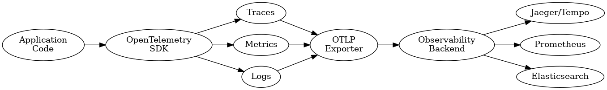
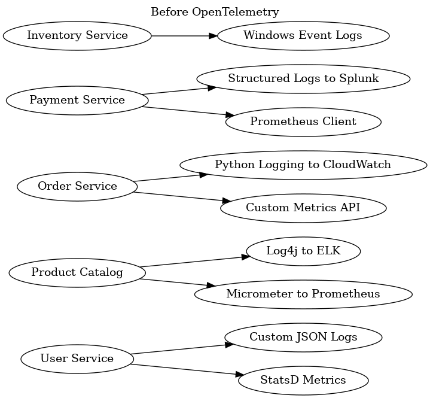
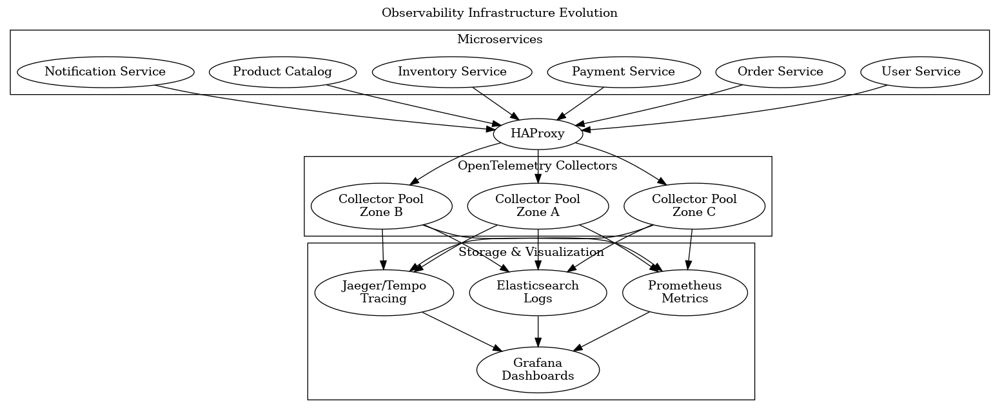
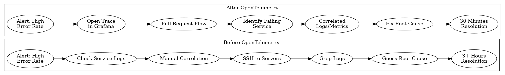

## Introduction: The Observability Challenge We Faced

It is 3 AM, and an alert wakes you. Your e-commerce platform has intermittent failures, and the error messages are cryptic. Your logs are spread across dozens of microservices. Your metrics live in three different systems, and your traces stop at service boundaries.

That was our situation eighteen months ago. Our architecture grew from a handful of services to over forty. Each service had its own logging approach, its own metrics collection, and sparse tracing. We needed one observability strategy, and we found OpenTelemetry.

## Understanding OpenTelemetry: The Foundation of Modern Observability

First, here is what OpenTelemetry is and why it matters for microservices.

OpenTelemetry (OTel) is an open-source observability framework. It gives you one standard way to collect and export telemetry data. Think of it as a universal translator for your application's core signals. It understands logs, metrics, and traces, and it converts them into formats that many observability backends can read.

OpenTelemetry came from the merger of two earlier projects, OpenTracing and OpenCensus. The merged project is a vendor-neutral CNCF standard, and most major observability vendors support it. It covers all three pillars of observability:

**1. Traces** follow a request as it travels through your system, like a trail of breadcrumbs through a forest of microservices.

**2. Metrics** give operating statistics, the heartbeat, blood pressure, and temperature of your applications.

**3. Logs** record the details of "what happened and when," so you can understand system behavior.


*OpenTelemetry Pipeline: How traces, metrics, and logs flow from application code through the SDK to observability backends*

## Our Architecture: Before the Transformation

To see why OpenTelemetry mattered for us, look at where we started. Our e-commerce platform had these services:

- **API Gateway**: Built with Kong, handles request routing
- **User Service**: Node.js application for authentication and profiles
- **Product Catalog**: Java Spring Boot service with PostgreSQL
- **Order Service**: Python FastAPI with MongoDB
- **Payment Service**: Go microservice integrating with payment providers
- **Inventory Service**: .NET Core service with SQL Server
- **Notification Service**: Node.js service for emails and SMS
- **Recommendation Engine**: Python service with machine learning models

Each service grew independently, so our observability was a Tower of Babel:


*Our heterogeneous observability landscape before OpenTelemetry: Each service used different logging, metrics, and tracing approaches*

This mix caused five problems:

1. **Hard correlation**: To trace one user request across services, we matched timestamps and user IDs by hand
2. **Monitoring overhead**: We maintained five different monitoring dashboards
3. **Knowledge silos**: Each team understood only the observability tools of its own service
4. **Slow debugging**: Root cause analysis for cross-service issues took hours or days
5. **Wasted cost**: We paid several observability vendors for overlapping features

## Why We Chose OpenTelemetry: The Decision Matrix

We evaluated three main approaches:

1. **Standardize on a single vendor**: Lock into one observability platform
2. **Build a custom abstraction layer**: Create our own instrumentation framework
3. **Adopt OpenTelemetry**: Implement the open standard

We judged them on five factors.

**Vendor independence** came first. Vendor lock-in hurt us before. With vendor-neutral OpenTelemetry, we could switch backends and keep our instrumentation code. As Alistair Cockburn explains in the original [Hexagonal Architecture](https://alistair.cockburn.us/hexagonal-architecture) article, infrastructure concerns at the edges of your system keep it flexible.

**Language support** mattered because we use many languages. OpenTelemetry supports all of them well, with consistent APIs across platforms. So our Node.js and Java developers could use the same observability terms.

**Community and ecosystem** health showed long-term viability. Major cloud providers and observability vendors back OpenTelemetry. The CNCF's [2023 survey](https://www.cncf.io/reports/cncf-annual-survey-2023/) reported wider adoption of OpenTelemetry in 2023.

**Performance overhead** worried us. In our benchmarks, a well-configured OpenTelemetry added less than 3% overhead, which fit our performance SLAs.

**Migration path** had to be gradual. OpenTelemetry works with existing standards, so we could migrate one service at a time instead of all at once.

## Implementation Strategy: The Phased Approach

We did not instrument everything at once. We worked in phases to reduce risk and learn as we went.

### Phase 1: Establishing the Foundation (Months 1-2)

We started with the OpenTelemetry Collector as our central telemetry hub. The Collector is a Swiss Army knife for telemetry data. It receives data in many formats, processes it, and exports it to different backends.

```yaml
# otel-collector-config.yaml
receivers:
  otlp:
    protocols:
      grpc:
        endpoint: 0.0.0.0:4317
      http:
        endpoint: 0.0.0.0:4318

  # Bridge for existing Prometheus metrics
  prometheus:
    config:
      scrape_configs:
        - job_name: 'legacy-services'
          static_configs:
            - targets: ['inventory-service:9090']

processors:
  batch:
    timeout: 1s
    send_batch_size: 1024

  memory_limiter:
    check_interval: 1s
    limit_mib: 512

  resource:
    attributes:
      - key: environment
        value: production
        action: upsert

exporters:
  # Jaeger accepts OTLP natively; the old "jaeger" exporter was removed in Collector v0.85
  otlp/jaeger:
    endpoint: jaeger-collector:4317
    tls:
      insecure: false

  prometheus:
    endpoint: "0.0.0.0:8889"

  elasticsearch:
    endpoints: ["https://es-cluster:9200"]
    logs_index: otel-logs

service:
  pipelines:
    traces:
      receivers: [otlp]
      processors: [memory_limiter, batch]
      exporters: [otlp/jaeger]

    metrics:
      receivers: [otlp, prometheus]
      processors: [memory_limiter, batch]
      exporters: [prometheus]

    logs:
      receivers: [otlp]
      processors: [memory_limiter, batch, resource]
      exporters: [elasticsearch]
```

This configuration has three design decisions:

1. **Protocol support**: We enabled both gRPC and HTTP, because different services prefer different protocols
2. **Backward compatibility**: The Prometheus receiver kept collecting metrics from services that we did not migrate yet
3. **Processing pipeline**: The batch processor improved efficiency, and the memory limiter prevented resource exhaustion

### Phase 2: Pilot Service Implementation (Months 2-3)

We chose the Order Service as our pilot. It was critical enough to test our approach and small enough to iterate quickly. It had clear boundaries with other services, and the Python team wanted better observability.

This is how we instrumented the Order Service:

```python
# order_service/telemetry.py
import os
from opentelemetry import trace, metrics
from opentelemetry.sdk.trace import TracerProvider
from opentelemetry.sdk.trace.export import BatchSpanProcessor
from opentelemetry.sdk.metrics import MeterProvider
from opentelemetry.sdk.metrics.export import PeriodicExportingMetricReader
from opentelemetry.exporter.otlp.proto.grpc.trace_exporter import OTLPSpanExporter
from opentelemetry.exporter.otlp.proto.grpc.metric_exporter import OTLPMetricExporter
from opentelemetry.instrumentation.fastapi import FastAPIInstrumentor
from opentelemetry.instrumentation.pymongo import PymongoInstrumentor
from opentelemetry.instrumentation.requests import RequestsInstrumentor
from opentelemetry.sdk.resources import Resource
from opentelemetry.semconv.resource import ResourceAttributes

def configure_telemetry(app_name: str, app_version: str):
    """
    Configure OpenTelemetry for the Order Service.
    This setup ensures we capture traces, metrics, and logs with proper context.
    """

    # Define resource attributes that identify this service
    resource = Resource(attributes={
        ResourceAttributes.SERVICE_NAME: app_name,
        ResourceAttributes.SERVICE_VERSION: app_version,
        ResourceAttributes.DEPLOYMENT_ENVIRONMENT: os.getenv("ENVIRONMENT", "production"),
        "team": "orders-team",
        "language": "python"
    })

    # Configure Tracing
    tracer_provider = TracerProvider(resource=resource)

    # Set up the OTLP exporter for traces
    otlp_trace_exporter = OTLPSpanExporter(
        endpoint=os.getenv("OTEL_EXPORTER_OTLP_ENDPOINT", "otel-collector:4317"),
        insecure=os.getenv("OTEL_EXPORTER_OTLP_INSECURE", "true").lower() == "true"
    )

    # Use BatchSpanProcessor for better performance
    span_processor = BatchSpanProcessor(
        otlp_trace_exporter,
        max_export_batch_size=512,
        max_queue_size=2048,
        schedule_delay_millis=5000
    )

    tracer_provider.add_span_processor(span_processor)
    trace.set_tracer_provider(tracer_provider)

    # Configure Metrics
    metric_reader = PeriodicExportingMetricReader(
        OTLPMetricExporter(
            endpoint=os.getenv("OTEL_EXPORTER_OTLP_ENDPOINT", "otel-collector:4317"),
            insecure=os.getenv("OTEL_EXPORTER_OTLP_INSECURE", "true").lower() == "true"
        ),
        export_interval_millis=60000  # Export metrics every minute
    )

    meter_provider = MeterProvider(
        resource=resource,
        metric_readers=[metric_reader]
    )
    metrics.set_meter_provider(meter_provider)

    # Auto-instrument libraries
    FastAPIInstrumentor().instrument(tracer_provider=tracer_provider)
    PymongoInstrumentor().instrument(tracer_provider=tracer_provider)
    RequestsInstrumentor().instrument(tracer_provider=tracer_provider)

    return trace.get_tracer(app_name), metrics.get_meter(app_name)

# order_service/main.py
from fastapi import FastAPI, Request
from contextlib import asynccontextmanager
import time
from telemetry import configure_telemetry
from opentelemetry import trace
from opentelemetry.trace import Status, StatusCode

# Initialize telemetry before creating the app
tracer, meter = configure_telemetry("order-service", "1.2.0")

# Create metrics instruments
order_counter = meter.create_counter(
    "orders_created_total",
    description="Total number of orders created",
    unit="orders"
)

order_value_histogram = meter.create_histogram(
    "order_value_dollars",
    description="Distribution of order values",
    unit="dollars"
)

order_processing_duration = meter.create_histogram(
    "order_processing_duration_seconds",
    description="Time taken to process an order",
    unit="seconds"
)

@asynccontextmanager
async def lifespan(app: FastAPI):
    # Startup
    print("Starting Order Service with OpenTelemetry instrumentation")
    yield
    # Shutdown
    print("Shutting down Order Service")

app = FastAPI(lifespan=lifespan)

@app.post("/orders")
async def create_order(request: Request, order_data: dict):
    """
    Create a new order with comprehensive telemetry.
    This demonstrates manual instrumentation alongside auto-instrumentation.
    """

    # Get the current span from auto-instrumentation
    current_span = trace.get_current_span()

    # Add custom attributes to the span
    current_span.set_attribute("order.customer_id", order_data.get("customer_id"))
    current_span.set_attribute("order.total_items", len(order_data.get("items", [])))

    start_time = time.time()

    try:
        # Create a child span for inventory check
        with tracer.start_as_current_span("check_inventory") as inventory_span:
            inventory_span.set_attribute("items.count", len(order_data.get("items", [])))

            # Simulate inventory check
            available = await check_inventory(order_data["items"])

            if not available:
                inventory_span.set_status(Status(StatusCode.ERROR, "Insufficient inventory"))
                raise ValueError("Insufficient inventory")

        # Create a child span for payment processing
        with tracer.start_as_current_span("process_payment") as payment_span:
            payment_span.set_attribute("payment.method", order_data.get("payment_method"))
            payment_span.set_attribute("payment.amount", order_data.get("total_amount"))

            payment_result = await process_payment(order_data)
            payment_span.set_attribute("payment.transaction_id", payment_result["transaction_id"])

        # Record metrics
        order_counter.add(1, {"payment_method": order_data.get("payment_method")})
        order_value_histogram.record(order_data.get("total_amount", 0))

        # Record processing duration
        duration = time.time() - start_time
        order_processing_duration.record(duration)

        current_span.set_status(Status(StatusCode.OK))

        return {
            "order_id": "ORD-12345",
            "status": "confirmed",
            "estimated_delivery": "2024-01-15"
        }

    except Exception as e:
        current_span.set_status(Status(StatusCode.ERROR, str(e)))
        current_span.record_exception(e)

        # Record failed order metric
        order_counter.add(1, {"payment_method": order_data.get("payment_method"), "status": "failed"})

        raise
```

This implementation shows five patterns:

1. **Resource attributes**: We defined service-level attributes, and OpenTelemetry attaches them to all telemetry
2. **Auto-instrumentation**: OpenTelemetry instruments libraries like FastAPI, PyMongo, and Requests automatically
3. **Manual instrumentation**: We added custom spans for business-critical operations
4. **Error handling**: The code records exceptions in traces
5. **Metrics collection**: The code collects business metrics together with operational metrics

### Phase 3: Expanding to Critical Path Services (Months 3-5)

The Order Service proved our approach. Next we instrumented two more services in the critical order flow, the Payment Service (Go) and the Inventory Service (.NET).

For the Go Payment Service, we used OpenTelemetry's Go support:

```go
// payment_service/telemetry/telemetry.go
package telemetry

import (
    "context"
    "fmt"
    "os"

    "go.opentelemetry.io/otel"
    "go.opentelemetry.io/otel/attribute"
    "go.opentelemetry.io/otel/exporters/otlp/otlptrace/otlptracegrpc"
    "go.opentelemetry.io/otel/exporters/otlp/otlpmetric/otlpmetricgrpc"
    "go.opentelemetry.io/otel/propagation"
    "go.opentelemetry.io/otel/sdk/metric"
    "go.opentelemetry.io/otel/sdk/resource"
    "go.opentelemetry.io/otel/sdk/trace"
    semconv "go.opentelemetry.io/otel/semconv/v1.17.0"
)

// InitTelemetry initializes OpenTelemetry with traces and metrics
func InitTelemetry(ctx context.Context, serviceName, serviceVersion string) (func(), error) {
    // Create resource with service information
    res, err := resource.Merge(
        resource.Default(),
        resource.NewWithAttributes(
            semconv.SchemaURL,
            semconv.ServiceName(serviceName),
            semconv.ServiceVersion(serviceVersion),
            attribute.String("environment", os.Getenv("ENVIRONMENT")),
            attribute.String("team", "payments-team"),
        ),
    )
    if err != nil {
        return nil, fmt.Errorf("failed to create resource: %w", err)
    }

    // os.Getenv takes no default, so fall back by hand
    endpoint := os.Getenv("OTEL_EXPORTER_OTLP_ENDPOINT")
    if endpoint == "" {
        endpoint = "otel-collector:4317"
    }

    // Set up trace exporter
    traceExporter, err := otlptracegrpc.New(ctx,
        otlptracegrpc.WithEndpoint(endpoint),
        otlptracegrpc.WithInsecure(),
    )
    if err != nil {
        return nil, fmt.Errorf("failed to create trace exporter: %w", err)
    }

    // Create trace provider with batching for better performance
    tracerProvider := trace.NewTracerProvider(
        trace.WithBatcher(traceExporter),
        trace.WithResource(res),
        trace.WithSampler(trace.AlwaysSample()), // In production, use trace.TraceIDRatioBased(0.1)
    )

    // Set up metric exporter
    metricExporter, err := otlpmetricgrpc.New(ctx,
        otlpmetricgrpc.WithEndpoint(endpoint),
        otlpmetricgrpc.WithInsecure(),
    )
    if err != nil {
        return nil, fmt.Errorf("failed to create metric exporter: %w", err)
    }

    // Create metric provider
    meterProvider := metric.NewMeterProvider(
        metric.WithReader(metric.NewPeriodicReader(metricExporter)),
        metric.WithResource(res),
    )

    // Set global providers
    otel.SetTracerProvider(tracerProvider)
    otel.SetMeterProvider(meterProvider)

    // Set up propagators for distributed tracing
    otel.SetTextMapPropagator(propagation.NewCompositeTextMapPropagator(
        propagation.TraceContext{},
        propagation.Baggage{},
    ))

    // Return a cleanup function
    cleanup := func() {
        ctx := context.Background()
        tracerProvider.Shutdown(ctx)
        meterProvider.Shutdown(ctx)
    }

    return cleanup, nil
}
```

The Go implementation shows that OpenTelemetry is consistent across languages. The syntax changes, but the concepts stay the same.

### Phase 4: Observability Infrastructure Evolution (Months 5-6)

As we instrumented more services, we changed our observability infrastructure to handle more telemetry:


*Our evolved observability infrastructure: Microservices send telemetry through load-balanced OpenTelemetry Collector pools to centralized storage and visualization*

We made three infrastructure decisions.

**Collector scaling**: We deployed OpenTelemetry Collectors as a StatefulSet in Kubernetes, with horizontal pod autoscaling on CPU and memory usage. This setup handled our peak load of 50,000 spans per second.

**High availability**: HAProxy spread telemetry data across collector pools in different availability zones, so no single point of failure existed.

**Storage optimization**: We used sampling to control storage costs and still keep visibility:

```yaml
# Tail-based sampling configuration
processors:
  tail_sampling:
    decision_wait: 10s
    num_traces: 100000
    expected_new_traces_per_sec: 10000
    policies:
      - name: errors-policy
        type: status_code
        status_code: {status_codes: [ERROR]}

      - name: slow-traces-policy
        type: latency
        latency: {threshold_ms: 1000}

      - name: important-services
        type: and
        and:
          - name: service-name-policy
            type: string_attribute
            string_attribute:
              key: service.name
              values: [payment-service, order-service]

      - name: probabilistic-policy
        type: probabilistic
        probabilistic: {sampling_percentage: 10}
```

With this configuration, we keep 100% of error traces, all slow traces, and all traces from critical services. We keep a 10% sample of everything else.

## Tackling Implementation Challenges

### Challenge 1: Context Propagation Across Async Boundaries

At first, Python's async/await pattern broke our trace context propagation. When a request started background tasks, we lost the trace context:

```python
# The problem:
async def create_order(order_data):
    # This worked - context was preserved
    await validate_order(order_data)

    # This didn't work - context was lost
    asyncio.create_task(send_order_notification(order_data))

# The solution:
from opentelemetry import context as otel_context

async def create_order(order_data):
    await validate_order(order_data)

    # Capture current context
    ctx = otel_context.get_current()

    # Create task with context
    asyncio.create_task(
        send_order_notification_with_context(order_data, ctx)
    )

async def send_order_notification_with_context(order_data, ctx):
    # Restore context in the background task
    token = otel_context.attach(ctx)
    try:
        await send_order_notification(order_data)
    finally:
        otel_context.detach(token)
```

### Challenge 2: Performance Impact in High-Volume Services

Our Product Catalog service handled 10,000 requests per second. Our first instrumentation added 15% latency, which our SLAs did not allow.

We made three optimizations:

1. **Sampling at the edge**: We added head-based sampling in the API Gateway
2. **Batch processing**: We increased batch sizes and export intervals
3. **Selective instrumentation**: We disabled automatic instrumentation for non-critical paths

The overhead dropped to 2.5%, well within our performance budget.

### Challenge 3: Correlating Logs with Traces

Our existing logs had no trace context, so correlation was difficult. We wrote a pattern that adds trace information to logs:

```python
# Enhanced logging with trace context
import logging
from opentelemetry import trace
from opentelemetry.trace import format_trace_id, format_span_id

class TraceContextFilter(logging.Filter):
    """Add trace context to log records"""

    def filter(self, record):
        span = trace.get_current_span()
        if span.is_recording():
            span_context = span.get_span_context()
            record.trace_id = format_trace_id(span_context.trace_id)
            record.span_id = format_span_id(span_context.span_id)
            record.service_name = "order-service"
        else:
            record.trace_id = "00000000000000000000000000000000"
            record.span_id = "0000000000000000"
            record.service_name = "order-service"
        return True

# Configure structured logging
logging.basicConfig(
    format='{"timestamp": "%(asctime)s", "level": "%(levelname)s", '
           '"trace_id": "%(trace_id)s", "span_id": "%(span_id)s", '
           '"service": "%(service_name)s", "message": "%(message)s"}',
    level=logging.INFO
)

logger = logging.getLogger(__name__)
logger.addFilter(TraceContextFilter())
```

Now we can click from a trace span directly to related logs in Elasticsearch.

## Measuring Success: The Transformation Impact

After six months, we measured these results.

**Mean Time to Detection (MTTD)** dropped from 45 minutes to 5 minutes. Distributed tracing made issues visible immediately.

**Mean Time to Resolution (MTTR)** dropped from 3 hours to 30 minutes. Engineers could follow a request through its whole lifecycle.

**Cross-team collaboration** improved a lot. Teams shared one observability language, and the silos went away.

**Observability spending** dropped by 30%, because we consolidated vendors and added intelligent sampling.

**Developer productivity** increased in our quarterly surveys. 89% of engineers reported less time spent on debugging production issues.

This is a before-and-after view of investigating a typical production issue:


*Incident response transformation: From manual correlation across multiple systems to unified observability with distributed tracing*

## Best Practices and Lessons Learned

We developed these best practices, and I recommend them to any team that adopts OpenTelemetry.

### 1. Start with Auto-Instrumentation

Begin with automatic instrumentation for frameworks and libraries. It gives value immediately for little effort. Use manual instrumentation for business-critical paths and custom metrics.

### 2. Implement Semantic Conventions

Follow OpenTelemetry's [semantic conventions](https://opentelemetry.io/docs/concepts/semantic-conventions/) strictly. When attribute names are consistent across services, queries and alerts are much easier to write:

```python
# Good: Using semantic conventions
span.set_attribute("http.method", "POST")
span.set_attribute("http.route", "/api/orders")
span.set_attribute("http.status_code", 200)

# Bad: Custom attribute names
span.set_attribute("request_method", "POST")
span.set_attribute("endpoint", "/api/orders")
span.set_attribute("response_code", 200)
```

### 3. Design for Sampling from Day One

Add sampling early. We learned this the hard way when our tracing storage costs exploded. Use head-based sampling at service entry points to get predictable volume. Use tail-based sampling at collectors to keep the interesting traces.

### 4. Create Service-Level Dashboards

Build dashboards that show the golden signals (latency, traffic, errors, saturation) for each service. We created a template that every service can customize:

```json
{
  "dashboard": {
    "title": "${service_name} Golden Signals",
    "panels": [
      {
        "title": "Request Rate",
        "query": "rate(http_server_requests_total{service_name=\"${service_name}\"}[5m])"
      },
      {
        "title": "Error Rate",
        "query": "rate(http_server_requests_total{service_name=\"${service_name}\",status_code=~\"5..\"}[5m])"
      },
      {
        "title": "P95 Latency",
        "query": "histogram_quantile(0.95, rate(http_server_duration_seconds_bucket{service_name=\"${service_name}\"}[5m]))"
      },
      {
        "title": "CPU Usage",
        "query": "rate(process_cpu_seconds_total{service_name=\"${service_name}\"}[5m])"
      }
    ]
  }
}
```

### 5. Educate Your Teams

Observability is a practice as well as a technology. Our workshops taught teams how to read distributed traces, write effective queries, create useful alerts, and debug with traces and metrics.

### 6. Version Your Telemetry

Treat telemetry configuration as code. Version it, review it, and test it:

```yaml
# telemetry/v1.2.0/base-config.yaml
apiVersion: v1
kind: TelemetryConfig
metadata:
  version: 1.2.0
  description: Added new custom metrics for cart abandonment
spec:
  traces:
    sampling_rate: 0.1
    include_errors: always
  metrics:
    - name: cart_abandonment_rate
      type: histogram
      description: Rate of cart abandonment by step
  logs:
    include_trace_context: true
```

## Looking Forward: The Continuous Journey

We are now exploring four next steps:

- **Continuous profiling**: profiling data as the fourth pillar of observability, with projects like [Pyroscope](https://pyroscope.io/)
- **AIOps integration**: machine learning to detect anomalies in our telemetry data
- **Business metrics correlation**: technical metrics connected to business KPIs for better decisions
- **Edge observability**: OpenTelemetry for our edge services and CDN

## Resources for Your Journey

These resources helped us most:

1. [OpenTelemetry Documentation](https://opentelemetry.io/docs/) - The official docs are comprehensive and well-maintained
2. [Distributed Tracing in Practice](https://www.oreilly.com/library/view/distributed-tracing-in/9781492056638/) by Austin Parker et al. - Essential reading for understanding distributed tracing
3. [The RED Method](https://grafana.com/blog/the-red-method-how-to-instrument-your-services/) - For choosing the right metrics
4. [Google SRE Books](https://sre.google/books/) - For understanding observability in the context of reliability

## Conclusion: The Observability Transformation

OpenTelemetry changed our engineering culture as well as our technology stack. We stopped fighting fires and started to optimize ahead of problems. Issues that took hours to diagnose now take minutes. Our teams share one observability language.

The path was not always smooth, but the result was worth it.

If you consider OpenTelemetry for your microservices, start small, iterate quickly, and focus on value. Begin with one service, prove the value, and then expand one service at a time.

---

_This post describes our 18 months with OpenTelemetry. Your results can be different._
